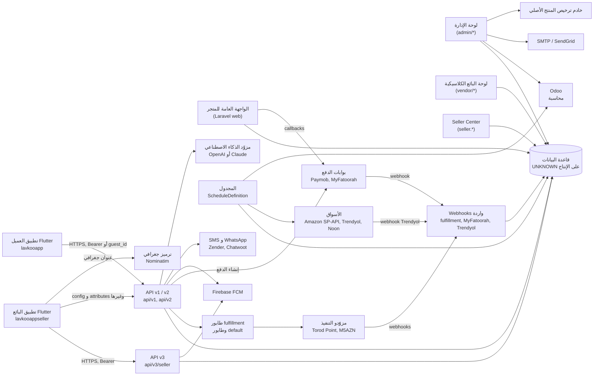

# Lavkoo GCC — Discovery-01 — التقرير 02: المعمارية الحالية عبر المستودعات وعقود الـ API ومخطط الاعتماديات

> **المرحلة:** AUDIT (قراءة فقط) — **الجلسة:** `claude/exciting-shannon-4mh2ok` — **التاريخ:** 2026-11-12 (+03:00)
> **SHA الأساس:** `lavkoo@7f42777` · `lavkooapp@eedbbb8` · `lavkooappseller@8ea0092` · مرجع قديم `ksaapp98@79f50be`
> **يعتمد على:** [E01](../evidence/E01-backend-architecture-map.md)، [E02](../evidence/E02-store-context-settings-currency-cache.md)، [E14](../evidence/E14-seller-vendor-backend-api-v3.md)، [E16](../evidence/E16-customer-app-architecture-context.md)، [E19](../evidence/E19-seller-app-architecture-auth-gate.md)، [E22](../evidence/E22-api-contract-customer.md)، [E23](../evidence/E23-api-contract-seller.md)؛ ومقتطفات ثانوية من [E06](../evidence/E06-communications-compliance-activation.md)، [E07](../evidence/E07-theme-system-backend.md)، [E10](../evidence/E10-payments-gateways.md)، [E11](../evidence/E11-inventory-fulfillment-shipping.md)، [E12](../evidence/E12-sales-channels-marketplaces.md)، [E15](../evidence/E15-tests-ci-quality-gates.md)، [E17](../evidence/E17-customer-app-dynamic-theme.md)؛ والقرارات المعتمدة `lavkoo:docs/gcc/DECISIONS.md:9`.
> **الحالة:** نهائي لهذه الجلسة — لا يتضمن أي تنفيذ.

## 0. الخلاصة

- المستودعات الثلاثة مترابطة عبر عقد HTTP واحد فقط: تطبيق العميل يستهلك `api/v1` (و`api/v1` مشترك مع تطبيق البائع)، وتطبيق البائع يستهلك `api/v3/seller`. لا يوجد أي تكامل آخر بين التطبيقين والخلفية.
- الخلفية Laravel 12 بطبقات متعايشة ثلاثة أنماط؛ لا توجد نقطة واحدة يمرّ عبرها كل وصول للبيانات، ولا توجد أي بادئة أو ترويسة أو عمود أو مفتاح كاش يحمل **سياق متجر أو دولة أو كيان قانوني** (VERIFIED، [E01 §3 A1](../evidence/E01-backend-architecture-map.md)، [E02 §3.1](../evidence/E02-store-context-settings-currency-cache.md)).
- العقد مطابق من الجانبين شكلياً: صفر نقطة تطبيق بلا مسار في الخلفية، وصفر عدم تطابق في الفعل HTTP بعد احتساب `_method` لكلا التطبيقين (VERIFIED، [E22 §2.4](../evidence/E22-api-contract-customer.md)، [E23 §2.1](../evidence/E23-api-contract-seller.md)).
- أخطر فجوات العقد لـ GCC ليست في المسارات بل في **المال والعملة والعرض**: المبالغ بلا رمز عملة، والتطبيقان يحوّلان ويقرّبان بقيم عامة بخانتين، وهذا يناقض "لا تحويل آلي" و"KWD/BHD/OMR بثلاث خانات" (VERIFIED، [E22 F02–F03](../evidence/E22-api-contract-customer.md)، [E23 F02](../evidence/E23-api-contract-seller.md)).
- مخطط قاعدة البيانات الإنتاجي غير موجود في المستودع: لا dump متتبَّع، و37 جدولاً تُعدَّل ولا تُنشأ في أي migration (VERIFIED، [E01 §2.11](../evidence/E01-backend-architecture-map.md)). لذلك لا يمكن من هذا المستودع وحده إثبات ما يعمل فعلاً في الإنتاج (UNKNOWN).

## 1. خريطة المستودعات الثلاثة بالأرقام

| المستودع | الدور | الإطار والحزمة | الإصدار المُعلَن | الأعداد (عدّ ساكن) | المصدر |
|---|---|---|---|---|---|
| `lavkoo` | الخلفية والموقع ولوحة الإدارة ولوحة البائع وAPI الثلاثة (المدقَّق: `7f42777`) | `laravel/laravel` (الحزمة الجذر)، Laravel `^12.0` مثبّت `v12.62.0`، Passport `v12.4.3`، `nwidart/laravel-modules` `10.0.6` | ادعاء المنتج الأصلي `SOFTWARE_VERSION = '16.3'` | 235 model، 430 controller، 904 ملف خدمة، 39 middleware، 12 job، 26 listener، 24 event، 10 observer، 336 migration في النواة و14 في الـ Modules، 396 ملف اختبار في `tests/`، 3 Modules متتبَّعة (AI وBlog وTaxModule) | `lavkoo:composer.json:2`، `lavkoo:composer.json:33`، `lavkoo:composer.json:34`، `lavkoo:composer.json:45`، `lavkoo:composer.lock:3449-3450`، `lavkoo:app/Library/Constant.php:471`، [E01 §1، §2.1، §2.10](../evidence/E01-backend-architecture-map.md) |
| `lavkooapp` | تطبيق العميل Flutter | Flutter بـ `provider` و`get_it` و`go_router` و`dio` | `version: 3.0.6+48`، اسم الحزمة `syriapharmacy` | 709 ملف Dart في `lib/` | `lavkooapp:pubspec.yaml:1`، `lavkooapp:pubspec.yaml:5`، `lavkooapp:pubspec.yaml:16-17`، `lavkooapp:pubspec.yaml:89`، [E16 §2.1](../evidence/E16-customer-app-architecture-context.md) |
| `lavkooappseller` | تطبيق البائع Flutter (fork من قالب Sixvalley seller) | Flutter بـ `provider` و`get_it` و`package_info_plus` | `version: 3.1.6+49`، اسم الحزمة `syriacosmeticsmanger` | 747 ملف Dart في `lib/` | `lavkooappseller:pubspec.yaml:1`، `lavkooappseller:pubspec.yaml:8`، `lavkooappseller:pubspec.yaml:20-21`، `lavkooappseller:README.md:1-4`، [E19 §2.1](../evidence/E19-seller-app-architecture-auth-gate.md) |
| `ksaapp98` | مرجع قديم للتطبيق العميل (غير هدف كتابة) | Flutter | UNKNOWN في هذا التقرير؛ التفصيل في التقرير 06 | UNKNOWN في هذا التقرير | `ksaapp98@79f50be` |
| `pharmacyksa98` | الخلفية القديمة | Laravel | UNKNOWN (missing access: pharmacyksa98) | UNKNOWN | — |

ملاحظات على الجدول:

1. اسم الحزمة في Flutter (`syriapharmacy`، `syriacosmeticsmanger`) وهوية الإطلاق (Bundle/Package ID) تختلفان عن الاسم التجاري؛ قاعدة المشروع تمنع إعادة التسمية الآلية، وهذا الاختلاف موثّق في [E16 §2.11](../evidence/E16-customer-app-architecture-context.md) و[E19 §2.9](../evidence/E19-seller-app-architecture-auth-gate.md) (VERIFIED).
2. الـ HEAD المحلي لـ `lavkoo` تقدّم بعد التدقيق بعدة commits توثيقية تحت `docs/gcc/` فقط؛ تحقّق [E22](../evidence/E22-api-contract-customer.md) من أن الفرق خارج `docs/gcc` فارغ. الكود المدقَّق هو `7f42777`.
3. عدد الـ Modules الملفات (229 ملف PHP) يشمل الاختبارات والمكوّنات؛ عدد migrations الـ Modules 14 (`lavkoo:Modules/AI`، `lavkoo:Modules/Blog`، `lavkoo:Modules/TaxModule`).

## 2. معمارية الـ backend كما هي فعلاً

### 2.1 الطبقات: ثلاثة أنماط متعايشة

| النمط | أين يُمارَس | مثال | الحكم |
|---|---|---|---|
| (أ) Controller ← Service ← Repository ← Model | لوحتا الإدارة والبائع الكلاسيكية (`Admin` و`Vendor`) | `lavkoo:app/Http/Controllers/Admin/Product/BrandController.php:27-35` و`:96-109`؛ `lavkoo:app/Services/BrandService.php:12-27` | مطابق لـ `CLAUDE.md` جزئياً |
| (ب) دوال ساكنة `*Manager` و Eloquent مباشرة من الـ controller | الويب و API v1/v2 | `lavkoo:app/Http/Controllers/RestAPI/v1/OrderController.php:171-240`؛ `lavkoo:app/Utils/OrderManager.php:1537` | النمط الأقدم؛ منطق الطلب موزّع |
| (ج) خدمات مجالية تحت `app/Services/<Subsystem>` بلا مستودعات | Fulfillment وSalesChannels وOperationalCosts وMarketplace وTheme وAddress وMonitoring | `lavkoo:app/Utils/OrderManager.php:1762-1764` (نقطة ربط إلى `FulfillmentHooks`) | الأنظمة الأحدث |

قياس الـ controllers (عدّ ثابت، E01 §2.3): `Admin` 216، `Vendor` 41، `Web` 22، `RestAPI` (v1/v2/v3) 91، `Customer` 9، `Seller` (Seller Center) 15. الـ controllers ليست نحيفة: أكبرها `lavkoo:app/Http/Controllers/RestAPI/v3/seller/ProductController.php` بـ 2,238 سطراً. الاعتماد على `RepositoryInterface` محصور: 86 من 216 controller في `Admin`، و16 من 91 في `RestAPI`، وصفر في `Seller` (VERIFIED بالعدّ، [E01 §2.3](../evidence/E01-backend-architecture-map.md)).

الربط بين واجهات المستودعات وتطبيقاتها آلي بمسح مجلد `app/Repositories`: `lavkoo:app/Providers/InterfaceServiceProvider.php:20-36`. الواجهات 97 والتطبيقات 96.

### 2.2 الإقلاع والـ providers

- التطبيق مهيأ بأسلوب Laravel 11/12 عبر `Application::configure()` في `lavkoo:bootstrap/app.php:42-144`، وتحميل المسارات يتم من `RouteServiceProvider::map()` بالترتيب في `lavkoo:app/Providers/RouteServiceProvider.php:48-66`.
- الـ providers المسجَّلة: 17 من التطبيق و3 حزم خارجية (`lavkoo:bootstrap/providers.php:3-28`). `BroadcastServiceProvider` و`EventServiceProvider` معطّلان بالتعليق (`lavkoo:bootstrap/providers.php:6-7`)، فالبثّ غير مفعّل والمستمعون يُكتشفون تلقائياً (`lavkoo:app/Providers/AppServiceProvider.php:163-166`).
- **مسار ساخن قبل التوجيه:** `AppServiceProvider::boot()` يُنفَّذ قبل مطابقة المسار في كل طلب غير console (`lavkoo:app/Providers/AppServiceProvider.php:171`)، ويحمّل `business_settings` كاملاً من الكاش (`lavkoo:app/Providers/AppServiceProvider.php:187`)، ويبني مصفوفة `web_config` واحدة تُشارَك مع كل القوالب. هذا هو القيد المعماري الأهم لأي سياق متجر: السياق المأخوذ من بادئة المسار لن يكون معروفاً في تلك اللحظة (VERIFIED، [E01 §2.2، §4.2](../evidence/E01-backend-architecture-map.md)).
- providers أخرى تقرأ **إعداداً واحداً عاماً** عند الإقلاع: المنطقة الزمنية (`lavkoo:app/Providers/ConfigServiceProvider.php:29-35`)، البريد (`lavkoo:app/Providers/MailConfigServiceProvider.php:28-46`)، بوابات الدفع الخمس (`lavkoo:app/Providers/PaymentConfigProvider.php:30-151`)، Firebase (`lavkoo:app/Providers/FirebaseServiceProvider.php:19-22`)، الدخول الاجتماعي (`lavkoo:app/Providers/SocialLoginServiceProvider.php:29-48`)، والثيم (`lavkoo:app/Providers/ThemeServiceProvider.php:17-23`).

### 2.3 جدول نقاط الدخول (ملفات المسارات)

الأعداد عدّ ثابت لتعريفات `Route::…` كما في [E01 §2.4](../evidence/E01-backend-architecture-map.md)، وليست مخرجات `route:list` (ممنوع تشغيلها في هذه المرحلة).

| الملف | المُحمِّل | البادئة | الـ middleware والحماية (ملخص) | الـ guard | الغرض | التعريفات |
|---|---|---|---|---|---|---|
| `routes/web/routes.php` | `lavkoo:app/Providers/RouteServiceProvider.php:215-220` | `/` | `web`، `logUserBrowsingNavigation`، ومجموعة `maintenance_mode` + `guestCheck` لجزء كبير من المسارات، و`customer` لمجموعة أصغر | `customer` (جلسة)؛ الضيف بـ `guest_id` في الجلسة | واجهة المتجر والسلة والدفع وحساب العميل وcallbacks بوابات الدفع | 219 |
| `routes/admin/routes.php` | `lavkoo:app/Providers/RouteServiceProvider.php:187-192` | `admin/*` | `web` + `admin` + `actch:admin_panel` + `module:<name>` لمعظم المسارات؛ مسارات الدخول والتفعيل عامة. التفاصيل الأمنية في SEC-E01-03 (تفويض لوحة الإدارة) | `admin` (جلسة) | لوحة الإدارة | 810 |
| `routes/admin/fulfillment.php` | `lavkoo:app/Providers/RouteServiceProvider.php:194-199` | `admin/fulfillment-providers` | `admin` + `module:3rd_party_setup` + `EnsureFulfillmentMigrated` (`lavkoo:routes/admin/fulfillment.php:20-24`) | `admin` | مركز تكامل المزوّدين | 33 |
| `routes/admin/addresses.php` | `lavkoo:app/Providers/RouteServiceProvider.php:202-207` | `admin/address-system` | `admin` + `module:business_settings` + `EnsureAddressMigrated` | `admin` | نظام العناوين الموحّد | 17 |
| `routes/admin/sales-channels.php` | `lavkoo:app/Providers/SalesChannelsServiceProvider.php:66` | `admin/sales-channels` | `admin` + `module:sales_channels` + `EnsureSalesChannelsMigrated` (`lavkoo:routes/admin/sales-channels.php:25-29`) | `admin` | مركز قنوات البيع | 50 |
| `routes/admin/operational-costs.php` | `lavkoo:app/Providers/SalesChannelsServiceProvider.php:67` | `admin/operational-costs` | `admin` + `module:operational_costs` | `admin` | دفتر التكاليف | 41 |
| `routes/admin/odoo-accounting.php` | `lavkoo:app/Providers/SalesChannelsServiceProvider.php:70` | `admin/accounting/odoo` | `admin` + `module:operational_costs` | `admin` | ربط Odoo | 16 |
| `routes/vendor/routes.php` | `lavkoo:app/Providers/RouteServiceProvider.php:209-214` | `vendor/*` | `web` + `maintenance_mode` + `actch:admin_panel` + `seller` + `seller_staff_access` لمعظم المسارات | `seller` (جلسة) | لوحة البائع الكلاسيكية | 221 |
| `routes/seller/routes.php` | `lavkoo:app/Providers/RouteServiceProvider.php:180-185` | `vendor/*` (أسماء `seller.`) | ما سبق + `seller_center` + `seller_can:<permission>` (`lavkoo:routes/seller/routes.php:40-48`) | جلسة `seller` + `SellerPrincipal` | Seller Center الجديد على البادئة نفسها | 27 |
| `routes/rest_api/v1/api.php` | `lavkoo:app/Providers/RouteServiceProvider.php:97-103` | `api/v1` | `api` + `api_lang` (`lavkoo:routes/rest_api/v1/api.php:54`)؛ ثلاث درجات وصول: `auth:api` و`apiGuestCheck` وعام | Passport `api` أو معرّف ضيف | API تطبيق العميل ونقاط مشتركة مع تطبيق البائع | 180 |
| `routes/rest_api/v2/api.php` | `lavkoo:app/Providers/RouteServiceProvider.php:105-111` | `api/v2/seller` و`api/v2/delivery-man` | `api` + `api_lang`؛ مجموعة المندوب بـ `delivery_man_auth` و`actch:deliveryman_app` | token مخصص لكل مجموعة | API البائع القديم (معنون "Old Seller Mobile APP API Routes") و API المندوب (`lavkoo:routes/rest_api/v2/api.php:20-27`) | 95 (عدّ E01: 59 بائع + 36 مندوب؛ عدّ E22: 55 بائع + 40 مندوب، والمجموع متفق) |
| `routes/rest_api/v3/seller.php` | `lavkoo:app/Providers/RouteServiceProvider.php:113-119` | `api/v3/seller` | `api` + `api_lang` (`lavkoo:routes/rest_api/v3/seller.php:49`) + `seller_api_auth` + `seller_can:<permission>` أو `seller_owner` | token → `SellerPrincipal` | API تطبيق البائع الحالي | 236 |
| `routes/rest_api/delivery_syria.php` | `lavkoo:app/Providers/RouteServiceProvider.php:127-133` | `api/delivery-syria/...` | `api` + `deliverysyria_auth` | Bearer مشترك | webhook ناقل سوري موروث | 1 |
| `routes/rest_api/fulfillment_webhooks.php` | `lavkoo:app/Providers/RouteServiceProvider.php:139-144` | `api/fulfillment-webhooks/...` | حدّ معدّل مخصص؛ التحقق داخل الـ controller (SEC-E01-10، توثيق webhooks) | لا guard | webhooks مزوّدي التنفيذ | 1 |
| `routes/rest_api/myfatoorah_webhook.php` | `lavkoo:app/Providers/RouteServiceProvider.php:150-155` | `api/myfatoorah/webhook` | حدّ معدّل مخصص؛ التحقق داخل الـ controller (SEC-E01-10، توثيق webhooks) | لا guard | webhook MyFatoorah | 1 |
| `routes/rest_api/sales_channel_webhooks.php` | `lavkoo:app/Providers/SalesChannelsServiceProvider.php:64` | `api/sales-channel-webhooks/{account}` | حدّ معدّل مخصص؛ معرّف الحساب في المسار | لا guard | webhook Trendyol (معنون بحساب القناة) | 1 |
| `routes/install.php` و`routes/update.php` | **غير مركّبَين** (`lavkoo:app/Providers/RouteServiceProvider.php:57-58`) | — | — | — | مثبّت ومحدِّث المنتج الأصلي | 11 و3 |
| `routes/test.php` و`routes/shared.php` و`routes/console.php` | غير محمّلة أو فارغة | — | — | — | بقايا؛ التفصيل في SEC-E01-08 (مسارات بقايا) | — |
| `Modules/AI/routes/*` | `lavkoo:Modules/AI/app/Providers/RouteServiceProvider.php:40-66` | `admin/*`، `vendor/*`، `api/v3/seller/*`، `api/v1/customer/*` | بحسب الملف، كما في النواة | كما في النواة | توليد محتوى بالذكاء الاصطناعي | 81 |
| `Modules/Blog/routes/*` | `lavkoo:Modules/Blog/app/Providers/RouteServiceProvider.php:40-62` | `/blog`، `admin/blog/*` | `web`؛ الإدارة بـ `module:marketing` | `admin` للإدارة | المدوّنة | 30 |
| `Modules/TaxModule/routes/*` | `lavkoo:Modules/TaxModule/app/Providers/RouteServiceProvider.php:40-72` | `admin/vat-tax/*`، `admin/report/*`، `vendor/report/*`، `api/v1/vat-tax/*`، `api/v3/seller/*` | بحسب الملف | كما في النواة | إعداد الضريبة وتقاريرها | 22 |

المجموع التقريبي: نحو 1,949 تعريف مسار في النواة و133 في الـ Modules (E01 §2.4).

**ملاحظات بنيوية:**

1. لا توجد أي بادئة دولة أو متجر أو لغة في أي مسار؛ الصفحة الرئيسية هي `/` (`lavkoo:routes/web/routes.php:165`).
2. مسارات بوابات الدفع تحت `/payment/*` تُسجَّل **شرطياً** فقط إذا لم يوجد add-on `Gateways` منشوراً على القرص (`lavkoo:routes/web/routes.php:472-482`)، والمجلد `Modules/Gateways` مستثنى من git (`lavkoo:.gitignore:25`). أي أن الواجهة الفعلية للدفع على الخادم قد تختلف عن المستودع (UNKNOWN على الإنتاج؛ [E01 §2.10](../evidence/E01-backend-architecture-map.md)).
3. مسارات الدفع من Paymob وMyFatoorah موجودة في المستودع (`lavkoo:app/Http/Controllers/Payment_Methods/PaymobController.php:14-56`)، أما Tabby وTamara فلا أثر لهما: بحث `tabby|tamara` غير حساس لحالة الأحرف في `app` و`config` و`routes` و`Modules` و`database` و`resources/views` و`tests` أعاد صفراً من الملفات (تكرار البحث في هذه الجلسة؛ مطابق لـ [E10 §2.1](../evidence/E10-payments-gateways.md)).
4. الصيانة (`artisan down`) تمرّ عبر middleware عام قبل أي مسار (`lavkoo:app/Http/Middleware/CheckForMaintenanceMode.php:14-16`)، أما وضع الصيانة الإداري فعلم عام واحد يختار "الأنظمة" بمطابقة أنماط المسارات (`lavkoo:app/Traits/MaintenanceModeTrait.php:10-32`)، ولا يُطبَّق على مسارات الـ webhooks (VERIFIED، [E01 §2.5 و§4.1](../evidence/E01-backend-architecture-map.md)، مع GCC-12 في `lavkoo:docs/gcc/DECISIONS.md:27`).

### 2.4 الـ middleware والـ guards

| الطبقة | المحتوى | الدليل |
|---|---|---|
| عام (كل طلب) | `TrustProxies`، `CheckForMaintenanceMode`، `ValidatePostSize`، `TrimStrings`، `HandleCors`، `MonitorRequest` وغيرها | `lavkoo:bootstrap/app.php:44-59` |
| مجموعة `web` | الجلسة، CSRF، `Localization`، `DetectMobile`، `ApplySeoRedirects`، `RecordAnalytics` | `lavkoo:bootstrap/app.php:60-83` |
| مجموعة `api` | `throttle:3000,1`، `SubstituteBindings`، `RecordHttpTelemetry`، `MonitorRequest`، `RecordAnalytics`، `RecordApiResponseShape` | `lavkoo:bootstrap/app.php:84-94` |
| الأسماء المستعارة | `admin`، `seller`، `seller_staff_access`، `seller_center`، `customer`، `module`، `actch`، `api_lang`، `maintenance_mode`، `delivery_man_auth`، `seller_api_auth`، `seller_can`، `seller_owner`، `guestCheck`، `apiGuestCheck` وغيرها | `lavkoo:bootstrap/app.php:100-133` |

**سلوكيات تمسّ GCC مباشرة:**

- `api_lang` يقرأ ترويسة `lang` ويطوي `sa` إلى `ar` و`us` إلى `en` لأن إصدارات منشورة من تطبيق العميل أرسلت رمز الدولة في ترويسة اللغة (`lavkoo:app/Http/Middleware/APILocalizationMiddleware.php:23-29`).
- لغة الويب: الـ middleware يقرأ مفتاح الجلسة `locale` (`lavkoo:app/Http/Middleware/Localization.php:20-22`)، والكود يكتب المفتاح `local` (`lavkoo:app/Utils/Helpers.php:80`)، ولا توجد كتابة للمفتاح `locale`؛ فاللغة تُحسم فعلياً داخل `Helpers::default_lang()` (`lavkoo:app/Utils/Helpers.php:62-84`) (VERIFIED، [E01 §2.5](../evidence/E01-backend-architecture-map.md)).
- `MonitorRequest` يربط كائن `RequestContext` بالحاوية لكل طلب (معرّف الارتباط، المنصة من `X-Platform`، إصدار التطبيق)، وهو السابقة الوحيدة لكائن "سياق طلب" في النظام (`lavkoo:app/Http/Middleware/MonitorRequest.php:32-50`).

**الـ guards والمصادقة:**

| الفاعل | الآلية | النموذج | حامل الهوية | ما يُحمله الحامل |
|---|---|---|---|---|
| مدير وموظف الإدارة | guard `admin` (جلسة) | `App\Models\Admin` (`lavkoo:config/auth.php:49-52`، `:88-91`) | كوكي الجلسة | دور وصلاحيات `module_access`؛ لا نطاق بيانات |
| بائع (لوحة الويب) | guard `seller` (جلسة) | `App\Models\Seller` (`lavkoo:config/auth.php:54-57`) | الجلسة و`seller_staff_id` للموظف | `SellerPrincipal` (`lavkoo:app/Http/Middleware/SellerCenterContext.php:30-52`) |
| عميل (الويب) | guard `customer` (جلسة) | `App\User` (`lavkoo:config/auth.php:59-62`) | الجلسة؛ الضيف بـ `guest_id` | هوية فقط |
| عميل (API) | guard `api` بسائق `passport` (`lavkoo:config/auth.php:44-47`) | `App\User` | Passport personal access token (`lavkoo:app/Http/Controllers/RestAPI/v1/auth/CustomerAPIAuthController.php:101`) | هوية فقط |
| بائع (API v3) | middleware مخصص بلا guard | `Seller` / `SellerStaff` / مفتاح API مُصدَر | token يُحلّ إلى `SellerPrincipal` (`lavkoo:app/Http/Middleware/SellerApiAuthMiddleware.php:41-93`) | بائع/موظف/مفتاح + صلاحيات وظيفية |
| بائع (API v2 القديم) | داخل كل controller | `Seller` | `sellers.auth_token` (`lavkoo:app/Http/Controllers/RestAPI/v2/seller/auth/LoginController.php:35-36`) | هوية فقط |
| مندوب توصيل (API v2) | `DeliveryManAuth` | `App\Models\DeliveryMan` (`lavkoo:app/Http/Middleware/DeliveryManAuth.php:18-32`) | token في جدول المندوبين | هوية فقط |

**ملاحظات على الـ guards:**

- لا يحمل أي token أو جلسة إشارة إلى متجر أو دولة أو كيان قانوني (VERIFIED، [E01 §2.6](../evidence/E01-backend-architecture-map.md)).
- صنفان لجدول `users`: `App\User` للمصادقة و`App\Models\User` لكود الأعمال (`lavkoo:app/User.php:16-18`، `lavkoo:app/Models/User.php:56-58`) (E01-F15).
- عمر token لم يُضبط في المستودع؛ العمر افتراضي الحزمة (INFERRED).
- وضع الضيف معتمد على معرّف ضيف يُمرَّر في الطلب؛ التفاصيل الأمنية في SEC-E22-01 (هوية الضيف) والبنود المجاورة في SEC-E01-06 (هوية الضيف والتخزين).

### 2.5 الطوابير والـ jobs

- اتصال الطابور الافتراضي `sync` ما لم يُضبط `QUEUE_CONNECTION` (`lavkoo:config/queue.php:16`)، وملف المثال يضع `database` (`lavkoo:.env.example:16`). القيمة الإنتاجية UNKNOWN (missing access: production `.env`).
- **طابور مسمّى واحد فقط:** `fulfillment` عبر `config('fulfillment.queue.*')` (`lavkoo:config/fulfillment.php:71-74`، `lavkoo:app/Services/Fulfillment/FulfillmentQueue.php:74-83`). كل ما عداه يذهب إلى `default`. مع السائق `sync` لا تُرسل jobs الـ fulfillment أصلاً ويتولى المجدول العمل (`lavkoo:app/Services/Fulfillment/FulfillmentQueue.php:25-43`).

| Job | الطابور | المحاولات / المهلة | الحمولة | الدليل |
|---|---|---|---|---|
| `Fulfillment\DispatchProviderFulfillment` | `fulfillment` | 1 / 120s | معرّف الشحنة وعلم `manual` | `lavkoo:app/Jobs/Fulfillment/DispatchProviderFulfillment.php:20-35` |
| `Fulfillment\ReconcileProviderFulfillment` | `fulfillment` | 1 / 120s | معرّف الشحنة | `lavkoo:app/Jobs/Fulfillment/ReconcileProviderFulfillment.php:12-18` |
| `Fulfillment\CancelProviderFulfillment` | `fulfillment` | 1 / 90s | معرّف الشحنة | `lavkoo:app/Jobs/Fulfillment/CancelProviderFulfillment.php:12-18` |
| `Fulfillment\ProcessProviderEvent` | `fulfillment` | 3 / 60s | معرّف حدث المزوّد | `lavkoo:app/Jobs/Fulfillment/ProcessProviderEvent.php:16-34` |
| `Fulfillment\RouteOrderFulfillment` | `fulfillment` | 2 / 60s | معرّف الطلب | `lavkoo:app/Jobs/Fulfillment/RouteOrderFulfillment.php:13-28` |
| `SalesChannels\DrainStockEvents` | `default` | 1 / 300s، `WithoutOverlapping` | حد عددي فقط | `lavkoo:app/Jobs/SalesChannels/DrainStockEvents.php:29-50` |
| `DeliverSellerWebhook` | `default` | 1 | معرّف التسليم | `lavkoo:app/Jobs/DeliverSellerWebhook.php:23-42` |
| `RunSellerBulkJob` | `default` | 1 / 900s | معرّف المهمة | `lavkoo:app/Jobs/RunSellerBulkJob.php:25-46` |
| `RebuildProductSearchIndex` | `default` | فريدة لمدة ساعة | المستخدم الطالب | `lavkoo:app/Jobs/RebuildProductSearchIndex.php:29-55` |
| 16 مستمعاً مصفوفاً للبريد | `default` | 2 / 30s | الحدث مسلسلاً | `lavkoo:app/Listeners/Concerns/QueuedMailDelivery.php:23-30` |

**ملاحظات:**

1. كل job يحمل **معرّفات كيانات فقط** ويعيد قراءة الحالة عند التنفيذ؛ لا يحمل لغة ولا عملة ولا متجراً (VERIFIED، [E01 §2.7](../evidence/E01-backend-architecture-map.md)). هذا يعني أن أي job خليجي سيحتاج سياقه من الكيان نفسه لا من الحمولة.
2. `retry_after` الافتراضي 90 ثانية، وفي ملف المثال 180 (`lavkoo:.env.example:56`)، وهو أقل من مهلة `RunSellerBulkJob` (900s) و`DrainStockEvents` (300s)، وتعليق الإعداد يشترط أن يزيد على أطول job (`lavkoo:config/queue.php:41-42`) (VERIFIED للقيم، INFERRED للأثر؛ E01-F12).
3. `SendEmailJob` بلا نقطة إرسال في المستودع (`lavkoo:app/Jobs/SendEmailJob.php:13-38`)، وهو كود موروث.

### 2.6 المجدول (Scheduler)

- التعريف الوحيد في `App\Console\ScheduleDefinition::define` ويُربط من `lavkoo:bootstrap/app.php:138`. عدد المدخلات الفعّالة 45، ومدخل معلّق واحد (`lavkoo:app/Console/ScheduleDefinition.php:159`). يتطلب سطر cron واحداً `schedule:run` كل دقيقة، ووجوده في الإنتاج UNKNOWN.
- المنطقة الزمنية للمجدول هي `app.timezone` الثابتة `Asia/Dhaka` (`lavkoo:config/app.php:69`).
- أقفال `withoutOverlapping` تعيش في الكاش، لذلك لا يصلح السائق `array` (`lavkoo:docs/integrations/operations.md:40`).

| الفئة | أمثلة من الجدول (E01 §2.9) | التواتر | شرط التسجيل |
|---|---|---|---|
| السلة والتذكيرات | `cart:remind-abandoned` (مرحلتان) | كل 30 دقيقة، يومياً 10:00 | لا شيء |
| تسويات ومتاجر البائعين | `marketplace:settle --release`، `marketplace:evaluate-sla`، `seller:run-automation`، `seller:retry-webhooks` | يومياً 02:00 و03:00، كل 15 دقيقة، كل 5 دقائق | لا شيء |
| الثيم | `theme:publish-due` | كل 5 دقائق | لا شيء |
| البحث | `search:reindex-products` | أسبوعياً الأحد 04:00 | لا شيء |
| Fulfillment | `fulfillment:recover`، `fulfillment:poll`، `fulfillment:sync`، `fulfillment:prune` | من كل دقيقة إلى يومياً | `recover` و`poll` و`sync` تعمل فعلياً مع مفتاح التكاملات |
| القنوات | `channels:sync`، `channels:publish`، `channels:stock-events`، `channels:dispatch`، `channels:find-shipments`، `channels:amazon-reports`، `channels:decisions`، `channels:purge-buyer-data` | من كل دقيقة إلى ساعة | مفتاح القنوات وحساب مفعّل |
| التكاليف | `costs:refresh`، `costs:accrue-storage` | كل ساعة، يومياً 01:20 | `costs:refresh` يُسجَّل فقط إذا `OperationalCostsSwitch::scheduled()` |
| المراقبة والتحليلات والقياس | `monitoring:flush`، `monitoring:evaluate`، `analytics:rollup`، `telemetry:rollup`، `commerce:metrics-refresh`، `commerce:campaigns-tick` | من كل دقيقة إلى يومياً | لا شيء |
| الدفع | `myfatoorah:reconcile` | كل 10 دقائق | يُسجَّل فقط إذا `myfatoorah.enabled` و`myfatoorah.schedule_enabled` |
| الصحة والتوثيق | `scheduler-heartbeat` (يكتب `business_settings.scheduler_last_run_at`)، `api:snapshot` | كل 5 دقائق، أسبوعياً الاثنين 04:10 | لا شيء |

**الخلاصة لـ GCC:** المجدول لا يحمل أي حلقة على المتاجر ولا خياراً `--store`؛ الخيارات الموجودة `--seller` و`--account` و`--channel` فقط (VERIFIED، [E01 §4.2](../evidence/E01-backend-architecture-map.md)).

### 2.7 الأحداث والمستمعون والمراقبون

- 24 حدثاً و26 ملفاً في `app/Listeners` (منها concern واحد)، و10 ملفات في `app/Observers` (E01 §2.8).
- خريطة `$listen` في `EventServiceProvider` غير نافذة لأن الـ provider غير مسجَّل؛ الربط بالاكتشاف التلقائي (INFERRED من سلوك Laravel 12).
- المستمعون ناقلو إشعارات (بريد وpush) لا منطق مالي: `lavkoo:app/Listeners/OrderPlacedListener.php:35-71`، `lavkoo:app/Listeners/RefundListener.php:29-57`. الأحداث لا تنفّذ `ShouldBroadcast` وسائق البثّ `null` (`lavkoo:config/broadcasting.php:18`).
- المراقبون المسجَّلون فعلاً (`lavkoo:app/Providers/ObserverServiceProvider.php:50-77`) يحملون منطق أعمال، منها `SellerWebhookEventObserver` الذي يطلق webhooks البائع، وحمولة `order.placed` فيها `order_amount` بلا رمز عملة (`lavkoo:app/Observers/SellerWebhookEventObserver.php:31-42`).
- خمسة مراقبين موروثين (`OrderObserver`، `ProductObserver`، `BusinessSettingsObserver`، `CurrencyObserver`، `TranslationObserver`) غير مسجَّلين؛ بحث أسمائها في `app` و`Modules` و`bootstrap` و`config` أعاد تعريف الصنف فقط (E01-F13).

### 2.8 الـ Modules والإضافات (add-ons)

| العنصر | الحالة في المستودع | الدليل |
|---|---|---|
| `Modules/AI` | موجود (123 ملفاً) | `lavkoo:Modules/AI/module.json:7-9`؛ اختيار المزوّد من قاعدة البيانات `lavkoo:Modules/AI/AIProviders/AIProviderManager.php:29-41` |
| `Modules/Blog` | موجود (68 ملفاً) | `lavkoo:Modules/Blog/module.json:7-9` |
| `Modules/TaxModule` | موجود (88 ملفاً) | `lavkoo:Modules/TaxModule/module.json:7-9` |
| `Modules/Auction` | **غير موجود**، ولم يوجد في تاريخ المستودع | `CLAUDE.md` يذكره (`lavkoo:CLAUDE.md:36`)؛ 33 ملفاً في النواة تشير إلى مساحة الأسماء `Modules\Auction` محمية بفحص `getCheckAddonPublishedStatus('Auction')` (`lavkoo:app/Utils/module-helper.php:694-712`)؛ استيراد صنف من هذه المساحة في `lavkoo:app/Http/Controllers/RestAPI/v3/seller/SellerController.php` (E14-F14) |
| `Modules/Gateways` | مستثنى من git عمداً (`lavkoo:.gitignore:25-26`) | add-on بوابات الدفع والرسائل القصيرة؛ إن وُجد منشوراً يغيّر تسجيل المسارات وعرض البوابات (E01-F08) |
| `config/system-addons.php` | ملف متتبَّع يحمل حالة ترخيص ستة "تطبيقات" | `lavkoo:app/Traits/ActivationClass.php:27-48` |
| ترخيص المنتج الأصلي | يُفحص يومياً من خادم خارجي ويُعاد كتابة ملف الحالة وقت التشغيل | `lavkoo:app/Traits/ActivationClass.php:17-25`، `lavkoo:app/Traits/ActivationClass.php:97-125` (E01-F17) |

الـ migrations الخاصة بالـ Modules الثلاثة: 14 ملفاً تنشئ جداول مثل `blogs` و`taxes` و`taxables` و`order_taxes` و`system_tax_setups` و`ai_settings` (E01 §2.10).

### 2.9 مصدر مخطط قاعدة البيانات

1. **لا يوجد أي dump متتبَّع.** `.gitignore` يستثني `*.sql` و`/backup` (`lavkoo:.gitignore:49-53`)، و`CLAUDE.md` يوجب استيراد `installation/backup/database.sql` قبل أي migration (`lavkoo:CLAUDE.md:22`)، والملف غير موجود في الشجرة.
2. **الـ migrations لا تبني المخطط من الصفر.** من 350 ملف migration: 102 تنشئ جداولاً، 239 تعدّل فقط، وتنشئ مجتمعةً 139 جدولاً. **37 جدولاً تُعدَّل ولا تُنشأ أبداً**، منها `users` و`orders` و`order_details` و`products` و`categories` و`brands` و`sellers` و`shops` و`admins` و`coupons` و`currencies` و`shipping_addresses` و`transactions` و`seller_wallets` و`admin_wallets` و`customer_wallets` و`withdraw_requests` و`payment_requests` و`banners` (E01 §2.11).
3. نحو 110 جدولاً من أسماء الـ models بلا migration إنشاء، منها جداول الثيم ودفتر البائع والتسويات والمخزون (تقريبي؛ E01 §2.11، E07 §2.3، E14-F08).
4. **الاختبارات لا تستعمل قاعدة حقيقية:** كل اختبار يبني مخططاً مستنتَجاً من الـ models عبر traits تحت `tests/Support` (مثال: `lavkoo:tests/Support/BuildsFulfillmentSchema.php:10-32`)، والكود يقرّ بذلك (`lavkoo:app/Console/Commands/BootstrapTestSchema.php:14-18`).

**النتيجة:** المخطط الحقيقي للإنتاج موجود فقط في قاعدة الإنتاج (وربما في المستودع القديم `pharmacyksa98`، UNKNOWN). لا يمكن من هذا المستودع إعادة بناء قاعدة مطابقة (VERIFIED بالغياب؛ انظر §8 لأوامر البحث).

### 2.10 النشر والـ CI

- **النشر يدوي بحزمة overlay**، لا CD: `lavkoo:scripts/deploy/build-overlay.php:6-34` يبني من فرق بين revisionين الملفات تحت `app` و`bootstrap` و`config` و`database` و`resources` و`routes` فقط، ويرفض أي حذف أو تغيير في `public/` و`Modules/` و`composer.*` (E01-F10). `deploy.php` يطبّقها مع كشف الانحراف و**لا يشغّل migrations** (`lavkoo:scripts/deploy/deploy.php:6-31`).
- **CI** (`lavkoo:.github/workflows/ci.yml:5-9`): `lint` (`:24-42`)، `tests-sqlite` كامل المجموعة (`:44-80`)، `tests-mysql` لمسارات fulfillment وsecurity وaddress (`:85-148`)، `tests-mysql-sales-channels` (`:202-310`)، `tests-strict-mode` (`:314-357`)، `leak-guard` (`:152-165`)، `build-overlay` يبني artifact ولا ينشر (`:169-198`).
- **الاختبارات:** 396 ملف PHP تحت `tests/`، وأكبر مجموعات SalesChannels (113 ملفاً) وAddress (57) وFulfillment (52) وOperationalCosts (34) (E15 §2.1). **لا يوجد ملف اختبار باسم نواة السلة أو المحفظة أو الكوبونات أو الولاء أو الثيم أو API البائع** (بحث أسماء الملفات عن `Cart|Wallet|Coupon|Loyalty|Theme|SellerApi|SellerCenter` أعاد صفراً، E01 §2.13، E14-F09).

## 3. معمارية تطبيق العميل وتطبيق البائع

### 3.1 تطبيق العميل (`lavkooapp`)

| الجانب | الواقع | الدليل |
|---|---|---|
| إدارة الحالة | `provider` مع 40 `ChangeNotifierProvider` وواحد `Provider<SectionRendererRegistry>` | `lavkooapp:lib/main.dart:155-217` |
| الحقن | `get_it` بـ 153 `registerLazySingleton` و38 `registerFactory` | `lavkooapp:lib/di_container.dart:196`، `:206-207`، `:267-318` |
| الطبقات | Controller ← ServiceInterface ← RepositoryInterface ← `DioClient`؛ كثير من تطبيقات المستودعات ترمي `UnimplementedError` | `lavkooapp:lib/interface/repo_interface.dart:1-12` |
| التنقّل | `go_router` بـ 76 مساراً | `lavkooapp:lib/helper/route_healper.dart:1081-1103` |
| عنوان الـ API | ثابت وقت الترجمة `https://lavkoo.com`؛ لا flavor ولا `--dart-define` ولا ملف بيئة | `lavkooapp:lib/utill/app_constants.dart:39` |
| عميل HTTP | singleton واحد `DioClient` بمهلة 60 ثانية؛ معترض واحد لا يعدّل الطلب؛ لا معترض لتجديد التوكن | `lavkooapp:lib/data/datasource/remote/dio/dio_client.dart:12-375`، `lavkooapp:lib/data/datasource/remote/dio/logging_interceptor.dart:7-10` |
| الترويسات | سبع ترويسات في كل طلب عبر `DioClient`: `Content-Type`، `Authorization`، `Accept`، `X-Platform`، `X-App-Version`، `X-Client-Id`، و`lang` | `lavkooapp:lib/data/datasource/remote/dio/dio_client.dart:65-73` |
| مسارات خارج `DioClient` | ست نقاط `http.MultipartRequest` بترويسة `Authorization` فقط دون `lang` ولا `X-Platform` ولا `X-App-Version`؛ ومواضع WebView لنتيجة الدفع | `lavkooapp:lib/features/profile/domain/repositories/profile_repository.dart:41-43`؛ [E22 §2.2](../evidence/E22-api-contract-customer.md) |
| ترويسات قالب الثيم | `X-UI-Components`، `X-UI-Engine`، `X-UI-Schema` لطلبي `theme/version` و`theme/home` فقط | `lavkooapp:lib/features/dynamic_theme/engine/capability_registry.dart:89-93` |
| الإشعارات | Firebase FCM مع موضوعات عامة بلا بُعد متجر؛ توكن واحد لكل عميل | `lavkooapp:lib/main.dart:104-153`؛ [E16 §2.10](../evidence/E16-customer-app-architecture-context.md) |
| الروابط العميقة | بلا بادئة دولة في أربع طبقات؛ host أندرويد (`lavkoo.com`) يخالف نطاق iOS (`pharmacyksa.com`) | [E16 §2.9](../evidence/E16-customer-app-architecture-context.md) (E16-F09) |
| العملة والتنسيق | الدالة المركزية تضرب في معامل صرف داخل العميل وتنسّق بصفر خانات عشرية (114 موضعاً في 42 ملفاً) | [E16 F01](../evidence/E16-customer-app-architecture-context.md) |
| اللغة | ترويسة `lang` من التفضيلات، وعند تسجيل اللغة يرسل التطبيق رمز `sy` للعربية، والخلفية تفسّر `sa` كلغة عربية (تداخل دلالي) | `lavkooapp:lib/localization/controllers/localization_controller.dart:38-39`؛ [E16 F12](../evidence/E16-customer-app-architecture-context.md) |
| الاختبارات والـ CI | 11 ملف اختبار في `test/` (عدّ ساكن في هذه الجلسة) ولا يوجد مجلد `.github` (لا CI)؛ الغائب قياساً على `ksaapp98` هو اختبار حماية الإصدار (`ksaapp98:test/release_version_test.dart:26-27`). تصحيح لصياغة E16-F15 التي تذكر غياب الاختبارات بإطلاق | `lavkooapp:test/dynamic_theme_controller_test.dart:1`، [E16 F15](../evidence/E16-customer-app-architecture-context.md) |

### 3.2 التخزين المحلي للعميل

| المفتاح | المحتوى | البُعد | الدليل |
|---|---|---|---|
| `user_login_token` (SharedPreferences) | توكن الدخول | عام لكل تثبيت؛ لا بُعد متجر | `lavkooapp:lib/features/auth/domain/repositories/auth_repository.dart:126-133` (الجوانب الأمنية في SEC-E16-03، حماية التخزين المحلي) |
| `guestId` و`guest_cart_id` | معرّف الضيف ومعرّف سلة الضيف | عام | `lavkooapp:lib/features/auth/domain/repositories/auth_repository.dart:156-168` |
| مخازن Drift وHive وsqflite | ذاكرة مؤقتة للكتالوج والثيم والصحة | عام؛ 15 نقطة كتالوج تُخدَّم من الكاش حتى 400 ثانية | [E16 §2.6](../evidence/E16-customer-app-architecture-context.md)، [E22 F10](../evidence/E22-api-contract-customer.md) |

الخروج يحذف `user_login_token` و`guestId` فقط (`lavkooapp:lib/features/auth/domain/repositories/auth_repository.dart:186-191`)، فلا يُمسح أي كاش متجر لأنه لا يوجد بُعد متجر أصلاً (E16-F05).

### 3.3 تطبيق البائع (`lavkooappseller`)

| الجانب | الواقع | الدليل |
|---|---|---|
| البنية | feature-first: لكل ميزة `controllers/` (ChangeNotifier) ← `domain/services/` ← `domain/repositories/` ← `DioClient` | `lavkooappseller:docs/seller-center-update-study.md:33-45` |
| الحالة والحقن | `provider` و`get_it`؛ كل المستودعات singletons | `lavkooappseller:pubspec.yaml:20-21`، `lavkooappseller:lib/di_container.dart:236-246` |
| عنوان الـ API | ثابت `https://lavkoo.com` بلا flavors | `lavkooappseller:lib/utill/app_constants.dart:11` |
| الأسطح المستهلكة | `/api/v3/seller/**` (الغالبية) و8 مسارات `v1` مشتركة مع تطبيق العميل: `config` و`app-health` و`attributes` و`business-pages` و`vat-tax` وثلاثة `mapapi` | `lavkooappseller:lib/utill/app_constants.dart` (الثوابت؛ [E23 §2.1](../evidence/E23-api-contract-seller.md)) |
| مواضع خارج `DioClient` | تسعة مواضع `http.MultipartRequest` تضيف `Authorization` يدوياً في ثمانية منها، وبلا ترويسات اللغة | [E19 §2.1](../evidence/E19-seller-app-architecture-auth-gate.md) (E19-F08) |
| الجلسة | جلسة واحدة لكل حساب؛ كل دخول يستبدل الرمز؛ الموظف مرتبط ببائع واحد | [E19 §2.2](../evidence/E19-seller-app-architecture-auth-gate.md)، E19-F14، E19-F19 |
| بوابة الإصدار | الحد الأدنى من `business_settings.type = seller_app_version_control` بقيمة JSON لكل منصة يُكتب من لوحة الإدارة (`lavkoo:app/Http/Controllers/Admin/Settings/BusinessSettingsController.php:305-315`)؛ القيمة الافتراضية `'0'` إن غاب الحقل (`lavkooappseller:lib/features/splash/screens/splash_screen.dart:73-82`) | E19 §2.5 |
| الإصدار المقارَن | من الحزمة عبر `package_info_plus` وافتراضه `0.0.0` إن فشلت القراءة (`lavkooappseller:lib/helper/version_helper.dart:13-29`) | E19 §2.5 |
| الإشعارات | عمود رمز واحد لكل بائع، موضوعان عامّان، `lavkoo_seller` بلا مرسِل؛ الحمولة بلا معرّف متجر | [E19 F05](../evidence/E19-seller-app-architecture-auth-gate.md) |
| التخزين المحلي | مفاتيح عامة على مستوى التثبيت (عملة، سلة POS، طابور المبيعات غير المتصلة) | [E19 F15](../evidence/E19-seller-app-architecture-auth-gate.md) |
| المال | تنسيق بكسر واحد عام و`toStringAsFixed(2)` | [E19 F04](../evidence/E19-seller-app-architecture-auth-gate.md) |

### 3.4 مقارنة مباشرة

| البُعد | تطبيق العميل | تطبيق البائع |
|---|---|---|
| الاختبارات | 11 ملف اختبار في `test/`؛ لا `.github` ولا CI | 19 ملف اختبار في `test/` (عقود وبوابة إصدار ومساعدات)، و`lavkooappseller:.github/workflows/ci.yml:1` |
| عميل HTTP | `DioClient` واحد مع 6 مواضع multipart خارجه | `DioClient` واحد مع 9 مواضع خارجه |
| الترويسات | سبع ترويسات مركزية | مركزية، و`lang` بلا دولة |
| عنوان الـ API | ثابت واحد | ثابت واحد |
| إعداد `config` | مشترك مع البائع | مشترك مع العميل؛ لا إعداد خاص بالبائع (E19-F03) |
| بوابة الإصدار | ثابت يدوي `16.2.1` لا يطابق بناء `3.0.6+48` (E16-F07، E22-F12) | قيمة من `config` لكل منصة؛ القيمة الإنتاجية UNKNOWN (E19-F06) |
| الصيانة | وضع واحد عام يحجب التطبيق كله | وضع واحد عام يحجب التطبيق كله (E19-F07) |
| الروابط العميقة | بلا بادئة دولة؛ عدم تطابق host بين المنصتين | مخطط `lavkooseller://` بلا معالج (E19-F11) |
| اللغة | `lang` بقيم `ar` و`en` مع طيّ `sa` | قائمتان ثابتتان بـ `ar_SY` (E19-F18) |

**تأكيد مطلوب بموجب الطلب:** لا يشارك تطبيق البائع معمارية ثيم العميل. الثيم في تطبيق البائع يقتصر على اشتراطات صور المتجر المرتبطة بقيمة `active_theme` العامة (E19-F13)، ولا يوجد في `lavkooappseller/lib` أي ملف يطابق `dynamic_theme|theme_section|SectionRenderer` (بحث ساكن في هذه الجلسة: صفر ملفات).

## 4. عقود الـ API

### 4.1 الأعداد

| البند | العميل: `api/v1` ↔ `lavkooapp` | البائع: `api/v3/seller` ↔ `lavkooappseller` |
|---|---|---|
| ثوابت النقاط في التطبيق | 164 (كلها `/api/v1/…`) | 191 |
| مواضع الاستدعاء | — | 262 (254 على v3 و8 على v1) |
| أزواج (فعل، مسار) مميّزة | 161 | **241** (233 على v3 و8 على v1؛ GET 122، POST 80، PUT 27، DELETE 12) |
| مسارات الخلفية | 180 في `api.php` (`lavkoo:routes/rest_api/v1/api.php:1-542`) | 256 تحت `/api/v3/seller` = 236 في `seller.php` + 19 في `Modules/AI` + 1 في `Modules/TaxModule` |
| نقاط التطبيق بلا مسار في الخلفية | **صفر** | **صفر** |
| عدم تطابق فعل HTTP بعد `_method` | **صفر** | **صفر** |
| مسارات لا يستدعيها التطبيق | 24 من 180 | 23 من 256 |
| استعمال واجهات خارج الإصدار المعتاد | — | 8 نقاط v1 مشتركة؛ صفر استعمال لـ v2 |
| إصدار `api/v2` | صفر استعمال في `lavkooapp/lib` | — |

**ملاحظة على الأعداد:** عدّ مسارات v3 يختلف بحسب احتساب Modules: [E01 §4.1](../evidence/E01-backend-architecture-map.md) تعدّ 228 مساراً مصادقاً في `seller.php` وحده، بينما [E23 §2.1](../evidence/E23-api-contract-seller.md) تعدّ 256 بما فيها الوحدات. كلا العددين صحيح ضمن تعريفه؛ الفرق لا يغيّر النتيجة الجوهرية.

**بوابات مسارات v3 (E23 §2.1):** 8 قبل الدخول، 11 `seller_owner`، 212 `seller_can:<permission>`، 25 مصادقة فقط. الصلاحيات الوظيفية 11 مفتاحاً مفروضة على المسار (E14-F18).

**مسارات v1 غير المستهلكة بثابت في التطبيق (24):** `address/regions` و`address/cities` (والعنوان الموحّد غير مستهلك في التطبيق إطلاقاً: `lavkooapp` لا يشير إلى `region_id` أو `city_id` أو `national_address` أو `unified_address`؛ [E22 §2.4](../evidence/E22-api-contract-customer.md)، E22-F04)، و`cart/fulfillment-notice`، و`customer/order/fulfillments`، و`products/search`، و`theme/sections`، وغيرها (`lavkoo:routes/rest_api/v1/api.php:70-73`، `:181`، `:188`، `:196`، `:252`). تنبيه منهجي: "غير مستهلك بثابت" لا يعني غير مستهلك مطلقاً، لأن قسم القالب الديناميكي ينادي عناوين يرسلها الخادم.

### 4.2 الفروقات المؤكدة (غير أمنية)

| المعرّف | الفرق | المصدر | الحالة |
|---|---|---|---|
| E22-F02 / E23-F02 | المبالغ في الاستجابات بلا رمز عملة في العميل، والتطبيقان يحوّلان ويقرّبان بقيم عامة (`Convert::usd`، `Convert::default`) | `lavkoo:app/Services/Marketplace/SellerLedgerStatementService.php:91`، `:94-107` | VERIFIED |
| E22-F03 / E23-F04 | التطبيق يعرض بصفر منازل (العميل) أو خانتين ثابتتين (البائع)، ويتجاهل `decimal_point_settings` | [E22 F03](../evidence/E22-api-contract-customer.md)، [E23 F04](../evidence/E23-api-contract-seller.md) | VERIFIED |
| E23-F03 | وسم `currency` في أربع حمولات حديثة مصدره الإعداد العام، والتطبيق يحلّله ولا يستعمله | [E23 §2.10](../evidence/E23-api-contract-seller.md) | VERIFIED |
| E23-F05 | لا طبقة Resource: الاستجابات نماذج Eloquent خامة، فالمخطط هو العقد | `lavkoo:bootstrap/app.php:90-93` | VERIFIED |
| E22-F14 | لا يوجد manifest أو لقطة عقد متتبَّعة في git؛ وأداة `api:manifest` تبني الوثيقة وقت التشغيل من جدول المسارات (`lavkoo:app/Console/Commands/ApiManifestCommand.php:17-19`) | [E22 §2.5](../evidence/E22-api-contract-customer.md) | VERIFIED |
| E22-F07 / E23-F07 | شكل الخطأ غير موحّد: `errors` ككائن، وأخطاء تحقق برمز 200، ونتيجة سلبية برمز 202؛ 401 بثلاثة أشكال، وتمسح الجلسة في التطبيق | [E22 §2.7](../evidence/E22-api-contract-customer.md)، [E23 §2.8](../evidence/E23-api-contract-seller.md) | VERIFIED |
| E23-F08 | ستة مواضع multipart تستلم صفحة HTML عند رفض الصلاحية لعدم وجود ترويسة `Accept` | [E23 F08](../evidence/E23-api-contract-seller.md) | INFERRED (السلوك) / VERIFIED (الترويسات) |
| E22-F12 | `X-App-Version` يحمل ثابتاً `16.2.1` لا يطابق إصدار الحزمة | `lavkooapp:lib/utill/app_constants.dart:29` | VERIFIED |
| E22-F13 | `notifications` و`customer/info` و`config` تعيد بيانات عالمية بلا تصفية حسب السوق | [E22 F13](../evidence/E22-api-contract-customer.md) | VERIFIED |
| E22-F15 / E23-F06 | محلّلات التطبيق تشترط حقولاً مالية دون فحص `null`، وتحليل `.toDouble()` على سبعة حقول في محفظة البائع | [E22 F15](../evidence/E22-api-contract-customer.md)، [E23 F06](../evidence/E23-api-contract-seller.md) | VERIFIED |
| E23-F12 | مساران متوازيان للسحب: `balance-withdraw*` على `seller_wallets` و`seller-center/payouts` على الـ ledger | [E23 F12](../evidence/E23-api-contract-seller.md) | VERIFIED |
| E23-F13 | قائمة الضرائب عامة وتُصفّى بالحالة النشطة فقط لا بالبلد أو الكيان | [E23 F13](../evidence/E23-api-contract-seller.md) | VERIFIED |
| E23-F17 | فلتر السعر في قائمة منتجات البائع ينتظر `currency_code` لا يرسله التطبيق | [E23 F17](../evidence/E23-api-contract-seller.md) | VERIFIED للحقول، INFERRED للأثر |
| E23-F20 | تطبيق البائع يستدعي خدمة ترميز جغرافي خارجية (Nominatim) مباشرة بنص عنوان العميل، خارج عقد الخلفية | [E23 F20](../evidence/E23-api-contract-seller.md) | VERIFIED |

### 4.3 التدفقات الحرجة

| التدفق | نقطة التطبيق | مسار الخادم | الملاحظة |
|---|---|---|---|
| الإعداد العام | `GET config` | `lavkoo:routes/rest_api/v1/api.php:66` | كائن واحد مسطّح؛ يعتمد عليه التطبيقان؛ لا معاملات متجر |
| معرّف الضيف | `GET get-guest-id` | `lavkoo:routes/rest_api/v1/api.php:530` | تفاصيل مصادقة الضيف في SEC-E22-01 (هوية الضيف) |
| الدخول | `POST auth/login` بـ `email_or_phone`، `password`، `type` | `lavkoo:routes/rest_api/v1/api.php:126` | مع حد معدّل |
| تسجيل الخروج | `GET auth/logout` | `lavkoo:routes/rest_api/v1/api.php:121` | يلغي الرمز ويمسح رمز الإشعارات |
| سلة الضيف والعميل | `GET cart`، `POST cart/add`، `POST cart/update` | `lavkoo:routes/rest_api/v1/api.php:177-180` | السلة تُعرَّف بـ `guest_id` أو بالعميل |
| الشحن | `GET shipping-method/by-seller/...`، `POST choose-for-order` | `lavkoo:routes/rest_api/v1/api.php:168-169` | يعيد ناتج `Helpers` |
| الكوبون | `GET coupon/apply?code=` | `lavkoo:routes/rest_api/v1/api.php:505-508` | مسار مصادق |
| إنشاء الطلب | `GET customer/order/place` بمعاملات الاستعلام، و`place-by-wallet`، و`place-by-offline-payment` | `lavkoo:routes/rest_api/v1/api.php:390`، `:326` | الطلب يُرسَل معاملات استعلام طويلة؛ بنود سلامة كتابة الطلب مُحالة إلى المعالجة المقيّدة (انظر حدود التقرير) |
| بدء الدفع | `POST digital-payment` بـ `payment_method`، `payment_platform:app`، `payment_request_from:app` | `lavkoo:routes/rest_api/v1/api.php` | الاستجابة تعيد رابط الدفع للـ WebView |
| حالة MyFatoorah | `GET payment/myfatoorah/status?reference=` | `lavkoo:routes/rest_api/v1/api.php:540-542` | مسار عام مع حد معدّل |
| المحفظة | `GET customer/wallet/list`، `POST add-to-fund` بـ `current_currency_code` | `lavkoo:routes/rest_api/v1/api.php:420` | حقل العملة المرسل من التطبيق في تدفق المحفظة هو `current_currency_code` |
| الولاء | `GET customer/loyalty/list`، `POST loyalty-exchange-currency` بـ `point` | `lavkoo:routes/rest_api/v1/api.php:428` | نقاط دون متجر |
| الكتالوج | `POST products/filter`، `GET products/details/{slug}` | `lavkoo:routes/rest_api/v1/api.php:253`، `:255` | الكتالوج يُخدَّم من الكاش المحلي |
| الثيم | `GET theme/version`، `GET theme/home` مع `If-None-Match` | `lavkoo:routes/rest_api/v1/api.php` | ثيم واحد (`default`) |
| الإشعارات | `GET notifications?guest_id=...` | `lavkoo:routes/rest_api/v1/api.php:201` | لا تصفية سوق (E22-F13) |
| الدخول للبائع | `POST auth/login` بـ `email`، `password` | `lavkoo:routes/rest_api/v3/seller.php:54` | يعيد `{token}`؛ الفشل 401 مع `errors` و`loginStatus` |
| قائمة الطلبات للبائع | `limit`، `offset`، `status`، فلاتر التاريخ والدفع والعميل | مسارات `v3/seller` | الفلاتر لا تحمل بُعد دولة |
| إعداد الطلب للبائع | تسعة مفاتيح في `OrderSetupModel` | `lavkooappseller:lib/features/order_details/domain/models/order_setup_model.dart:38-50` | لا حقل عملة أو كيان |
| إضافة/تحديث منتج | 53 مفتاحاً منها `unit_price` و`discount` و`shipping_cost` و`tax_ids` و`tax_model` | `lavkooappseller:lib/features/addProduct/domain/repository/add_product_repository.dart:180`، `:325` | الأسعار بعملة عامة |
| تحديث المخزون | `product_id`، `current_stock`، `variation` مع `_method: put` | `lavkooappseller:lib/features/addProduct/domain/repository/add_product_repository.dart:415-421` | صفوف مخزون بلا بُعد دولة |

### 4.4 توقعات الـ middleware والمعالجات كما يراها كل تطبيق

- **تطبيق العميل:** يتوقع `auth:api` أو `apiGuestCheck` حسب المسار؛ ومع 401 يمسح الرمز ومعرّف الضيف عبر `clearSharedData()` (`lavkooapp:lib/data/datasource/remote/exception/api_error_handler.dart:8-137`، E22-F08). الخادم يستعمل 401 لحالات ليست انتهاء جلسة (فشل إرسال OTP وغيرها)، فالتكامل هنا هشّ.
- **تطبيق البائع:** يتوقع `errors[0].message` في 401 و`loginStatus` عند الدخول؛ ويعرض رسالة الخطأ دون خروج عند 401 لتوصيل المسارات (`lavkoo:app/Http/Middleware/EnsureSellerPermission.php:32-40`، `lavkoo:app/Http/Middleware/EnsureSellerIsOwner.php:28-32`).
- **الصيغة الموحّدة للغة:** تطبيق البائع يرسل `lang` ويطوي الخادم `sa` إلى `ar` كما في العميل (`lavkoo:app/Http/Middleware/SellerApiAuthMiddleware.php:56-64`).
- `SellerApiMiddleware` موجود لكنه كود ميت (E14-F13).

### 4.5 أدوات العقد الموجودة

| الأداة | الموضع | الحالة |
|---|---|---|
| توثيق مولَّد وقت التشغيل | `api:manifest` و`api:snapshot` (`lavkoo:app/Console/Commands/ApiManifestCommand.php:17-19`، `lavkoo:app/Console/Commands/ApiSnapshotCommand.php:16-21`) | موجودة؛ الـ manifest مخزَّن في الكاش 86400 ثانية، ولا توجد لقطة متتبَّعة في git |
| اختبارات عقد في التطبيق | 14 ملف و122 اختباراً بحمولات ملتقطة يدوياً (E23-F11) | موجودة في `lavkooappseller` وE22 يصف ما يقابلها |
| اختبارات عقد في الخلفية | صفر اختبار يقابل حمولات التطبيقين | VERIFIED بالغياب (E23 §2.9، E23-F11) |
| اختبارات الأمن والانحدار للمسارات | `tests/Feature/Security` (2 ملف) و`SellerCenterRouteCollisionTest` | موجودة (E15 §2.1، E14-F09) |
| مزامنة الثيم والبيانات | `DataSyncRepo` في التطبيق (`lavkooapp:lib/data/reposotories/data_sync_repo.dart:16-103`) | موجودة؛ تفاصيلها في E22 |

## 5. مخطط الاعتماديات

### 5.1 المخطط

### 5.2 جدول الحواف

| الحافة | الآلية | الاتجاه | الحالة | الدليل |
|---|---|---|---|---|
| تطبيق العميل ← API v1 | HTTPS عبر `DioClient` بعنوان ثابت، ترويسة Bearer أو معرّف ضيف | طلب/استجابة | VERIFIED | §4.1، `lavkooapp:lib/utill/app_constants.dart:39` |
| تطبيق البائع ← API v3 | HTTPS بعنوان ثابت، token بائع | طلب/استجابة | VERIFIED | §4.1، `lavkooappseller:lib/utill/app_constants.dart:11` |
| تطبيق البائع ← API v1 | نقاط عامة مشتركة (config، attributes، business-pages، vat-tax، mapapi) | طلب/استجابة | VERIFIED | E23 §2.1 |
| تطبيق البائع ← خدمة ترميز جغرافي | نداء مباشر بنص العنوان | طلب/استجابة | VERIFIED | E23-F20 |
| الخلفية ← قاعدة البيانات | Eloquent و`DB` والاستعلامات المباشرة | قراءة/كتابة | VERIFIED | §2.1 |
| الخلفية ← طابور `fulfillment` | Jobs بمعرّفات كيانات فقط | دفع | VERIFIED | §2.5، `lavkoo:config/fulfillment.php:71-74` |
| المجدول ← الأسواق | أوامر `channels:*` و`marketplace:settle` | دفع | VERIFIED | §2.6 |
| مزوّدو التنفيذ ← الخلفية | webhooks بتوقيع يتحقق منه الـ controller وإعداد واحد لكل مزوّد | وارد | VERIFIED | `lavkoo:app/Http/Controllers/Api/FulfillmentWebhookController.php:37-57`؛ SEC-E01-10 (توثيق webhooks) |
| الخلفية ← مزوّدو التنفيذ | M5AZN وTorod Point عبر المحوّلات والمسوح | صادر/وارد | VERIFIED | `lavkoo:config/fulfillment.php:26-34`؛ [E11 §2.1](../evidence/E11-inventory-fulfillment-shipping.md) |
| الخلفية ← Paymob | بدء الدفع وcallbacks المسارات تحت `/payment/*` | صادر/وارد | VERIFIED للكود، UNKNOWN للتشغيل | `lavkoo:app/Http/Controllers/Payment_Methods/PaymobController.php:14-56`؛ `lavkoo:routes/web/routes.php:573-577`؛ [E10 §2.1](../evidence/E10-payments-gateways.md) |
| الخلفية ← MyFatoorah | بدء الدفع، الاستعلام، webhook واحد، الاسترداد، التسوية المجدولة | صادر/وارد | VERIFIED | `lavkoo:app/Http/Controllers/Api/MyFatoorahWebhookController.php:39-62`؛ `lavkoo:config/myfatoorah.php:60-62`؛ E10 |
| Tabby وTamara | لا تكامل في المستودع | — | VERIFIED بالغياب (بحث مسجَّل في §2.3) | §2.3 |
| الخلفية ← Trendyol | webhook معنون بمعرّف حساب القناة | وارد | VERIFIED | `lavkoo:app/Http/Controllers/Api/TrendyolWebhookController.php:29-34` |
| الخلفية ← Amazon SP-API وNoon وTrendyol | موصّلات تُحلّ من الإعداد ومعالجة مؤجَّرة | صادر/وارد | VERIFIED | `lavkoo:config/sales_channels.php:481-485`؛ [E12 §2.1](../evidence/E12-sales-channels-marketplaces.md) |
| الخلفية ← Odoo | ترحيل القيود عبر outbox وXML-RPC؛ اتصال واحد وشركة واحدة | صادر | VERIFIED للاختبارات والمعمار؛ UNKNOWN للإعداد | [E13 §2.1](../evidence/E13-finance-odoo-costs-settlements.md)، E13-F08؛ `tests/Unit/Accounting` (E15 §2.1) |
| الخلفية ← Firebase FCM | حساب خدمة واحد للمنصة | صادر | VERIFIED | `lavkoo:app/Providers/FirebaseServiceProvider.php:19-22` |
| الخلفية ← البريد | SMTP واحد أو SendGrid بديل | صادر | VERIFIED | `lavkoo:app/Providers/MailConfigServiceProvider.php:28-46` |
| الخلفية ← SMS و WhatsApp | مزوّد OTP واحد نشط من ستة؛ Zender؛ Chatwoot لـ WhatsApp | صادر | VERIFIED | [E06 §2.4](../evidence/E06-communications-compliance-activation.md) |
| الخلفية ← مزوّد الذكاء الاصطناعي | مزوّد OpenAI أو Claude يختاره الإعداد في قاعدة البيانات | صادر | VERIFIED | `lavkoo:Modules/AI/AIProviders/AIProviderManager.php:29-41`؛ `lavkoo:composer.json:22-58` |
| الخلفية ← خادم الترخيص | فحص يومي للنطاق | صادر | VERIFIED | `lavkoo:app/Traits/ActivationClass.php:97-117` |
| Delivery Syria | webhook موروث ونداء HTTP متزامن بعد commit في checkout | وارد/صادر | VERIFIED | `lavkoo:routes/rest_api/delivery_syria.php:16-18`؛ [E11 F13](../evidence/E11-inventory-fulfillment-shipping.md) |

## 6. انتقال السياق اليوم

### 6.1 جدول نقاط الدخول

عمود "أين يُحسم سياق المتجر مستقبلاً" اقتراح **PROPOSED** للمراجعة فقط، وليس تنفيذاً ولا قراراً جديداً.

| نقطة الدخول | السياق المتاح اليوم | أين يُحسم سياق المتجر مستقبلاً (PROPOSED) | الدليل |
|---|---|---|---|
| الواجهة العامة (web) | جلسة فقط: guard `customer`، `guest_id`، اللغة من المفتاح `local`، العملة `currency_code`. لا متجر | middleware مبكر يحلّ السياق من بادئة المسار قبل تحميل الإعدادات، أو تحويل تحميل الإعدادات إلى كسول | `lavkoo:app/Http/Middleware/GuestMiddleware.php:20-28`، `lavkoo:app/Utils/Helpers.php:322-344` |
| لوحة الإدارة | guard `admin` و`module_access` للدور. لا نطاق بيانات | نطاق على الدور والمستخدم مع مبدّل متجر في الجلسة (GCC-14) | `lavkoo:app/Utils/Helpers.php:374-390` |
| لوحة البائع الكلاسيكية (vendor) | الجلسة وحالة البائع `approved` | نطاق متجر/كيان في `SellerPrincipal` وفي الجلسة | `lavkoo:app/Http/Middleware/SellerMiddleware.php:21-26` |
| Seller Center | `SellerPrincipal` بلا متجر | حقل نطاق في الـ principal (E01 §5) | `lavkoo:app/Http/Middleware/SellerCenterContext.php:61-73` |
| API v1 (تطبيق العميل) | الـ token (هوية فقط) أو `guest_id`؛ ترويسة `lang`؛ `X-Platform` و`X-App-Version` للمراقبة. لا متجر ولا عملة | ترويسة أو معامل متجر اختياري مع افتراض السعودية عند الغياب (GCC-19) | `lavkoo:app/Http/Middleware/APILocalizationMiddleware.php:23-29`، `lavkoo:app/Http/Middleware/APIGuestMiddleware.php:21-33` |
| API v3 (تطبيق البائع) | `SellerPrincipal` المحلول من الـ token؛ `lang` | حقل نطاق في الـ principal، بعد تصميم العضوية (GCC-14) | `lavkoo:app/Http/Middleware/SellerApiAuthMiddleware.php:56-64` |
| API v2 (مندوب التوصيل وبائع قديم) | صف المندوب؛ token البائع القديم | PROPOSED: خارج نطاق GCC الحالي، ويُحسم بعد التحقق من عدم استعماله | `lavkoo:app/Http/Middleware/DeliveryManAuth.php:20-26` |
| Webhook مزوّد التنفيذ | رمز المزوّد في المسار ومرجع الشحنة في الحمولة؛ إعداد واحد لكل مزوّد | حساب المزوّد (غير موجود اليوم) ← الشحنة ← الطلب | `lavkoo:app/Http/Controllers/Api/FulfillmentWebhookController.php:37-57` |
| Webhook MyFatoorah | مرجع الفاتورة في الحمولة؛ إعداد واحد | حساب البوابة المرتبط بالكيان القانوني (PROPOSED، مطابق لـ DECISIONS: حسابات البوابات مرتبطة بالكيان) | `lavkoo:app/Http/Controllers/Api/MyFatoorahWebhookController.php:39-62` |
| Webhook Trendyol | معرّف `sales_channel_accounts` | يبقى كما هو: النقطة الوحيدة المعنونة بحساب | `lavkoo:app/Http/Controllers/Api/TrendyolWebhookController.php:29-34` |
| Callbacks بوابات الدفع (`/payment/*`) | مرجع الدفع في الاستعلام؛ جدول `payment_requests` | سياق الكيان من سجل الدفع نفسه لا من المسار | `lavkoo:routes/web/routes.php:574-612` |
| Queue jobs | معرّف كيان واحد؛ لا شيء غيره | السياق يُشتق من الكيان عند التنفيذ (لا من الحمولة) | §2.5 |
| Queued listeners (بريد وpush) | الحدث المسلسل؛ `web_config` لا يُبنى في console؛ لغة البريد تُحلّ بالافتراضي | السياق من الحدث نفسه؛ لغة وعملة المتجر المعني | `lavkoo:app/Providers/AppServiceProvider.php:171-172`، `lavkoo:app/Listeners/OrderPlacedListener.php:57-62` |
| Scheduler و console | مسحات عامة؛ خيارات `--seller` و`--account` و`--channel` فقط؛ منطقة زمنية واحدة | حلقة على المتاجر أو خيار `--store` | §2.6 |
| البثّ (broadcast) | غير مفعّل | — | `lavkoo:bootstrap/providers.php:6`، `lavkoo:config/broadcasting.php:18` |
| Webhooks البائع الصادرة | الحمولة: معرّف الطلب والمبلغ بلا عملة | تضمين المتجر والعملة في الحمولة | `lavkoo:app/Observers/SellerWebhookEventObserver.php:31-42` |
| روابط قصيرة وbeacon وdeep links | صف الحملة أو كوكي الزائر | بادئة المتجر في الرابط | `lavkoo:routes/web/routes.php:119-139` |

### 6.2 ملاحظة معمارية حاكمة

الـ providers تُقلع قبل مطابقة المسار، و`AppServiceProvider::boot()` يبني اليوم كل إعدادات الواجهة فيه (`lavkoo:app/Providers/AppServiceProvider.php:171-326`). سياق متجر مأخوذ من بادئة المسار لن يكون معروفاً عند تلك اللحظة. لذلك يحتاج أي تصميم خليجي إما إلى حسم السياق من `Request::path()` في provider مبكر جداً، أو إلى نقل تحميل الإعدادات التابعة للمتجر إلى middleware أو تحميل كسول مع بقاء السلوك الحالي افتراضياً (PROPOSED؛ [E01 §4.2](../evidence/E01-backend-architecture-map.md)).

**الترويسة والعقد:** تطبيق العميل لا يرسل أي ترويسة متجر، وتطبيق البائع كذلك؛ أي تغيير لعقد الـ API لحمل السياق يتطلب إصداراً متوافقاً مع النسخ المنشورة (§7).

## 7. الفروقات بين التوثيق والواقع

| الادعاء | المصدر | الواقع | الدليل | الحالة |
|---|---|---|---|---|
| وجود `Modules/Auction` ضمن الـ Modules | `lavkoo:CLAUDE.md:36` | المجلد غير موجود ولم يوجد قط في تاريخ المستودع، رغم أن 33 ملفاً يشير إلى مساحة أسمائه | §2.8 | VERIFIED |
| استيراد `installation/backup/database.sql` قبل أي migration | `lavkoo:CLAUDE.md:22` | الملف غير موجود ومستثنى من git | `lavkoo:.gitignore:49-53` | VERIFIED |
| المعمار "Controller → Service → Repository → Model، والـ controllers نحيفة" | `lavkoo:CLAUDE.md:26` | صحيح جزئياً للوحتَي الإدارة والبائع فقط؛ الويب وAPI يستخدمان دوال ساكنة واستعلامات مباشرة | §2.1 | VERIFIED |
| المسارات تحمّلها `RouteServiceProvider` | `lavkoo:CLAUDE.md` (قسم Routes) | صحيح، مع أربعة ملفات يحمّلها `SalesChannelsServiceProvider` | §2.3 | VERIFIED |
| `AIProviderManager` يختار المزوّد من قاعدة البيانات | `lavkoo:CLAUDE.md` (قسم AI) | صحيح | `lavkoo:Modules/AI/AIProviders/AIProviderManager.php:29-41` | VERIFIED |
| `RouteServiceProvider.txt` قالب كامل | `lavkoo:app/Providers/RouteServiceProvider.txt:47-59` | يخلو من ست خرائط مسارات مضافة في هذا المشروع؛ أي تشغيل لمسار التحديث أو أوامر `prepare:*` يُسقطها | §2.3، E01-F07 | VERIFIED |
| تعليق `SellerApiAuthMiddleware` عن عدد المسارات | `lavkoo:app/Http/Middleware/SellerApiAuthMiddleware.php` | لم يعد يطابق ملف المسارات | E14-F13 | VERIFIED |
| `MIGRATION.md` و`docs/seller-center-update-study.md` وREADME تطبيق البائع | `lavkooappseller` | متقادمة مقابل الهوية والإصدار الفعليين | E19-F17 | VERIFIED |
| ملفات config للمراقبة والتحليلات والقياس | الكود يقرأ `config('monitoring.*')` و`analytics.*` و`telemetry.*` و`commerce.*` | لا توجد ملفات config متتبَّعة بهذه الأسماء؛ الكود يعمل على قيم مضمّنة (E01-F11) | `lavkoo:app/Providers/MonitoringServiceProvider.php:304-307`، `lavkoo:config/database.php:36-94` | VERIFIED للمستودع، UNKNOWN للخادم |
| بوابة إصدار تطبيق العميل تقارن بإصدار الحزمة | `lavkooapp` (المنطق) | الرقم المقارَن ثابت يدوي `16.2.1` لا يطابق `3.0.6+48`، وتعليق الكود يذكر حدّاً `14.1` | `lavkooapp:lib/utill/app_constants.dart:29`، `lavkooapp:pubspec.yaml:5` | VERIFIED |
| الحد الأدنى لإصدار تطبيق البائع | الإعداد `seller_app_version_control` في الخلفية وتوثيق الهوية في `lavkooappseller` | قيمة الإنتاج غير معلومة، والمصادر متضاربة (بذر 14.1، وثيقة 14.1، اختبار 2.0.1، التطبيق 3.1.6) | `lavkoo:app/Http/Controllers/Admin/Settings/BusinessSettingsController.php:305-315`؛ E19-F06 | UNKNOWN للقيمة، VERIFIED للتضارب |

## حدود هذا التقرير وعناصر UNKNOWN

### أ. عناصر UNKNOWN والأسئلة المفتوحة

| # | السؤال | لماذا يهم | ما الذي يحسمه |
|---|---|---|---|
| U-02-01 | ما قيمة `QUEUE_CONNECTION`، و`CACHE_DRIVER`، والتقنية الفعلية لقاعدة الإنتاج؟ | يحدد أي طابور ومخزن كاش فعلي يعمل، ويؤثر على أقفال المجدول والكاش بين المتاجر | ملف `.env` الإنتاجي (مع حجب القيم) |
| U-02-02 | هل `Modules/Gateways` منشور على الخادم، وأي البوابات مفعّلة فعلاً؟ | يغيّر تسجيل مسارات الدفع وصفوف `payment_config` المعروضة (§2.3، E01-F08) | قائمة الملفات المنشورة على الخادم وصفوف `addon_settings` |
| U-02-03 | ما الإصدار الفعلي للمنشور من تطبيقي العميل والبائع، وهل يتطابق مع الإعداد؟ | شرط تغيير أي عقد لا يكسر النسخ المنشورة (§3.4، §4.2) | قائمة الإصدارات المنشورة في المتجرين ومدخلات `business_settings` لبوابة الإصدار |
| U-02-04 | ما الحد الأدنى الإنتاجي لإصدار البائع والعميل؟ | بوابة الإصدار تحجب كل البائعين عند قيمة خاطئة (E19-F06) | صف `seller_app_version_control` و`user_app_version_control` في الإنتاج |
| U-02-05 | هل يصل نداء `_method` المرسل بـ `POST` إلى مسارات `PUT`/`DELETE` في الإنتاج؟ | يحدد هل تعمل تسجيلات اللغة والتوكن (E16-F21) | سجلات الخادم أو تجربة تشغيل غير مُنفَّذة في هذه المرحلة |
| U-02-06 | ما بنية المخطط الإنتاجي الكاملة؟ | لا يمكن إثبات أي عقد أو تحويل بيانات بدونه | لقطة بنية بلا بيانات من قاعدة الإنتاج تحت سيطرة المالك |
| U-02-07 | هل `pharmacyksa98` يحوي الجداول والـ migrations الناقصة؟ | قد يحسم نحو 110 جدولاً بلا migration | وصول القراءة إلى `pharmacyksa98` (missing access) |
| U-02-08 | هل تُعرض العروض والإشعارات العالمية فعلاً لكل المستخدمين في الإنتاج؟ | يحدد أثر E22-F13 | بيانات إشعارات الإنتاج وقيم الإعداد |
| U-02-09 | ما الإعداد الفعلي لـ Odoo والضرائب وطرق الشحن لكل مزوّد؟ | يحدد حجم الاعتماد الفعلي على الأنظمة الخارجية | إعدادات `integration_settings` و`addon_settings` في الإنتاج |
| U-02-10 | هل `Modules/Auction` مفعّل في إعدادات الإنتاج رغم غيابه؟ | استيراد صنف غائب في v3 (E14-F14) | حالة `system-addons` على الخادم |
| U-02-11 | هل Firebase مشروع واحد أم أكثر، وأيهما يستعمله كل تطبيق؟ | يحدد عزل الإشعارات وصحة الإعداد (E16-F02، E19-F09) | الإعداد المنشور لكل تطبيق |

### ب. حدود التدقيق

- تقرير قراءة ساكنة فقط، لم يُشغَّل أي كود، ولم يُرسل أي طلب، ولم يُنفَّذ `route:list`؛ أعداد المسارات عدّ ساكن وفق ما وثّقه [E01](../evidence/E01-backend-architecture-map.md).
- لم يُفحص `vendor/` (غير موجود في المستودع)، لذا سلوك Laravel نفسه `INFERRED`.
- قيم الإعدادات في قاعدة الإنتاج وملف `.env` غير متاحة؛ كل ما يعتمد عليها `UNKNOWN`.
- عدد الـ Dart الكامل (709 و747) عدّ الملفات، ولم تُقرأ كل النماذج؛ مطابقة الحقول اقتصرت على التدفقات الحرجة (E22 و E23).
- الفحص الأمني التفصيلي خارج هذا التقرير: كل بند أمني حساس ورد هنا بمعرّف `SEC-…` فقط، والتفاصيل في الملحق المقيّد غير المنشور.
- بعض بنود العقد المتعلقة بسلامة كتابة الطلبات مُحالة إلى المعالجة المقيّدة وليست مفصّلة هنا.
- مستودع `pharmacyksa98` غير متاح: كل ما يخصه `UNKNOWN (missing access: pharmacyksa98)`.
- لم يُعَد فتح أي قرار من `DECISIONS.md`؛ لم يُسجَّل في هذا التقرير تعارض مُثبَت بدليل مع قرار معتمد.
- تصحيح مُسجَّل: [E16 F15](../evidence/E16-customer-app-architecture-context.md) يذكر غياب الاختبارات في `lavkooapp` بإطلاق، بينما يوجد فيه 11 ملف اختبار؛ الغائب الفعلي CI واختبار حماية الإصدار (§3.1).

## سجل الأدلة الرئيسية

| الادعاء | الموضع | الحالة |
|---|---|---|
| لا يوجد سياق متجر أو دولة أو كيان في أي طبقة دخول | `lavkoo:app/Http/Middleware/GuestMiddleware.php:20-28`؛ [E01 §3 A1](../evidence/E01-backend-architecture-map.md) | VERIFIED |
| الإعدادات العامة تُحمَّل كمفردات عند الإقلاع قبل مطابقة المسار | `lavkoo:app/Providers/AppServiceProvider.php:171-187` | VERIFIED |
| الكاش بمفاتيح ثابتة بلا بُعد متجر | `lavkoo:app/Library/Constant.php:1136-1198`؛ [E02 F03](../evidence/E02-store-context-settings-currency-cache.md) | VERIFIED |
| المبالغ مخزّنة بلا عملة وتُفسَّر بإعدادين عامين | `lavkoo:app/Utils/currency.php:50-67`؛ [E02 F01](../evidence/E02-store-context-settings-currency-cache.md) | VERIFIED |
| ثلاثة أنماط طبقية متعايشة | `lavkoo:app/Http/Controllers/Admin/Product/BrandController.php:27-35`؛ `lavkoo:app/Http/Controllers/RestAPI/v1/OrderController.php:171-240` | VERIFIED |
| عدد الـ controllers والـ services والـ models والـ migrations | §1؛ [E01 §2.3](../evidence/E01-backend-architecture-map.md)؛ عدّ مؤكَّد في هذه الجلسة لـ models (235) وcontrollers (430) وservices (904) وmigrations (336) | VERIFIED |
| المسارات وأماكن تحميلها | `lavkoo:app/Providers/RouteServiceProvider.php:48-66` | VERIFIED |
| بوابات الدفع المسجَّلة شرطياً مع استثناء add-on | `lavkoo:routes/web/routes.php:472-482`؛ `lavkoo:.gitignore:25` | VERIFIED |
| لا يوجد Tabby ولا Tamara في المستودع | بحث `tabby\|tamara` في `app` و`config` و`routes` و`Modules` و`database` و`resources/views` و`tests` (صفر)؛ [E10 §2.1](../evidence/E10-payments-gateways.md) | VERIFIED بالغياب |
| الطابور المسمّى الوحيد `fulfillment` | `lavkoo:config/fulfillment.php:71-74` | VERIFIED |
| الطابور الافتراضي `sync` | `lavkoo:config/queue.php:16` | VERIFIED |
| الـ jobs تحمل معرّفات كيانات فقط | `lavkoo:app/Jobs/Fulfillment/DispatchProviderFulfillment.php:20-35` | VERIFIED |
| 45 مدخلاً فعّالاً في المجدول، وبلا حلقة متاجر | `lavkoo:app/Console/ScheduleDefinition.php:28-43`، `:159`؛ [E01 §2.9](../evidence/E01-backend-architecture-map.md) | VERIFIED |
| المنطقة الزمنية الثابتة `Asia/Dhaka` | `lavkoo:config/app.php:69` | VERIFIED |
| Modules المتتبَّعة: AI وBlog وTaxModule؛ Auction غائب؛ Gateways مستثنى | `lavkoo:modules_statuses.json:2-6`؛ `lavkoo:.gitignore:25-26`؛ `lavkoo:CLAUDE.md:36` | VERIFIED |
| لا dump للمخطط، و37 جدولاً تُعدَّل ولا تُنشأ | `lavkoo:.gitignore:49-53`؛ [E01 §2.11](../evidence/E01-backend-architecture-map.md) | VERIFIED |
| مخطط الاختبارات مستنتَج من الـ models | `lavkoo:tests/Support/BuildsFulfillmentSchema.php:10-32`؛ `lavkoo:app/Console/Commands/BootstrapTestSchema.php:14-18` | VERIFIED |
| CI يشمل lint وsqlite وmysql وleak-guard وbuild-overlay | `lavkoo:.github/workflows/ci.yml:24-198` | VERIFIED |
| لا اختبارات لنواة السلة والمحفظة والكوبونات والولاء والثيم والـ API البائع | [E01 §2.13](../evidence/E01-backend-architecture-map.md)؛ [E14-F09](../evidence/E14-seller-vendor-backend-api-v3.md) | VERIFIED بالغياب |
| تطبيق العميل: عنوان ثابت، لا flavors، ترويسات سبع | `lavkooapp:lib/utill/app_constants.dart:39`؛ `lavkooapp:lib/data/datasource/remote/dio/dio_client.dart:65-73` | VERIFIED |
| تطبيق البائع: عنوان ثابت وبوابة إصدار من config | `lavkooappseller:lib/utill/app_constants.dart:11`؛ `lavkoo:app/Http/Controllers/Admin/Settings/BusinessSettingsController.php:305-315` | VERIFIED |
| الرقم المقارَن لإصدار العميل ثابت `16.2.1` | `lavkooapp:lib/utill/app_constants.dart:29`؛ `lavkooapp:pubspec.yaml:5` | VERIFIED |
| تطبيق العميل يستعمل 161 زوج نقطة/طريقة، صفر عدم تطابق | [E22 §2.4](../evidence/E22-api-contract-customer.md) | VERIFIED |
| تطبيق البائع يستعمل 241 زوج، صفر عدم تطابق | `lavkooappseller:lib/utill/app_constants.dart`؛ [E23 §2.1، §2.3](../evidence/E23-api-contract-seller.md) | VERIFIED |
| المبالغ بلا رمز عملة، والتطبيقان يحوّلان بقيم عامة | `lavkoo:app/Services/Marketplace/SellerLedgerStatementService.php:91`، `:94-107`؛ [E22 F02](../evidence/E22-api-contract-customer.md)، [E23 F02](../evidence/E23-api-contract-seller.md) | VERIFIED |
| تطبيق العميل لا يستهلك العنوان الموحّد | [E22 §2.4](../evidence/E22-api-contract-customer.md)، E22-F04 | VERIFIED |
| لا Resource layer في API | `lavkoo:bootstrap/app.php:90-93`؛ [E23 F05](../evidence/E23-api-contract-seller.md) | VERIFIED |
| توثيق العقد عبر `api:manifest` ولا لقطة متتبَّعة | `lavkoo:app/Console/Commands/ApiManifestCommand.php:17-19`؛ [E22 §2.5](../evidence/E22-api-contract-customer.md) | VERIFIED |
| لا اختبارات عقد في الخلفية | [E23 §2.9، F11](../evidence/E23-api-contract-seller.md) | VERIFIED بالغياب |
| الصيانة لا تُطبَّق على webhooks | `lavkoo:app/Traits/MaintenanceModeTrait.php:10-32`؛ `lavkoo:routes/rest_api/fulfillment_webhooks.php:15-18` | VERIFIED |
| الملفات الثلاثة للمستودعات الثلاثة: أعداد Dart وأسماء الحزم والإصدارات | `lavkooapp:pubspec.yaml:1`، `:5`؛ `lavkooappseller:pubspec.yaml:1`، `:8`؛ `lavkoo:composer.json:2` | VERIFIED |
| بوابة الإصدار للبائع تقرأ الإعداد من `config` | `lavkooappseller:lib/features/splash/screens/splash_screen.dart:73-82` | VERIFIED |
| البائع يرى ضرائب كل الدول دون تصفية | [E23 F13](../evidence/E23-api-contract-seller.md) | VERIFIED |
| تطبيق البائع يستدعي خدمة ترميز جغرافي خارجية | [E23 F20](../evidence/E23-api-contract-seller.md) | VERIFIED |
| فحص ترخيص المنتج يومياً من خادم خارجي | `lavkoo:app/Traits/ActivationClass.php:97-117` | VERIFIED |
| Odoo: اتصال واحد وشركة واحدة | [E13 F08](../evidence/E13-finance-odoo-costs-settlements.md) | VERIFIED |
| المحفظة والمستحقات والضرائب: صف واحد عام للإدارة | [E13 F01–F05](../evidence/E13-finance-odoo-costs-settlements.md) | VERIFIED |
