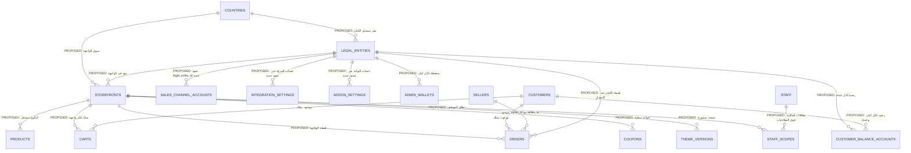

# Lavkoo GCC — Discovery-01 — التقرير 03: مصفوفة ملكية البيانات والعزل والعلاقات المستهدفة ومخاطر التوافق

> **المرحلة:** AUDIT (قراءة فقط) — **الجلسة:** `claude/exciting-shannon-4mh2ok` — **التاريخ:** 2026-11-12 (+03:00)
> **SHA الأساس:** `lavkoo@7f42777` · `lavkooapp@eedbbb8` · `lavkooappseller@8ea0092` · مرجع قديم `ksaapp98@79f50be`
> **يعتمد على:** [E03](../evidence/E03-data-model-ownership-inventory.md) · [E02](../evidence/E02-store-context-settings-currency-cache.md) · [E04](../evidence/E04-customer-identity-wallet-loyalty.md) · [E08](../evidence/E08-catalog-discovery-pricing.md) · [E13](../evidence/E13-finance-odoo-costs-settlements.md) · [E05](../evidence/E05-staff-roles-permissions-audit.md) · [E07](../evidence/E07-theme-system-backend.md) · [E10](../evidence/E10-payments-gateways.md) · [E11](../evidence/E11-inventory-fulfillment-shipping.md) · [E12](../evidence/E12-sales-channels-marketplaces.md) · [E14](../evidence/E14-seller-vendor-backend-api-v3.md) · [E01](../evidence/E01-backend-architecture-map.md) (لإشارات الطوابير والمجدول فقط) · `lavkoo:docs/gcc/DECISIONS.md`
> **الحالة:** نهائي لهذه الجلسة — لا يتضمن أي تنفيذ.

## الخلاصة

- لا يوجد في المستودع اليوم أي مفهوم **Country** أو **Storefront** أو **Legal Entity** كمرتكز في قلب التجارة. الموجود أبعاد جزئية متفرقة داخل أنظمة فرعية (الضرائب، العناوين، القنوات، Odoo، التكاليف)، وكل منها غير مترابط مع الآخر.
- أعمدة الملكية الموروثة (`seller_id`, `seller_is`, `shop_id`, `added_by`, `user_id`, `customer_id`, `is_guest`) لها دلالات متعددة ومتعارضة، ولا تصلح بوصفها معرّفاً للدولة أو المتجر. الكود يؤيد قرار DECISIONS بعدم إعادة استعمالها.
- المال موزَّع على مفاتيح عالمية: صف محفظة إدارة واحد (`admin_id = 1`)، ورصيد عميل واحد على `users`، ودفتر بائع بمفتاح `(seller_id, seller_is)`، ولا عمود عملة على أي جدول تجاري موروث.
- الحد الأدنى المقترح (PROPOSED) جدولان مرجعيان جديدان للكيانات (`legal_entities`, `storefronts`) مع `countries` مرجعي، وجدول رصيد `customer_balance_accounts`، وأعمدة `nullable` على عدد محدود من المرتكزات، مع تعبئة رجعية بالواجهة السعودية (GCC-19). لا يُقترح `country_id` على كل جدول.
- أكبر مخاطر التوافق (P0): المخطط الأساسي غير متتبَّع في المستودع، والمبالغ والأرصدة والدفاتر بلا عملة أو كيان، والكتالوج بلا بُعد متجر، ولا نطاق بيانات للموظفين.

## 1. تعريف المفاهيم المعتمدة وما يقابلها اليوم

المفاهيم من `lavkoo:docs/gcc/DECISIONS.md:11` (قائمة المفاهيم المتميّزة). الجدول يبيّن ما يقابل كل مفهوم في الجداول والكود الحالي، أو ما لا يقابله.

| المفهوم المعتمد | ما يقابله اليوم | الحكم | الحالة | الدليل |
|---|---|---|---|---|
| Country (الدولة) | لا جدول مرجعي للدول. توجد رموز دول موضعية في جداول منفصلة لا ترتبط ببعضها: `address_regions.country_code` (افتراضي `SA`)، و`taxes.country_code`، و`system_tax_setups.country_code`، و`fulfillment_routing_rules.country`، و`provider_city_mappings.country_code`، و`payment_routing_rules.country`، و`shipping_zones.countries`، و`delivery_country_codes.country_code`. | غائب كمفهوم؛ موجود كخاصية متفرقة | VERIFIED | `lavkoo:database/migrations/2026_11_07_100000_create_address_master_tables.php:24`؛ `lavkoo:Modules/TaxModule/database/migrations/2025_05_26_115643_create_taxes_table.php:20`؛ `lavkoo:database/migrations/2026_11_07_100200_create_inventory_and_routing_tables.php:123`؛ `lavkoo:app/Models/PaymentRoutingRule.php:16`؛ `lavkoo:database/migrations/2022_10_18_130956_create_delivery_country_codes_table.php:16`؛ [E03](../evidence/E03-data-model-ownership-inventory.md) §3 (الصف 9)؛ [E02](../evidence/E02-store-context-settings-currency-cache.md) §2.3 (هـ) |
| Storefront (واجهة البيع `/sa … /om`) | لا وجود بالمعنى المعتمد. الكلمة مستعملة بمعنيين آخرين: «قناة الموقع الذاتي» في وحدة المخزون (`inventory_locations.storefront_sellable`، `inventory_pools.storefront_reserve_*`)، و`storefront_code` إعداد لحساب Trendyol قيمه `SA`/`AE`/`KW`. | غائب؛ تصادم مصطلحي موثّق | VERIFIED | `lavkoo:database/migrations/2026_11_07_100200_create_inventory_and_routing_tables.php:33-36`؛ `lavkoo:database/migrations/2026_11_10_100000_add_stock_allocation.php:35`؛ `lavkoo:app/Services/SalesChannels/Support/ChannelSettings.php:14`؛ [E02](../evidence/E02-store-context-settings-currency-cache.md) §2.3 (هـ) |
| Legal Entity (الكيان القانوني البائع) | لا جدول. مكافئات جزئية: صف محفظة إدارة واحد لكل المنصة، وحقل `odoo_company_id` في جداول Odoo، وهوية فاتورة من إعداد عام واحد. | غائب؛ الكيان الوحيد ضمني (المنصة كلها) | VERIFIED | `lavkoo:app/Utils/OrderManager.php:809-812`؛ `lavkoo:database/migrations/2026_11_15_100000_create_odoo_accounting_tables.php:27`؛ `lavkoo:app/Http/Controllers/Admin/Order/OrderController.php:613`؛ [E13](../evidence/E13-finance-odoo-costs-settlements.md) §4.1 |
| Seller / Vendor / Shop | موجود: `sellers` للهوية والبنك والعمولة، و`shops` للمتجر (بـ `author_type` = `vendor` أو `admin`). البائع هوية دخول ومستأجر صلاحيات وطرف مقابل مالي، وليس واجهة بيع ولا كياناً قانونياً. | موجود ومستقل دلالياً؛ غير مربوط بكيان أو دولة | VERIFIED | `lavkoo:app/Models/Seller.php:44`؛ `lavkoo:app/Models/Shop.php:52`؛ [E14](../evidence/E14-seller-vendor-backend-api-v3.md) §4.1 (C1–C7) |
| Warehouse / Inventory Location | موجود بصيغتين غير مترابطتين: `inventory_locations` (مع `seller_id = 0` للمنصة) و`warehouses` (بلا ترحيل إنشاء). ورمز المزوّد يحمل موقعاً ثالثاً ضمنياً. | موجود؛ بلا دولة أو كيان | VERIFIED | `lavkoo:database/migrations/2026_11_07_100200_create_inventory_and_routing_tables.php:21`؛ `lavkoo:app/Models/Warehouse.php:16`؛ [E11](../evidence/E11-inventory-fulfillment-shipping.md) §6 (E11-F08) |
| Fulfillment Account (حساب التنفيذ) | لا جدول حساب. `integration_settings` صف واحد لكل رمز مزوّد (تعداد مغلق)، وكل جداول `provider_*` مفاتيحها مبنية على رمز المزوّد لا على حساب. | غائب كحساب؛ «المزوّد = الحساب» | VERIFIED | `lavkoo:database/migrations/2026_11_05_100000_create_provider_fulfillment_tables.php:27`؛ `lavkoo:database/migrations/2026_11_05_100000_create_provider_fulfillment_tables.php:247-248`؛ [E03](../evidence/E03-data-model-ownership-inventory.md) §3 (البند 7) |
| Sales Channel Account (حساب قناة البيع) | موجود: `sales_channel_accounts` بـ `channel`, `seller_id` (صفر = المنصة), `market`, `marketplace_ids`, `currency`. هو أقرب مرتكز جاهز، لكنه غير مرتبط بكيان قانوني أو واجهة. | موجود؛ أقرب مرتكز | VERIFIED | `lavkoo:database/migrations/2026_11_07_100100_create_sales_channel_tables.php:20`؛ `lavkoo:database/migrations/2026_11_07_100100_create_sales_channel_tables.php:27-31`؛ [E12](../evidence/E12-sales-channels-marketplaces.md) §2.4 |
| Customer (العميل) | موجود: هوية واحدة في `users`، وضيف في `guest_users`. الرصيد والنقاط عمودان عامان على `users`. | موجود؛ هوية عالمية (متوافقة مع GCC-13 كهوية، غير متوافقة كأرصدة) | VERIFIED | `lavkoo:app/Models/User.php:65`؛ `lavkoo:database/migrations/2023_08_12_215346_create_guest_users_table.php:16`؛ [E04](../evidence/E04-customer-identity-wallet-loyalty.md) §2.1 و§2.3 |

ملاحظة: لا يُقترح `country_id` على كل جدول. الدولة تُشتق من Storefront أو Legal Entity، وتبقى أعمدة `country_code` الموجودة (العناوين والضرائب) مراجع يُربط بجدول الدول لاحقاً.

## 2. الدلالات الفعلية لأعمدة الملكية

### 2.1 جدول الدلالات

لا يوجد في النظام الحالي مفتاح ملكية واحد ثابت المعنى. «البائع» يُعرَّف بزوج `(seller_id, seller_is)` أو `(added_by, user_id)` أو `(creator_id, creator_type)` حسب الجدول. الجدول التالي يلخص دلالة كل عمود كما يظهر في الكود.

| العمود (الجداول) | الدلالة الفعلية اليوم | الدليل | الحالة |
|---|---|---|---|
| `seller_id` + `seller_is` (`carts`, `orders`, `order_transactions`) | صاحب البضاعة أو المقابل في السلة والطلب. `seller_is` ∈ {`seller`, `admin`}. للمنتج الداخلي: `seller_id = 1` ثابتاً و`seller_is = admin`. الطلب يُقسَّم لكل زوج `(seller_id, seller_is)` داخل `order_group_id` واحد. | `lavkoo:app/Utils/CartManager.php:504-505`؛ `lavkoo:app/Utils/OrderManager.php:1068-1069` | VERIFIED |
| `order_details.seller_id` | بلا `seller_is`؛ يُفهم من الطلب الأب. علاقة `OrderDetail::seller()` تربط بجدول `sellers` دون شرط النوع. | `lavkoo:app/Models/OrderDetail.php:119-122` | VERIFIED |
| `products.added_by` + `products.user_id` | `added_by` ∈ {`admin`, `seller`}. `user_id` هو معرّف الإدارة أو البائع. لا يوجد عمود `seller_id` على المنتجات. العلاقة `Product::seller()` تربط `user_id` بـ`sellers` دون شرط على `added_by`. | `lavkoo:app/Services/ProductService.php:589`؛ `lavkoo:app/Models/Product.php:311-314` | VERIFIED |
| `products.shop_id` | عمود أُضيف في 2025 nullable ويُكتب عند إنشاء المنتج. الصفوف القديمة عُبّئت بحلقة تُحدِّث كل صف `shop_id IS NULL` بمتجر واحد دون شرط على المالك. | `lavkoo:database/migrations/2025_09_08_174517_add_shop_id_to_products_table.php:15`؛ `lavkoo:app/Traits/UpdateClass.php:680-687` | VERIFIED (الكود)؛ UNKNOWN (البيانات) |
| `shops.seller_id` + `shops.author_type` | متجر البائع: `author_type = vendor`. صف المتجر الداخلي: `seller_id = 0` و`author_type = admin`، ويُنشأ عند أول قراءة لإعداد المتجر الداخلي إن غاب. | `lavkoo:app/Utils/Helpers.php:765-767`؛ `lavkoo:app/Traits/InHouseTrait.php:24-42` | VERIFIED |
| `order_transactions.shop_id` | المتجر الحقيقي: متجر `admin` للطلبات الداخلية، ومتجر البائع لغيرها. | `lavkoo:app/Utils/OrderManager.php:283-294` | VERIFIED |
| `customer_id` + `is_guest` (`carts`, `orders`, `shipping_addresses`) | عند `is_guest = 1` يحمل `customer_id` معرّف صف في `guest_users` لا في `users`. فضاءا الترقيم مختلفان ويُفرَّق بينهما بالعلم وحده. عند تسجيل الدخول تُنقل السلة إلى معرّف المستخدم. | `lavkoo:app/Http/Middleware/GuestMiddleware.php:22-27`؛ `lavkoo:app/Utils/CartManager.php:26-28`؛ `lavkoo:app/Services/Fulfillment/Readiness/Compatibility/CompatibilitySpec.php:70` | VERIFIED |
| `user_id` (متعدد المعاني) | عميل في `chattings` و`wallet_transactions` و`loyalty_point_transactions` و`product_compares` و`shop_followers`. بائع أو إدارة في `products` و`stock_clearance_*`. «فاعل» مع `user_type` في `order_status_histories` و`delivery_man_transactions` و`recent_searches`. | `lavkoo:app/Models/Chatting.php:95-98`؛ `lavkoo:app/Models/WalletTransaction.php:31`؛ [E03](../evidence/E03-data-model-ownership-inventory.md) §2.3 | VERIFIED |
| `admin_wallets.admin_id` | ثابت = 1 في الكود: محفظة واحدة للمنصة كلها (15 موضعاً في 7 ملفات). | `lavkoo:app/Utils/OrderManager.php:809-812` | VERIFIED |
| `coupons.seller_id` (+ `customer_id`, `coupon_bearer`) | `NULL` = الإدارة فقط، `0` = كل البائعين، `n` = بائع محدد. `customer_id = 0` = كل العملاء. `coupon_bearer` ∈ {`inhouse`, `seller`}. | `lavkoo:database/migrations/2022_12_17_035723_few_field_add_to_coupons_table.php:17-20` | VERIFIED |
| `shipping_methods.creator_id` + `creator_type` | زوج مالك ثالث الصيغة (`admin` أو `seller`). | `lavkoo:app/Models/ShippingMethod.php:32-34` | VERIFIED |
| `transactions.payer_id` / `payment_receiver_id` / `paid_by` / `paid_to` | أزواج (معرّف + نوع) بلا مفتاح أجنبي في الـ Model، ولا migration يضيفها. | `lavkoo:app/Models/Transaction.php:11-27` | INFERRED |
| `operational_cost_*` مقابل `vendor_ledger_entries` | «المنصة» في جداول التكاليف الجديدة هي `seller_id = 0` (كيان واحد)، بينما دفتر البائع يرفض `sellerId` الصفري، والمحفظة الموروثة تستعمل `admin_id = 1`. | `lavkoo:database/migrations/2026_11_07_100000_create_operational_cost_tables.php:24-25`؛ `lavkoo:app/Services/Marketplace/VendorLedger.php:49-51`؛ `lavkoo:app/Utils/OrderManager.php:809-812`؛ [E13](../evidence/E13-finance-odoo-costs-settlements.md) §3 (A5) | VERIFIED |

### 2.2 ترميزات «المتجر الداخلي» (الإدارة كبائع)

المتجر الداخلي له ست ترميزات على الأقل في الكود، وهذا هو الشذوذ الأهم لأي backfill:

| الترميز | الموضع | الدليل |
|---|---|---|
| `(seller_id = 1, seller_is = 'admin')` في السلة والطلب | السلة والطلب | `lavkoo:app/Utils/CartManager.php:504-505` |
| `seller_id = 0` مع `author_type = 'admin'` في `shops` | صف المتجر الداخلي | `lavkoo:app/Utils/Helpers.php:765-767` |
| صف افتراضي في الذاكرة بـ `id = 0` | المتجر الداخلي عند الغياب | `lavkoo:app/Traits/InHouseTrait.php:24-42` |
| `seller_id = 0` بمعنى «حساب المنصة» | جداول الشحن والمندوبين والوحدات الجديدة | `lavkoo:database/migrations/2026_11_07_100100_create_sales_channel_tables.php:24-25` |
| `NULL` و`0` بمعنيين مختلفين | `coupons.seller_id` | `lavkoo:database/migrations/2022_12_17_035723_few_field_add_to_coupons_table.php:19` |
| `shop_id = 0` مع مفردة `vendor` لا `seller` | التصفية | `lavkoo:app/Http/Controllers/Admin/Promotion/ClearanceSaleController.php:184-186` |
| `products.shop_id` لمنتجات الإدارة يحمل معرّف صف المتجر الداخلي | المنتجات | `lavkoo:app/Http/Controllers/Admin/Product/ProductController.php:371-374` |

يضاف إلى ذلك أن تغيّر حالة الطلب قد يُنشئ صف محفظة بائع بالمعرّف `1` لطلب داخلي (`lavkoo:app/Utils/OrderManager.php:156`)، فتتقاطع قيمة المتجر الداخلي مع مفتاح بائع حقيقي محتمل. الحالة: VERIFIED ([E03](../evidence/E03-data-model-ownership-inventory.md) §2.3 و§6 E03-F04 و E03-F05).

### 2.3 لماذا لا يجوز إعادة استعمال هذه الأعمدة معرّفاً للدولة

الأدلة التالية (من [E14](../evidence/E14-seller-vendor-backend-api-v3.md) §4.1 ومن [E03](../evidence/E03-data-model-ownership-inventory.md) §2.3 و§5) تثبت أن الإعادة ستكسر الدلالات القائمة:

1. **`seller_id` هوية مصادقة.** صف `sellers` صف مصادقة بخصائص دخول ورموز جهاز وإعدادات تطبيق. «متجر الدولة» ليس مستخدماً يسجّل الدخول. (`lavkoo:app/Models/Seller.php:40-68`) — E14 C1.
2. **`seller_id` مستأجر صلاحيات.** الأدوار والموظفون والمفاتيح و webhooks وقواعد الأتمتة مملوكة لبائع. إعادة استعماله للدولة تخلط «من يعمل في المتجر» بـ«أي سوق». (`lavkoo:app/Services/Marketplace/SellerPermissionService.php:57-73`) — E14 C2.
3. **القيمة `0` والحارس `admin` يعنيان «المنصة نفسها».** ست دول تحتاج ست قيم، ولا مكان لذلك في حارس واحد. (`lavkoo:app/Utils/Helpers.php:765-767`؛ `lavkoo:app/Services/Fulfillment/ProductProviderAssignmentService.php:196`) — E14 C3.
4. **الطلب يُقسَّم لكل بائع.** الدولة تضم بائعين كثيرين، فاستعمال `seller_id` للدولة يهدم تقسيم الطلبات والعمولة والتسوية. (`lavkoo:app/Http/Controllers/RestAPI/v3/seller/OrderController.php:65-75`) — E14 C4.
5. **المال مربوط بالبائع لا بالكيان.** المحفظة ودفتر الأستاذ والعمولة والحساب البنكي لكل بائع. الكيان القانوني هو الطرف الذي يفوتر العميل ويدفع للبائع. (`lavkoo:app/Services/Marketplace/VendorLedger.php:36-48`) — E14 C5.
6. **الانتشار.** عدد مواضع `seller_is` 487 في 98 ملفاً، و`added_by` 530 في 126 ملفاً (تصحيح E03 §5). تغيير الدلالة غير قابل للحصر دون تدقيق شامل.
7. **`shop_id` بمعنى «متجر التاجر» في ستة نماذج فقط**، وقيمته للمنتج الإداري غير موحدة (الجدول في 2.2). (E14 C7؛ E03-F10)

الاستنتاج: لا يوجد تعارض بين قرار DECISIONS («لا تُعاد استعمال `shop_id` أو `seller_id` كمتجر دولة دون مراجعة دلالية») والكود. الكود يؤيد القرار. الحالة: VERIFIED.

## 3. مصفوفة مصدر الحقيقة

الأعمدة: **المالك الحالي** = الكيان الذي يتحكم في الصف اليوم. **فئة GCC المقترحة** = الملكية المقترحة (توثيقية، ليست قراراً معتمداً). **مرتكز / مشتق** = ANCHOR إن كان الجدول يحمل مرجع الملكية مباشرة، أو «← X» إن كان يُشتق من الأب X دون عمود جديد. **الحساسية** كما في [E03](../evidence/E03-data-model-ownership-inventory.md) (financial، historical، high-volume، low). الحالة لكل صف: VERIFIED للحقول المذكورة من migrations أو الكود، وINFERRED لما يُستنتج من `$fillable` أو `$casts` فقط، وUNKNOWN لقيم الإنتاج وأنواع الأعمدة الفعلية.

القاعدة: لا يُضاف `country_id` إلى كل جدول. الدولة تُشتق من Storefront أو Legal Entity.

### 3.1 الهوية والمحافظ والولاء والمدفوعات

| الجدول | المالك الحالي | فئة GCC المقترحة | مرتكز / مشتق | الحساسية | الدليل |
|---|---|---|---|---|---|
| `users` | Customer | Customer (هوية عالمية) | ANCHOR (هوية) | financial / historical | `lavkoo:app/Models/User.php:65` |
| `guest_users` | Customer (ضيف) | Storefront عند الإنشاء | مرتكز ناقص: يحتاج واجهة عند الإنشاء | high-volume | `lavkoo:database/migrations/2023_08_12_215346_create_guest_users_table.php:16` |
| `admins` | Global | Staff (GCC-14) | ANCHOR (هوية الموظف) | low | `lavkoo:app/Models/Admin.php:38` |
| `admin_roles` | Global | Global (يبقى) | — | low | `lavkoo:app/Models/AdminRole.php:26` |
| `staff_scopes` (جديد) | — | Staff Scope (PROPOSED) | ANCHOR جديد | low | [E05](../evidence/E05-staff-roles-permissions-audit.md) §4 |
| `wallet_transactions` | Customer | Customer × Legal Entity × Currency | ANCHOR مالي (يحتاج بُعد الكيان والعملة) | financial / historical / high-volume | `lavkoo:database/migrations/2022_05_12_104247_create_wallet_transactions_table.php:16` |
| `loyalty_point_transactions` | Customer | Customer × Storefront (GCC-15) | ANCHOR | financial / historical | `lavkoo:database/migrations/2022_05_14_063309_create_loyalty_point_transactions_table.php:16` |
| `customer_wallets`، `customer_wallet_histories` | Customer | إرث: المصدر الفعلي `users.wallet_balance` | — (إرث متروك مع مسار حيّ) | financial / historical | `lavkoo:app/Models/CustomerWallet.php:31` |
| `payment_requests` | Customer / Global | Legal Entity (حساب البوابة) | ANCHOR (يحتاج حساب بوابة) | financial / historical | `lavkoo:app/Models/PaymentRequest.php:16` |
| `myfatoorah_payment_attempts`، `myfatoorah_refunds`، `myfatoorah_webhook_events` | Global (حساب واحد) | Legal Entity | ← `payment_requests` | financial / historical | `lavkoo:database/migrations/2026_11_08_100001_create_myfatoorah_payment_attempts_table.php:37` |
| `addon_settings` (النموذج `Setting`) | Global | Legal Entity (حساب بوابة لكل كيان) | ANCHOR إعداد (يحتاج طبقة حساب) | financial | `lavkoo:app/Models/Setting.php:23` |
| `payment_routing_rules` | Global | Storefront / Legal Entity | مرتكز إعداد؛ المبالغ بعملة | financial | `lavkoo:app/Models/PaymentRoutingRule.php:16` |
| `offline_payment_methods` | Global | Legal Entity (حسابات بنكية) | مرتكز إعداد | financial | `lavkoo:database/migrations/2023_08_03_105256_create_offline_payment_methods_table.php:16` |
| `add_fund_bonus_categories` | Global | Storefront / Legal Entity (مبالغ بعملة المتجر) | مرتكز إعداد | financial | `lavkoo:database/migrations/2023_08_12_102355_create_add_fund_bonus_categories_table.php:16` |
| `referral_customers` | Customer | Customer × Storefront | ← `users` | financial | `lavkoo:database/migrations/2025_06_03_171327_create_referral_customers_table.php:14` |
| `approval_requests` | Global | Legal Entity (يُقيَّد بنطاق الموظف) | مرتكز إعداد؛ مبالغ بعملة | financial / historical | `lavkoo:app/Models/ApprovalRequest.php:18` |
| `addon_settings` / `business_settings` (الإعدادات العامة) | Global | Global + طبقة override لكل Storefront أو Legal Entity | ANCHOR للإعدادات (طبقة override جديدة) | historical / financial | `lavkoo:app/Models/BusinessSetting.php:13` |

### 3.2 البائع والمتجر والتسويات

| الجدول | المالك الحالي | فئة GCC المقترحة | مرتكز / مشتق | الحساسية | الدليل |
|---|---|---|---|---|---|
| `sellers` | Seller | Seller (هوية، تبقى عالمية) | ANCHOR (هوية) | financial / historical | `lavkoo:app/Models/Seller.php:44` |
| `shops` | Shop (Seller) أو Admin-in-house | Seller + Storefront (قرار مالك: ربط shop↔storefront) | ANCHOR ثانوي | historical | `lavkoo:app/Models/Shop.php:52` |
| `seller_staff`، `seller_roles`، `seller_api_keys`، `seller_webhooks` | Seller | Seller | ← `sellers` | low | `lavkoo:app/Models/SellerStaff.php:23` |
| `seller_wallets` | Seller | Seller × Legal Entity × Currency | ANCHOR مالي (التجميع الحالي بلا عملة) | financial | `lavkoo:app/Models/SellerWallet.php:28` |
| `admin_wallets` | Admin-in-house (صف واحد `admin_id = 1`) | Legal Entity | ANCHOR مالي (صف لكل كيان) | financial | `lavkoo:app/Models/AdminWallet.php:39` |
| `vendor_ledger_entries` | Seller / Admin-in-house | Seller × Legal Entity × Currency (مفتاح السلسلة) | ANCHOR مالي | financial / historical | `lavkoo:app/Models/VendorLedgerEntry.php:30` |
| `vendor_settlements`، `vendor_payout_requests` | Seller | Seller × Legal Entity | ← `vendor_ledger_entries` | financial / historical | `lavkoo:app/Models/VendorSettlement.php:26`؛ `lavkoo:app/Models/VendorPayoutRequest.php:39` |
| `commission_rules` | Global | Legal Entity / Storefront (مبالغ ثابتة بعملة) | مرتكز إعداد | financial | `lavkoo:app/Models/CommissionRule.php:16` |
| `order_item_commissions` | Order snapshot | Storefront / Legal Entity | ← `order_details` ← `orders` | financial / historical | `lavkoo:app/Models/OrderItemCommission.php:15` |
| `withdraw_requests` | Seller / Delivery man | Seller × Legal Entity | ← `seller_wallets` | financial / historical | `lavkoo:app/Models/WithdrawRequest.php:35` |
| `vendor_withdraw_method_infos`، `vendor_bank_change_logs` | Seller | Seller (الحساب البنكي واحد على `sellers`) | ← `sellers` | financial | `lavkoo:app/Models/Seller.php:54-57` |
| `seller_verification_documents` | Seller | Seller / Legal Entity (المتطلبات تختلف بالدولة) | ← `sellers` | historical | `lavkoo:app/Models/SellerVerificationDocument.php:20` |

### 3.3 الكتالوج والعروض والمحتوى

| الجدول | المالك الحالي | فئة GCC المقترحة | مرتكز / مشتق | الحساسية | الدليل |
|---|---|---|---|---|---|
| `products` | Admin-in-house / Seller | Storefront (كتالوج مستقل لكل واجهة) | ANCHOR | financial / historical / high-volume | `lavkoo:app/Models/Product.php:71` |
| `product_stocks`، `digital_product_variations`، `product_price_changes` | Admin / Seller | Storefront | ← `products` | historical | `lavkoo:app/Models/ProductPriceChange.php:29` |
| `categories` | Global | Global (GCC-08) + جدول ظهور لكل واجهة (PROPOSED) | مركزي | low | `lavkoo:app/Models/Category.php:32` |
| `category_governance` | Global | Global + تخصيص لكل دولة للقيود التنظيمية | ← `categories` | low | `lavkoo:app/Models/CategoryGovernance.php:14` |
| `brands`، `attributes`، `colors`، `tags` | Global | Global (GCC-18) + امتدادات محلية (PROPOSED) | مركزي | low | `lavkoo:app/Models/Brand.php:25`؛ `lavkoo:app/Models/Attribute.php:16` |
| `coupons` | Admin / Seller | Storefront (GCC-17: قواعد محلية) | ANCHOR | financial | `lavkoo:app/Models/Coupon.php:29` |
| `flash_deals`، `deal_of_the_days`، `flash_deal_products` | Admin | Storefront | ANCHOR (الأولان) / ← `flash_deals` | financial | `lavkoo:app/Models/FlashDeal.php:45`؛ `lavkoo:app/Models/DealOfTheDay.php:38` |
| `stock_clearance_setups`، `stock_clearance_products` | Admin / Shop | Storefront | ← `shops` / `products` | financial | `lavkoo:database/migrations/2024_11_02_075917_create_stock_clearance_setups_table.php:14` |
| `banners`، `help_topics`، `app_carousel_settings` | Global | Storefront (محتوى لكل واجهة) | مرتكز محتوى | low | `lavkoo:app/Models/Banner.php:44` |
| `business_pages`، `email_templates` | Global | Storefront / Legal Entity (GCC-11: سياسات معتمدة لكل دولة؛ هوية المرسل تختلف) | مرتكز محتوى | historical / low | `lavkoo:database/migrations/2025_03_08_201607_create_business_pages_table.php:14`؛ `lavkoo:database/migrations/2024_04_03_093637_create_email_templates_table.php:14` |
| `themes` | Global | Global (مكتبة) + Storefront (النشر) | ← `theme_versions` | low (المخطط UNKNOWN) | `lavkoo:app/Models/Theme.php:16` |
| `theme_versions` | Global | Storefront (نسخة منشورة لكل واجهة، GCC-07) | ANCHOR | historical | `lavkoo:app/Models/ThemeVersion.php:19` |
| `theme_sections`، `theme_blocks` | Global | Storefront | ← `theme_versions` | low | `lavkoo:app/Models/ThemeSection.php:17`؛ `lavkoo:app/Models/ThemeBlock.php:15` |
| `experience_campaigns` | Global | Storefront (حملة مركزية تختار أسواقها، GCC-17) | مرتكز بقائمة أسواق | low | `lavkoo:app/Models/ExperienceCampaign.php:33` |
| `product_search_index`، `product_metrics`، `product_collections` | Admin / Seller | Storefront | ← `products` | high-volume | `lavkoo:app/Models/ProductSearchIndex.php:18` |
| `redirects`، `seo_templates`، `robots_meta_contents` | Global | Storefront (المسارات تحمل بادئة `/sa`…) | مرتكز محتوى | low | `lavkoo:app/Models/Redirect.php:24` |

### 3.4 السلة والطلب والاسترجاع والشحن

| الجدول | المالك الحالي | فئة GCC المقترحة | مرتكز / مشتق | الحساسية | الدليل |
|---|---|---|---|---|---|
| `carts` | Customer × Seller | Storefront × Customer (GCC-13) | ANCHOR | high-volume | `lavkoo:database/migrations/2021_10_02_185124_create_carts_table.php:16` |
| `orders` | Order snapshot / Customer / Seller | Storefront + Legal Entity + Currency (لقطة) | ANCHOR | financial / historical / high-volume | `lavkoo:app/Models/Order.php:75` |
| `order_details` | Order snapshot | Storefront | ← `orders` | financial / historical / high-volume | `lavkoo:app/Models/OrderDetail.php:44` |
| `order_transactions` | Order snapshot / Seller | Storefront / Legal Entity | ← `orders` | financial / historical | `lavkoo:database/migrations/2021_09_28_025411_create_order_transactions_table.php:16` |
| `order_taxes` | Order snapshot | Legal Entity (لقطة) | ← `orders` | financial / historical | `lavkoo:Modules/TaxModule/database/migrations/2025_05_26_121656_create_order_taxes_table.php:16` |
| `transactions` | Order snapshot | Storefront / Legal Entity | ← `orders` | financial / historical | `lavkoo:app/Models/Transaction.php:11` |
| `refund_requests`، `refund_transactions` | Customer / Order snapshot | Storefront | ← `orders` | financial / historical | `lavkoo:database/migrations/2022_02_15_121410_create_refund_transactions_table.php:16` |
| `order_edit_histories`، `order_status_histories` | Order snapshot | Storefront | ← `orders` | historical | `lavkoo:database/migrations/2022_10_17_114744_create_order_status_histories_table.php:16` |
| `shipping_addresses` | Customer | Customer (الدولة خاصية للعنوان لا للمتجر) | ← `users` | historical / high-volume | `lavkoo:app/Models/ShippingAddress.php:45` |
| `shipping_methods` | Admin-in-house / Seller | Storefront (تكلفة بعملة المتجر) | ANCHOR | financial | `lavkoo:app/Models/ShippingMethod.php:32` |
| `shipping_zones`، `delivery_country_codes`، `delivery_zip_codes` | Global | Storefront (GCC-16) | مرتكز إعداد | financial / low | `lavkoo:app/Models/ShippingZone.php:15` |
| `address_regions`، `address_cities` | Global | Country (موجود: `country_code`) | ANCHOR (Country) | low | `lavkoo:database/migrations/2026_11_07_100000_create_address_master_tables.php:22` |
| `provider_fulfillments` | Order snapshot / Provider | Provider Account | ← `orders` (+ حساب المزوّد) | financial / historical | `lavkoo:database/migrations/2026_11_05_100000_create_provider_fulfillment_tables.php:40` |
| `provider_fulfillment_items` | Order snapshot | Provider Account | ← `provider_fulfillments` | historical | `lavkoo:database/migrations/2026_11_05_100000_create_provider_fulfillment_tables.php:116` |
| `external_order_mappings`، `external_order_lines` | Sales channel account / Order snapshot | Sales Channel Account | ← `sales_channel_accounts` | financial / historical | `lavkoo:database/migrations/2026_11_07_100100_create_sales_channel_tables.php:108` |

### 3.5 الضرائب والتكاليف والمحاسبة (Odoo)

| الجدول | المالك الحالي | فئة GCC المقترحة | مرتكز / مشتق | الحساسية | الدليل |
|---|---|---|---|---|---|
| `taxes`، `system_tax_setups` | Global | Legal Entity (وCountry عبر `country_code` الموجود) | مرتكز إعداد؛ بُعد الدولة خامد | financial | `lavkoo:Modules/TaxModule/database/migrations/2025_05_26_115043_create_system_tax_setups_table.php:19` |
| `operational_cost_contracts` | Admin-in-house / Seller | Legal Entity | ANCHOR | financial | `lavkoo:database/migrations/2026_11_07_100000_create_operational_cost_tables.php:22` |
| `operational_cost_entries`، `operational_cost_invoices`، `inventory_cost_layers` | Order snapshot / Provider | Legal Entity (عملة أساس لكل كيان) | ← العقد / الطلب / الموقع | financial / historical | `lavkoo:database/migrations/2026_11_07_100000_create_operational_cost_tables.php:89` |
| `odoo_account_mappings`، `odoo_posting_queue`، `odoo_reconciliations` | Admin-in-house / Seller | Legal Entity (`odoo_company_id` ≈ كيان) | ← الكيان | financial / historical | `lavkoo:database/migrations/2026_11_15_100000_create_odoo_accounting_tables.php:23` |

### 3.6 المخزون والمزوّدون والقنوات

| الجدول | المالك الحالي | فئة GCC المقترحة | مرتكز / مشتق | الحساسية | الدليل |
|---|---|---|---|---|---|
| `integration_settings` | Global (صف لكل رمز مزوّد) | Provider Account → Legal Entity | ANCHOR (يحتاج مفتاحاً مركباً مع الحساب) | low | `lavkoo:database/migrations/2026_11_05_100000_create_provider_fulfillment_tables.php:27` |
| `provider_product_mappings`، `provider_catalog_items` | Provider × Product | Provider Account × Storefront | ← `products` + الحساب | historical / high-volume | `lavkoo:database/migrations/2026_11_05_100000_create_provider_fulfillment_tables.php:218` |
| `inventory_locations` | Warehouse-Location | Warehouse → Legal Entity / Country | ANCHOR | low | `lavkoo:database/migrations/2026_11_07_100200_create_inventory_and_routing_tables.php:21` |
| `inventory_pools`، `inventory_reservations`، `channel_stock_events` | Warehouse-Location / Channel account | Warehouse | ← `inventory_locations` | high-volume | `lavkoo:database/migrations/2026_11_10_100000_add_stock_allocation.php:29` |
| `sales_channel_accounts` | Sales channel account | Sales Channel Account → Legal Entity | ANCHOR | low | `lavkoo:database/migrations/2026_11_07_100100_create_sales_channel_tables.php:20` |
| `sales_channel_product_mappings`، `channel_listing_drafts`، `channel_order_dispatches` | Sales channel account | Sales Channel Account | ← `sales_channel_accounts` | historical / high-volume | `lavkoo:database/migrations/2026_11_07_100100_create_sales_channel_tables.php:60` |
| `warehouses`، `warehouse_stock`، `stock_movements`، `product_batches`، `suppliers`، `purchase_orders` | Admin-in-house / Seller | Warehouse / Legal Entity (المشتريات) | `warehouses` ANCHOR ثانوي؛ الباقي ← الأب | financial / historical | `lavkoo:app/Models/Warehouse.php:16`؛ `lavkoo:app/Models/PurchaseOrder.php:20` |

### 3.7 النظام والتدقيق والإشعارات والمراقبة

| الجدول | المالك الحالي | فئة GCC المقترحة | مرتكز / مشتق | الحساسية | الدليل |
|---|---|---|---|---|---|
| `audit_logs` | Global | Global مع نطاق للقراءة (يُشتق من `subject`) | مشتق | historical / high-volume | `lavkoo:app/Models/AuditLog.php:15` |
| `jobs` | Global | Global (payload يحمل معرّفات الكيانات فقط) | — | high-volume | `lavkoo:database/migrations/2022_04_19_095926_create_jobs_table.php:16` |
| `notifications`، `notification_seens` | Global / Customer / Seller | Storefront (جمهور لكل واجهة) | ← المستلم | low / high-volume | `lavkoo:app/Models/Notification.php:26` |
| `chattings`، `support_tickets` | Customer × Seller/Admin | Storefront / Customer × Storefront | ← `shops` أو الواجهة | high-volume / historical | `lavkoo:app/Models/Chatting.php:63`؛ `lavkoo:app/Models/SupportTicket.php:32` |
| `monitoring_*` (17) و`analytics_*` (7) و`telemetry_*` | Global | Global؛ بُعد Storefront للتحليلات | — | high-volume | `lavkoo:app/Services/Analytics/Reporting/AnalyticsReporting.php:1052-1055` |

### 3.8 حصيلة المصفوفة الكاملة

[E03](../evidence/E03-data-model-ownership-inventory.md) §2.2 يصنّف 250 اسم جدول صفاً بصف (139 بمخطط إنشاء، و36 ALTER-only، و75 بلا migration)، إضافةً إلى 6 صفوف مجمّعة لنحو 35 جدولاً بلا Model. وبعد التصحيح في E03 §5.1:

- 26 مرتكزاً (ANCHOR): أربعة منها هويات موجودة (`users`, `sellers`, `admins`, `address_regions`)، و22 يُقترح أن يحمل مرجع الواجهة أو الكيان أو الحساب مباشرة.
- 150 جدولاً تُشتق ملكيتها عبر الأب دون عمود جديد.
- 24 جدولاً تبقى Global (هوية وجداول إطار العمل ومراجع الكتالوج المركزية).
- 50 جدولاً صغيراً للإعداد أو المحتوى تحتاج مرجع واجهة أو كيان مباشراً لأنها بلا أب مناسب.

الحالة: VERIFIED (الأعداد من E03 بعد تصحيح الجرد)؛ قيم الإنتاج UNKNOWN.

## 4. العلاقات المستهدفة المقترحة (PROPOSED)

كل ما في هذا القسم **اقتراح توثيقي** لا قرار. لا يوجد أي من الكيانات المقترحة في المستودع اليوم ([E03](../evidence/E03-data-model-ownership-inventory.md) §5.1).

### 4.1 مخطط العلاقات

### 4.2 الإضافات الدنيا (PROPOSED)

الحد الأدنى هو أصغر مجموعة من البنى الجديدة تحقق قرارات DECISIONS المتعلقة بالدول والكيانات والمحافظ دون تغيير سلوك السعودية. الصفوف والأعمدة الموجودة تبقى كما هي، ويُعبَّأ ما يُضاف بقيمة السعودية الافتراضية (GCC-19) بعد التحقق.

| # | الإضافة (PROPOSED) | النوع | ما الذي تحله | الحجم | الدليل / القرار |
|---|---|---|---|---|---|
| 1 | `countries` (`code` ISO، `currency_code`، `minor_units` ∈ {2, 3}، `is_active`) | جدول مرجعي جديد | يثبّت الدولة وعدد الخانات (KWD/BHD/OMR = 3) بدل الافتراضات المتفرقة | جدول واحد | `lavkoo:docs/gcc/DECISIONS.md:11`؛ [E02](../evidence/E02-store-context-settings-currency-cache.md) §2.4 |
| 2 | `legal_entities` (`country_id`، الاسم القانوني، المعرّف الضريبي، مفتاح سلسلة الفواتير، الحالة) | جدول جديد | الكيان القانوني البائع لكل دولة | جدول واحد | `lavkoo:docs/gcc/DECISIONS.md:12`؛ [E03](../evidence/E03-data-model-ownership-inventory.md) §5.1 |
| 3 | `storefronts` (`code` ∈ sa/ae/kw/qa/bh/om، `country_id`، `legal_entity_id`، `currency_code`، `status`، `is_default`، `pause_mode`) | جدول جديد | الواجهة `/sa…/om`، وGCC-12 (إيقاف)، وGCC-19 (الافتراضي) | جدول واحد | `lavkoo:docs/gcc/DECISIONS.md:9-10`؛ `lavkoo:docs/gcc/DECISIONS.md:27` و`:34` |
| 4 | `customer_balance_accounts` (`customer_id`، `legal_entity_id`، `currency_code`، رصيد المحفظة، رصيد النقاط؛ فريد على الثلاثة) | جدول جديد | رصيد لكل (عميل × كيان × عملة) مع إبقاء `users.wallet_balance` و`users.loyalty_point` إسقاطاً للسعودية | جدول واحد | `lavkoo:docs/gcc/DECISIONS.md:41`؛ [E04](../evidence/E04-customer-identity-wallet-loyalty.md) §5.2 |
| 5 | `staff_scopes` (`admin_id`، `storefront_id` أو `legal_entity_id`، نوع النطاق) | جدول جديد | GCC-14: نطاق بيانات وإجراءات فوق صلاحيات الوحدات القائمة | جدول واحد | `lavkoo:docs/gcc/DECISIONS.md:29`؛ [E05](../evidence/E05-staff-roles-permissions-audit.md) §4 |
| 6 | `storefront_id` (nullable، مع backfill للسعودية) على: `products`, `carts`, `orders`, `coupons`, `shipping_methods`, `flash_deals`, `theme_versions` | عمود جديد لكل جدول | المرتكزات السبعة الأولى من E03 §5.1 | 7 أعمدة | [E03](../evidence/E03-data-model-ownership-inventory.md) §5.1؛ [E08](../evidence/E08-catalog-discovery-pricing.md) §4.1 |
| 7 | `legal_entity_id` (nullable) على: `admin_wallets`, `seller_wallets`, `vendor_ledger_entries`, `integration_settings`, `addon_settings`, `sales_channel_accounts`, `operational_cost_contracts`, `taxes`، مع توسيع المفتاح الفريد في `vendor_ledger_entries` وفي `integration_settings` بالحساب | أعمدة جديدة وتوسيع مفاتيح | ربط الحسابات (بوابات، مزوّدين، قنوات، ضرائب) والمحافظ بالكيان | 8 أعمدة + مفاتيح | [E13](../evidence/E13-finance-odoo-costs-settlements.md) §4.1؛ [E10](../evidence/E10-payments-gateways.md) §2.6؛ [E11](../evidence/E11-inventory-fulfillment-shipping.md) §2.4 |
| 8 | لقطة الطلب: `legal_entity_id`، `currency_code`، وحقل لقطة JSON للكيان والعنوان الضريبي | أعمدة جديدة على `orders` | تثبيت الكيان والعملة وقت الإصدار؛ الطلبات السعودية القديمة تُعبَّأ بقيمة موثّقة | 3 أعمدة | [E03](../evidence/E03-data-model-ownership-inventory.md) §2.6 و§5؛ [E13](../evidence/E13-finance-odoo-costs-settlements.md) F07 |
| 9 | أعمدة الدفتر على `wallet_transactions` و`loyalty_point_transactions`: `storefront_id`، `legal_entity_id`، `currency_code`، مرجع المصدر (طلب/دفعة/استرداد)، المنفّذ، مفتاح تفرّد | أعمدة قابلة للـ NULL | إسناد الحركات لكيان وعملة وطلب دون تغيير القيم القائمة | 6 أعمدة | [E04](../evidence/E04-customer-identity-wallet-loyalty.md) §5.2 (2) |
| 10 | جداول ربط لاحقة (ليست ضمن الحد الأدنى): `category_storefronts` (GCC-08)، وتخصيصات العلامات والسمات (GCC-10/18)، `consents` (GCC-11/13) | جداول لاحقة | ظهور الفئة، الهوية المحلية، الموافقات | مؤجَّل | [E08](../evidence/E08-catalog-discovery-pricing.md) §4؛ [E04](../evidence/E04-customer-identity-wallet-loyalty.md) §2.8 |

### 4.3 ما لا يُقترح ولا يُمسّ

- **لا `country_id` على كل جدول.** الدولة تُشتق عبر `storefronts` أو `legal_entities`. الجداول التي تحمل `country_code` اليوم تُربط بـ`countries` لاحقاً ولا تُعاد كتابتها.
- **لا إعادة تسمية ولا إعادة ترقيم:** `orders.id` (تسلسل التطبيق)، و`order_group_id`، و`provider_fulfillments.reference`، وإشارات `seller_id`/`seller_is`/`added_by` بدلالاتها الحالية ([E03](../evidence/E03-data-model-ownership-inventory.md) §5).
- **لا تحويل تلقائي للأرصدة التاريخية** وأي عمود جديد يبقى `NULL` للصفوف القديمة حتى تُعبَّأ بالواجهة السعودية بعد المطابقة.
- **المتجر الداخلي وتقسيم البائعين** لا يُلغيان؛ الكيانات الجديدة لا تعيد استعمال `seller_id = 1` أو `seller_id = 0`.

## 5. مصفوفة انتقال السياق والعزل

الجدول يبيّن الوضع الحالي لكل آلية انتقال للسياق (web، APIs، queue jobs، webhooks، cache keys، search index، session، app-local storage، scheduled tasks) والفجوة مقابل GCC. الحدّ الفاصل: أي عمود يُكتب فيه «لا» يعني أن السياق غير محمول في تلك الآلية.

| الآلية | الوضع الحالي | الفجوة مقابل GCC | الدليل | الحالة |
|---|---|---|---|---|
| **Web (الواجهة)** | لا بادئة دولة ولا `Route::domain`. الإقليم والعملة والسلة مرتبطة بالجلسة. | لا حامل لسياق المتجر (لا مسار ولا ترويسة ولا middleware ولا عمود). | `lavkoo:app/Providers/RouteServiceProvider.php:97-119`؛ [E02](../evidence/E02-store-context-settings-currency-cache.md) §2.3 و§2.5 (E02-F02) | VERIFIED |
| **Session** | ملف تعريف واحد مشتق من اسم التطبيق بمسار `/`، ومخزن ملفات. مفاتيح العملة والكوبون والعنوان والسلة بلا بُعد متجر. | مسارات `/sa` و`/ae` ستشارك جلسة واحدة ما لم تُفصل. | `lavkoo:config/session.php:127-130`؛ `lavkoo:config/session.php:143`؛ [E02](../evidence/E02-store-context-settings-currency-cache.md) §2.5 (E02-F04) | VERIFIED |
| **Locale والعملة في الويب** | اللغة مفتاح الجلسة `local`. تبديل العملة عبر `POST /currency` يكتب الرمز في الجلسة. | تبديل العملة لا يرتبط بسياق متجر؛ في الوضع `single_currency` يغيّر الرمز دون تحويل. | `lavkoo:app/Utils/language.php:104-130`؛ `lavkoo:app/Http/Controllers/Web/CurrencyController.php:18-28`؛ [E02](../evidence/E02-store-context-settings-currency-cache.md) §2.2 (د) (E02-F18) | VERIFIED |
| **REST API v1/v2 (العميل)** | اللغة بترويسة `lang`. لا ترويسة متجر ولا عملة؛ العملة تُحوَّل محلياً في التطبيق. | لا حامل لسياق المتجر في الترويسات. `GET /api/v1/config` يعيد قيمة واحدة لكل إعداد. | `lavkoo:app/Http/Middleware/APILocalizationMiddleware.php:23`؛ `lavkoo:app/Http/Controllers/RestAPI/v1/ConfigController.php:158`؛ [E02](../evidence/E02-store-context-settings-currency-cache.md) §2.5 | VERIFIED |
| **API بلا جلسة** | مجموعة `api` بلا `StartSession`. | الحالة المؤقتة لأي سياق متجر يجب أن تُحمل بالترويسة أو بالمعرّف، لا بالجلسة. | `lavkoo:bootstrap/app.php:84-94` | VERIFIED |
| **API v3 (البائع)** | هوية البائع من الـ token وحده؛ لا وسيط متجر في الطلب. التطبيق المنشور لا يرسل سياق دولة. | GCC-19 (الافتراضي الضمني): غياب سياق المتجر يجب أن يُعرَّف صراحةً بأنه السعودية. | `lavkoo:app/Http/Controllers/RestAPI/v3/seller/ProductController.php:143-151`؛ [E14](../evidence/E14-seller-vendor-backend-api-v3.md) §4.1 (C8) | VERIFIED |
| **لوحات الإدارة والبائع (ويب)** | مفاتيح صلاحية وحدات بلا نطاق بيانات. المشرف يرى كل البائعين والطلبات؛ مرشّح `seller_id` اختياري. | GCC-14: لا نطاق متجر أو كيان على أي شاشة مالية أو قائمة عملاء. | `lavkoo:routes/admin/routes.php:581-620`؛ `lavkoo:app/Http/Controllers/Admin/Order/OrderController.php:139-164`؛ [E05](../evidence/E05-staff-roles-permissions-audit.md) §2.4 و§2.6 (E05-F01، E05-F03) | VERIFIED |
| **Queue jobs** | الحمولة معرّف كيان واحد فقط؛ لا لغة ولا عملة ولا متجر. السياق يُشتق من الكيان داخل كل job. طابور مسمّى واحد لـ`fulfillment`. | لا تنتقل سياقات المتجر عبر الطابور؛ لا عزل لطابور أو لمجدول لكل متجر. | `lavkoo:app/Jobs/Fulfillment/DispatchProviderFulfillment.php:20-35`؛ `lavkoo:app/Services/Fulfillment/FulfillmentQueue.php:74-83`؛ [E01](../evidence/E01-backend-architecture-map.md) §2.7 (E01-F06) | VERIFIED |
| **Queued listeners (بريد وإشعارات)** | الحدث مسلسل؛ `web_config` لا يُبنى في سياق console. اللغة بالمستلم، والبريد المؤجَّل يُحلّ بلغة المتجر الافتراضية. | لا لغة ولا عملة للمتجر في سياق الطابور؛ قوالب البريد بهوية واحدة. | `lavkoo:app/Listeners/OrderPlacedListener.php:57-62`؛ `lavkoo:app/Traits/PushNotificationTrait.php:29-33`؛ [E02](../evidence/E02-store-context-settings-currency-cache.md) §2.2 (E02-F11) | VERIFIED (الآلية)؛ INFERRED (الأثر) |
| **Webhooks: الدفع (MyFatoorah)** | أحداث webhook مع مفتاح تفرّد عالمي؛ الحساب واحد. | يجب تمييز الحساب المُرسِل بالكيان؛ حساب واحد للمنصة وعنوان webhook واحد. | `lavkoo:database/migrations/2026_11_08_100002_create_myfatoorah_webhook_events_table.php:27`؛ [E10](../evidence/E10-payments-gateways.md) §6 (E10-F03) | VERIFIED |
| **Webhooks: المزوّد والقناة** | مفتاح `dedupe_key` عالمي في أحداث المزوّد؛ معرّف الحساب في مسار webhook القناة (Trendyol). | مفاتيح التفرّد يجب أن تتضمن الحساب أو الكيان؛ تسجيل الـ webhook يشمل كل الدول. | [E11](../evidence/E11-inventory-fulfillment-shipping.md) §2.11؛ `lavkoo:app/Http/Controllers/Api/TrendyolWebhookController.php:29-34`؛ [E12](../evidence/E12-sales-channels-marketplaces.md) (E12-F07) | VERIFIED |
| **Cache keys** | مفاتيح ثابتة بلا سوق: بيانات الإعدادات، والمنتجات والتصنيفات وأسعار الحدود، وقوائم الصفحة الرئيسية. حفظ أي إعداد يُسقط معظم الكاش. | لا بُعد سوق في أي مفتاح؛ الإبطال شامل ومتعدد المسارات. | `lavkoo:app/Utils/settings.php:26-28`؛ `lavkoo:app/Library/Constant.php:1136-1198`؛ `lavkoo:app/Utils/settings.php:466-500`؛ [E02](../evidence/E02-store-context-settings-currency-cache.md) §2.6؛ [E08](../evidence/E08-catalog-discovery-pricing.md) (E08-F09) | VERIFIED |
| **Cache: إبطال شامل** | 17 موضعاً تفرغ المخزن كله من إجراءات إدارية وخدمات، منها سياسات وصرف وقياسات. | كل تغيير لواجهة واحدة يُفرغ كاش كل الواجهات. | `lavkoo:app/Services/Platform/Policy.php:119`؛ [E02](../evidence/E02-store-context-settings-currency-cache.md) §2.6 (E02-F09) | VERIFIED |
| **Search index** | فهرس البحث مفتاحه (منتج، لغة) ويشمل كل المنتجات؛ سقف 500 معرّف يُستهلك قبل الترشيح. | يجب ترشيح الواجهة داخل الاستعلام قبل السقف، وإضافة بُعد الواجهة للمفتاح. | `lavkoo:app/Models/ProductSearchIndex.php:18`؛ `lavkoo:app/Services/Search/ProductSearchService.php:32`؛ [E08](../evidence/E08-catalog-discovery-pricing.md) (E08-F08) | VERIFIED |
| **الجلسة: مفاتيح السلة والضيف** | `session('guest_id')` وسلة الضيف والكوبون مفاتيح للمستخدم، لا للمتجر. | مفتاح الضيف والسلة يحتاجان بُعد الواجهة. | `lavkoo:app/Utils/CartManager.php:372-381`؛ [E09](../evidence/E09-cart-checkout-order-pipeline.md) (E09-F04) | VERIFIED |
| **Scheduled tasks** | التسوية والإفراج والمزامنات تعمل لكل الحسابات معاً. المنطقة الزمنية للمجدول ثابتة وتختلف عن إعداد التطبيق. | لا إيقاف أو عزل لمجدول لكل واجهة؛ منطقة المجدول تحتاج قراراً. | `lavkoo:app/Console/ScheduleDefinition.php:35`؛ `lavkoo:config/app.php:69`؛ [E01](../evidence/E01-backend-architecture-map.md) (E01-F06) | VERIFIED |
| **Settings: الإعدادات العامة** | `business_settings` و`addon_settings` وإعدادات البريد والدفع تُحسم عند الإقلاع قبل التوجيه. | لا طبقة override لكل واجهة؛ البوابات بحساب واحد للنظام. | [E02](../evidence/E02-store-context-settings-currency-cache.md) §2.1 (ب، د) (E02-F12)؛ `lavkoo:app/Http/Controllers/Admin/ThirdParty/PaymentMethodController.php:181-189` | VERIFIED |
| **Theme delivery** | `is_active` واحد عالمي للثيم النشط، وعقد التسليم بلا مدخل متجر. | GCC-07: نشر لكل واجهة؛ الحصرية الحالية تمنع الثيمات المتعددة. | `lavkoo:app/Services/Theme/ThemeManager.php:83-86`؛ [E07](../evidence/E07-theme-system-backend.md) §2.5 و§2.6 (E07-F02، E07-F04) | VERIFIED |
| **Notifications (الإشعارات)** | الإشعارات العامة تُرسل لجمهور عام؛ الموضوع (topic) للتطبيق واحد. | GCC-09/12: موضوع لكل واجهة ومرسل لكل سوق. | `lavkoo:app/Utils/settings.php:267-268`؛ `lavkoo:app/Models/Notification.php:26`؛ [E07](../evidence/E07-theme-system-backend.md) (E07-F05) | VERIFIED |
| **App-local storage (التطبيقان)** | غير مغطى في مدخلات هذا التقرير. | UNKNOWN في هذا التقرير؛ يُغطّى في التقرير 02 والتقرير 08 (تطبيقا Flutter). | UNKNOWN | UNKNOWN |

## 6. مخاطر التوافق

### 6.1 المخاطر المحورية لهذا التقرير

ترتيب الخطر وفق أثره على أعمدة الملكية والأرصدة والمخطط. المعرّفات `R03-…` داخلية لهذا التقرير، وترتبط بسجل المخاطر الموحّد في التقرير 05.

| المعرّف | الخطر | الدرجة | الحالة | الدليل | المعالجة المقترحة (PROPOSED، توثيقية) | القرار المرتبط |
|---|---|---|---|---|---|---|
| R03-01 | المخطط الأساسي غير متتبَّع: 36 جدولاً ALTER-only بينها `users` و`orders` و`products` و`sellers` و`shops`، و71 جدولاً بلا migration بينها `business_settings` و`themes` و`vendor_ledger_entries`، والجداول المالية الأساسية غير مُعرَّفة في المستودع. | P0 | VERIFIED | [E03](../evidence/E03-data-model-ownership-inventory.md) E03-F01؛ [E13](../evidence/E13-finance-odoo-costs-settlements.md) E13-F04؛ `lavkoo:app/Services/Fulfillment/Readiness/Compatibility/RestoreSection.php:23-30`؛ `lavkoo:CLAUDE.md:22` | استخراج `schema-only` للقراءة من نسخة مطابقة للإنتاج قبل أي تصميم ترحيل. | `lavkoo:docs/gcc/DECISIONS.md:49-50` (guardrails) |
| R03-02 | المبالغ في الجداول التجارية الموروثة بلا عملة ولا كيان؛ معناها يتبع `currency_model` والعملة الافتراضية وقت القراءة. | P0 | VERIFIED (كود)؛ UNKNOWN (قيم الإنتاج) | [E03](../evidence/E03-data-model-ownership-inventory.md) E03-F02؛ [E02](../evidence/E02-store-context-settings-currency-cache.md) E02-F01؛ `lavkoo:app/Utils/currency.php:50-67`؛ `lavkoo:app/Models/Order.php:75-131` | قرار وحدة تخزين لكل واجهة؛ تثبيت `currency_model` في الإنتاج؛ لقطة عملة للطلبات الجديدة؛ منع أي تجميع عابر للعملات. | `lavkoo:docs/gcc/DECISIONS.md:39` (local pricing) |
| R03-03 | رصيد المحفظة والنقاط عمودان عامان على `users`، والدفتران بلا واجهة أو كيان أو عملة أو مرجع طلب. | P0 | VERIFIED | [E04](../evidence/E04-customer-identity-wallet-loyalty.md) E04-F01؛ [E03](../evidence/E03-data-model-ownership-inventory.md) E03-F03؛ `lavkoo:app/Models/User.php:95-96`؛ `lavkoo:database/migrations/2022_05_12_104511_add_two_column_to_users_table.php:16-19` | جدول `customer_balance_accounts`، مع إبقاء العمودين إسقاطاً للسعودية، ومطابقة قبل أي ترحيل. | GCC-13؛ GCC-15؛ `lavkoo:docs/gcc/DECISIONS.md:41` |
| R03-04 | أربعة كتّاب لرصيد المحفظة متباعدون في التحويل والأنواع المعالجة، ولا يوجد ضبط تزامن وتفرّد موحّد لكتابة الرصيد (التفاصيل المقيّدة في SEC-E04-10). | P0 | VERIFIED (كود)؛ INFERRED (الأثر) | [E04](../evidence/E04-customer-identity-wallet-loyalty.md) E04-F03، E04-F05؛ `lavkoo:app/Utils/CustomerManager.php:36-91`؛ `lavkoo:app/Traits/CustomerTrait.php:42-92`؛ `lavkoo:app/Repositories/WalletTransactionRepository.php:107-158`؛ `lavkoo:app/Utils/OrderManager.php:2299-2349` | كاتب واحد يملك التحويل وضبط التزامن والتفرّد، والدوال القديمة تبقى واجهات رقيقة عليه. | GCC-13 |
| R03-05 | التجميعات المالية بمفاتيح بلا كيان: محفظة الإدارة صف واحد بلا سجل حركات، ومحفظة البائع بلا عملة، ودفتر البائع وتسويته بالمفتاح `(seller_id, seller_is)` فقط، وعملة التسوية هي عملة أول قيد. | P0 | VERIFIED | [E13](../evidence/E13-finance-odoo-costs-settlements.md) E13-F01، E13-F02، E13-F03؛ `lavkoo:app/Services/Marketplace/VendorLedger.php:74-80`؛ `lavkoo:app/Services/Marketplace/SettlementEngine.php:102` | بُعد الكيان والعملة في مفتاح الرصيد والتسوية؛ الصف السعودي يبقى مرجعاً افتتاحياً؛ لقطة قراءة فقط لجداول الإيراد الخمسة قبل أي توسّع (E13 §4.2). | `lavkoo:docs/gcc/DECISIONS.md:12` و`:41-42` |
| R03-06 | الدلالات المتعددة لـ`seller_id`/`seller_is`/`shop_id`/`added_by`/`user_id`، والمتجر الداخلي بست ترميزات، وتقاطع قيمة `1` مع معرّف بائع. | P1 | VERIFIED | [E03](../evidence/E03-data-model-ownership-inventory.md) E03-F05؛ الجدول 2.2 أعلاه | قاموس دلالات مُلزِم قبل أي backfill، واستعلامات مطابقة على نسخة من البيانات؛ لا إعادة استعمال للدولة. | `lavkoo:docs/gcc/DECISIONS.md:11` |
| R03-07 | `products.shop_id` غير موثوق للصفوف القديمة: الحلقة تُحدِّث كل صف `NULL` بمتجر واحد دون شرط على المالك، وقيمة المتجر الداخلي غير متسقة. | P1 | VERIFIED (كود)؛ UNKNOWN (البيانات) | [E03](../evidence/E03-data-model-ownership-inventory.md) E03-F10؛ `lavkoo:app/Traits/UpdateClass.php:680-687` | اعتماد `(added_by, user_id)` مصدراً للملكية، ومطابقة `shop_id` على نسخة من البيانات قبل أي اعتماد عليه. | `lavkoo:docs/gcc/DECISIONS.md:11` |
| R03-08 | لا لقطة كيان قانوني على الطلب؛ هوية الفاتورة تُقرأ من الإعداد الحي وقت الطباعة، فتتغير الفاتورة التاريخية بتغيير الإعداد. | P1 | VERIFIED (الأعمدة)؛ INFERRED (الطباعة) | [E03](../evidence/E03-data-model-ownership-inventory.md) E03-F11؛ [E13](../evidence/E13-finance-odoo-costs-settlements.md) E13-F07؛ `lavkoo:resources/views/admin-views/order/invoice.blade.php:527-531` | لقطة كيان وضريبة وعملة عند إصدار الطلب؛ الفواتير السعودية تُثبَّت على الكيان السعودي. | `lavkoo:docs/gcc/DECISIONS.md:12` (historical snapshots) |
| R03-09 | الخانات العشرية: أعمدة بخانتين (`decimal(14,2)` و`decimal(24,2)`)، وأعمدة `double` و`float`، وإعداد عرض عام واحد. العملات الثلاث (KWD/BHD/OMR) لا تُمثَّل بدقة في مسارات الدفع والتكاليف والضرائب. | P1 | VERIFIED (بنيوياً من الجداول) | [E03](../evidence/E03-data-model-ownership-inventory.md) E03-F07 و§2.5؛ [E10](../evidence/E10-payments-gateways.md) E10-F04؛ [E13](../evidence/E13-finance-odoo-costs-settlements.md) E13-F10؛ `lavkoo:app/Services/MyFatoorah/PaymentInitiationService.php:72`؛ `lavkoo:app/Services/Accounting/Odoo/OdooMoney.php:33-34` | عدد الخانات لكل عملة من `countries`؛ توسيع الدقة توسيعاً غير هدّام؛ اختبارات تقريب لكل عملة قبل التفعيل. | ملاحظة المال في الإطار المرجعي للتدقيق (قواعد الإطار المرجعي للتدقيق) |
| R03-10 | التفرّد العالمي للـ SKU والباركود وكود القسيمة والـ slug ومفاتيح المزوّد بلا حساب: الصنف نفسه لا يُباع في متجرين كمنتجين مستقلين، والمزوّد نفسه لا يعمل بحسابين. | P1 | VERIFIED | [E03](../evidence/E03-data-model-ownership-inventory.md) E03-F09؛ [E08](../evidence/E08-catalog-discovery-pricing.md) E08-F03، E08-F04؛ `lavkoo:app/Http/Requests/ProductAddRequest.php:49-52`؛ `lavkoo:database/migrations/2026_11_05_100000_create_provider_fulfillment_tables.php:247-248` | تفرّد مركّب `(الواجهة/الحساب، القيمة)` بعد فحص التكرارات في بيانات الإنتاج. | `lavkoo:docs/gcc/DECISIONS.md:13` |
| R03-11 | ترقيم الطلبات تسلسل عالمي من التطبيق؛ رقم الفاتورة هو رقم الطلب؛ مرجع المزوّد يضمّن رقم الطلب؛ لا ترقيم فواتير قانوني لكل كيان. | P1 | VERIFIED | [E03](../evidence/E03-data-model-ownership-inventory.md) E03-F06؛ `lavkoo:app/Utils/OrderManager.php:799-807`؛ `lavkoo:resources/views/admin-views/order/invoice.blade.php:555`؛ `lavkoo:app/Services/Fulfillment/FulfillmentRouter.php:146` | إبقاء `orders.id` كما هو؛ ترقيم فواتير قانوني جديد لكل كيان بلا إعادة ترقيم للتاريخ. | `lavkoo:docs/gcc/DECISIONS.md:50` (guardrail 2) |
| R03-12 | لا global scope للبائع أو المتجر أو الدولة؛ العزل بشروط `where` يدوية في كل استعلام، ومفتاح صلاحية واحد للعملاء والمحافظ دون نطاق، ولا نطاق بيانات للموظف. | P0 | VERIFIED | [E05](../evidence/E05-staff-roles-permissions-audit.md) E05-F01، E05-F03؛ [E03](../evidence/E03-data-model-ownership-inventory.md) E03-F13 و§2.4؛ `lavkoo:routes/admin/routes.php:581-620` | نطاق متجر مركزي (`staff_scopes` وسياق واجهة) واختبارات عزل قبل إضافة أي واجهة ثانية؛ لا الاكتفاء بإضافة أعمدة. | GCC-14؛ `lavkoo:docs/gcc/DECISIONS.md:29` |

### 6.2 مخاطر مرتبطة من الملاحق الأخرى (للتجميع في التقرير 05)

| الموضوع | الدرجة | الحالة | الدليل | ملاحظة |
|---|---|---|---|---|
| سلة وطلب بلا بُعد متجر أو كيان؛ الدفع يجمع كل المجموعات | P0 (E09-F02) / P1 (E09-F05) | VERIFIED | [E09](../evidence/E09-cart-checkout-order-pipeline.md) | يطابق قرار single-store checkout |
| كتالوج بلا بُعد متجر؛ قاعدة الظهور غير إلزامية | P0 | VERIFIED | [E08](../evidence/E08-catalog-discovery-pricing.md) E08-F02 | يطابق قرار المنتجات المستقلة |
| وحدة السعر عالمية؛ تحويل صرف آلي في `multi_currency` | P0 | VERIFIED (كود) | [E08](../evidence/E08-catalog-discovery-pricing.md) E08-F01؛ [E10](../evidence/E10-payments-gateways.md) E10-F05 | يتعارض مع local pricing إن فُعّل النمط نفسه للواجهات الجديدة |
| بوابات الدفع بحساب واحد للنظام؛ MyFatoorah أحادي الدولة بنيوياً؛ `payment_requests` بلا حساب | P0 | VERIFIED | [E10](../evidence/E10-payments-gateways.md) E10-F01، E10-F02، E10-F03 | قرار بقاء Paymob وMyFatoorah مع ربط الحساب بالكيان |
| ضريبة بدولة واحدة وعلم شمول واحد ومحلِّل بلا دولة | P0 | VERIFIED | [E13](../evidence/E13-finance-odoo-costs-settlements.md) E13-F05 | قرار الكيان القانوني المنفصل للضرائب |
| كاش عام بلا بُعد؛ إبطال شامل بتفريغ المخزن | P0 / P1 | VERIFIED | [E02](../evidence/E02-store-context-settings-currency-cache.md) E02-F03 (P0)؛ E02-F09 (P1) | قرار الكاش المعزول بالسوق (provisional) |
| إعدادات المحفظة والولاء والإحالة عامة | P1 | VERIFIED | [E04](../evidence/E04-customer-identity-wallet-loyalty.md) E04-F16 | GCC-15 |
| حذف الحساب نهائياً دون فحص الأرصدة؛ لا إلغاء تلقائي لاسترداد طلب مدفوع بالمحفظة خارج POS | P1 | VERIFIED | [E04](../evidence/E04-customer-identity-wallet-loyalty.md) E04-F12، E04-F10 | التزامات غير مسوّاة قبل التسوية التاريخية |
| هوية العميل: هاتف غير مطبَّع، صنفا نموذج بقواعد إخفاء مختلفة، معرّف الضيف يشارك عمود العميل | P1 | VERIFIED (كود)؛ UNKNOWN (قيود قاعدة البيانات) | [E04](../evidence/E04-customer-identity-wallet-loyalty.md) E04-F11 | GCC-13 |
| لا بنية موافقات أو تفضيلات تسويقية | P1 | VERIFIED | [E04](../evidence/E04-customer-identity-wallet-loyalty.md) E04-F14 | GCC-11 وGCC-13 |
| قنوات البيع: الحساب بلا كيان؛ حساب Amazon متعدد الأسواق بكتابة للأول فقط؛ القيد الفريد يمنع حسابين لمعرّف بائع واحد | P1 | VERIFIED | [E12](../evidence/E12-sales-channels-marketplaces.md) E12-F02، E12-F06، E12-F07 | قرار الإبقاء على قنوات البيع وOdoo |
| Odoo: اتصال وشركة واحدة؛ التكاليف بعملة أساس عامة واحدة | P1 | VERIFIED | [E13](../evidence/E13-finance-odoo-costs-settlements.md) E13-F08، E13-F11 | ربط الاتصال بالكيان |
| مساران للعمولة وقواعد بلا متجر وعملة | P1 | VERIFIED | [E13](../evidence/E13-finance-odoo-costs-settlements.md) E13-F13 | مصدر واحد للعمولة |
| الشحن: إعدادات عامة، لا فحص أهلية منتج، مطابقة مدن سعودية، هاتف سعودي فقط | P1 | VERIFIED | [E11](../evidence/E11-inventory-fulfillment-shipping.md) E11-F04، E11-F11، E11-F12 | GCC-16 |
| مصدر تنفيذ المنتج عمود عام واحد؛ ثلاثة مفاهيم لموقع المخزون بلا دولة | P1 | VERIFIED | [E11](../evidence/E11-inventory-fulfillment-shipping.md) E11-F05، E11-F08 | قرار مصدر واحد لكل منتج لكل واجهة |
| الثيم النشط عالمي (`is_active`)؛ مفاتيح الثيم والحملات بلا سوق؛ إشعار النشر بـ topic واحد | P1 | VERIFIED | [E07](../evidence/E07-theme-system-backend.md) E07-F02، E07-F03، E07-F05 | GCC-07 |
| عقد API البائع لا يحمل سياق متجر؛ تحويل مبالغ البائع بعملة أساس عامة؛ فاتورة البائع بهوية شركة واحدة | P1 | VERIFIED | [E14](../evidence/E14-seller-vendor-backend-api-v3.md) E14-F02، E14-F04، E14-F05 | GCC-19 وقرار الكيان القانوني |
| نطاق اللوحات والتصدير: تقارير ولوحات تجمع النظام بعملة افتراضية واحدة | P0 / P1 | VERIFIED | [E05](../evidence/E05-staff-roles-permissions-audit.md) E05-F02 (P0)؛ [E13](../evidence/E13-finance-odoo-costs-settlements.md) E13-F17 (P1) | فلتر كيان ومنع الجمع عبر العملات |
| تحليل المسار بالمقطع الأول؛ بادئة `/sa` تغيّر `segment(1)` وتؤثر في الترجمة والمخرجات | P1 | VERIFIED | [E03](../evidence/E03-data-model-ownership-inventory.md) E03-F12؛ [E07](../evidence/E07-theme-system-backend.md) E07-F10 | اختبار انحدار عند تصميم المسارات |

### 6.3 ترتيب المعالجة المقترح (PROPOSED، توثيقي فقط)

هذا الترتيب مقترح لمناقشة المالك، ولا يعني بدء أي تنفيذ:

1. إغلاق فجوة المخطط (R03-01) بقراءة `schema-only` فقط.
2. تثبيت الأرصدة والدفاتر السعودية كمرجع افتتاحي ومطابقتها (R03-03، R03-05؛ [E04](../evidence/E04-customer-identity-wallet-loyalty.md) §5.1).
3. إضافة الجداول المرجعية `countries` و`legal_entities` و`storefronts` دون أي تغيير سلوكي، مع تعبئة السعودية.
4. إضافة الأعمدة nullable وتعبئتها رجعياً، مع قراءة مزدوجة (dual-read) للتحقق من تطابق النتائج.
5. توحيد كاتب الرصيد (R03-04) قبل أي حساب رصيد جديد.
6. نطاق الموظفين والعزل (R03-12) قبل فتح أي واجهة ثانية.

## حدود هذا التقرير وعناصر UNKNOWN

- **قيم الإنتاج (UNKNOWN):** `currency_model`، و`system_default_currency`، و`decimal_point_settings`، و`business_mode`، وعدد صفوف `shops` بـ`author_type = 'admin'`، ووجود بائع بالمعرّف `1`، ومحتوى `seller_wallets(seller_id = 1)`. يحسمها استعلام قراءة فقط على قاعدة الإنتاج ([E03](../evidence/E03-data-model-ownership-inventory.md) §7 البنود 4–5؛ [E02](../evidence/E02-store-context-settings-currency-cache.md) §2.2 (ز)).
- **المخطط الفعلي (UNKNOWN):** أنواع الأعمدة والفهارس والمفاتيح الفريدة والأجنبية لجداول الفئتين A و D، وهل `orders.id` من نوع `AUTO_INCREMENT`. يحسمها `SHOW CREATE TABLE` للقراءة فقط من الإنتاج، أو ملف `installation/backup/database.sql` غير المتتبَّع ([E03](../evidence/E03-data-model-ownership-inventory.md) §2.1 و§7 البند 1).
- **أصل جداول بلا migration (UNKNOWN):** وجود جداول الثيم والدفاتر والمحافظ والتكاليف في الإنتاج وأنواعها. يحسمه تشغيل أمر التوافق القائم قراءةً على نسخة مستعادة، أو المستودع القديم `pharmacyksa98` الذي **لا يمكن الوصول إليه: UNKNOWN (missing access: pharmacyksa98)** ([E03](../evidence/E03-data-model-ownership-inventory.md) §7 البنود 2–3).
- **الإعدادات الحية للتشغيل (UNKNOWN):** `QUEUE_CONNECTION`، و`CACHE_DRIVER`، و`SESSION_DRIVER`، و`SESSION_DOMAIN`، ومنطقة المجدول الفعلية. يحسمها `.env` الإنتاجي ([E01](../evidence/E01-backend-architecture-map.md) §U4؛ [E02](../evidence/E02-store-context-settings-currency-cache.md) §2.6).
- **وحدة `Modules/Auction` (UNKNOWN):** غير موجودة في المستودع، وتُشير إليها ثلاث إشارات لجداول `auction_*` وتحديث محفظة. أثرها غير قابل للتحقق ([E13](../evidence/E13-finance-odoo-costs-settlements.md) §7 البند 10).
- **حالة الترحيلات المطبَّقة (UNKNOWN):** هل طُبِّقت هجرة `DECIMAL(40,20)` وهجرات التكاليف و Odoo على الإنتاج ([E13](../evidence/E13-finance-odoo-costs-settlements.md) §7 البند 7).
- **تخزين التطبيقين المحلي (UNKNOWN في هذا التقرير):** خارج مدخلات هذا التقرير، ويُغطّى في التقرير 02 والتقرير 08.
- **المسائل الأمنية المقيّدة:** هذا التقرير يشير إليها بمعرّفات `SEC-…` فقط ولا يصف تفاصيلها: `SEC-E03-01` إلى `SEC-E03-05`، و`SEC-E04-01` إلى `SEC-E04-18`، و`SEC-E05-01` إلى `SEC-E05-06`، و`SEC-E13-01` إلى `SEC-E13-04`. لم يُفتح الملحق المقيّد لكتابة هذا التقرير.
- **الاختبارات:** لم يُشغَّل أي اختبار أو أمر أو كود من المستودعات (قواعد الإطار المرجعي للتدقيق، القسم 2). الأعداد المذكورة مأخوذة من الملاحق المدقَّقة، وأُعيد فتح عدد من المواضع (انظر سجل الأدلة) ولم تُعَد كل الأعداد.
- **تصحيحات وتناقضات معروفة:** الرقم 428 لـ`seller_is` في E14 قديم، والرقم المعتمد 487 في 98 ملفاً من E03 §5. وتعليق `BootstrapTestSchema.php` يذكر أعداد migrations بوحدات مختلفة عن E03 ولا يُعدّ تعارضاً في الوقائع ([E03](../evidence/E03-data-model-ownership-inventory.md) §9).
- **ما لم يُفحص:** محتوى `resources/views` بالتفصيل، وسلوك كل مسار كتابة للعمولات، والمحفظة في تطبيقي Flutter. لا تغطي هذه الحدود استنتاجات المصفوفة إلا بالقدر المذكور.

## سجل الأدلة الرئيسية

| الادعاء | الموضع | الحالة |
|---|---|---|
| المخطط الأساسي غير متتبَّع ويعتمد على ملف dump مستثنى | `lavkoo:CLAUDE.md:22`؛ `lavkoo:.gitignore:53` | VERIFIED |
| المستودع يقرّ بجداول خارج الـ migrations | `lavkoo:app/Services/Fulfillment/Readiness/Compatibility/RestoreSection.php:23-30` | VERIFIED |
| لا Country/Storefront/Legal Entity في الكود؛ الأبعاد الجزئية موجودة | [E02](../evidence/E02-store-context-settings-currency-cache.md) §2.3 (هـ) | VERIFIED |
| `address_regions.country_code` افتراضه `SA` | `lavkoo:database/migrations/2026_11_07_100000_create_address_master_tables.php:24` | VERIFIED |
| `admin_wallets` صف واحد بـ`admin_id = 1` | `lavkoo:app/Utils/OrderManager.php:809-812` | VERIFIED |
| المتجر الداخلي بـ`seller_id = 1` و`seller_is = admin` في السلة | `lavkoo:app/Utils/CartManager.php:504-505` | VERIFIED |
| `shops` الداخلي بـ`seller_id = 0` و`author_type = admin` | `lavkoo:app/Utils/Helpers.php:765-767` | VERIFIED |
| ملكية المنتج بـ`added_by` و`user_id` | `lavkoo:app/Services/ProductService.php:589` | VERIFIED |
| حلقة تعبئة `products.shop_id` | `lavkoo:app/Traits/UpdateClass.php:680-687` | VERIFIED |
| `order_transactions.shop_id` للطلب الداخلي والبائع | `lavkoo:app/Utils/OrderManager.php:283-294` | VERIFIED |
| `customer_id` يحمل معرّف الضيف عند `is_guest = 1` | `lavkoo:app/Http/Middleware/GuestMiddleware.php:22-27` | VERIFIED |
| `coupons.seller_id` بقيم `NULL`/`0`/`n` | `lavkoo:database/migrations/2022_12_17_035723_few_field_add_to_coupons_table.php:17-20` | VERIFIED |
| `users.wallet_balance` و`loyalty_point` عمودان عامان | `lavkoo:app/Models/User.php:95-96` | VERIFIED |
| دفتر المحفظة بلا عملة ولا كيان ولا متجر | `lavkoo:database/migrations/2022_05_12_104247_create_wallet_transactions_table.php:16-27` | VERIFIED |
| أربعة كتّاب لرصيد المحفظة | `lavkoo:app/Utils/CustomerManager.php:36-91`؛ `lavkoo:app/Traits/CustomerTrait.php:42-92`؛ `lavkoo:app/Repositories/WalletTransactionRepository.php:107-158`؛ `lavkoo:app/Utils/OrderManager.php:2299-2349` | VERIFIED |
| تحويل المبالغ بين وحدة التخزين والعملة عند `multi_currency` | `lavkoo:app/Utils/currency.php:50-67` | VERIFIED |
| لا عمود عملة على الجداول التجارية الموروثة | `lavkoo:app/Models/Order.php:75-131` | VERIFIED |
| دفتر البائع بمفتاح `(seller_id, seller_is)` | `lavkoo:app/Services/Marketplace/VendorLedger.php:74-80` | VERIFIED |
| عملة التسوية هي عملة أول قيد | `lavkoo:app/Services/Marketplace/SettlementEngine.php:102` | VERIFIED |
| محفظة البائع بمفتاح `seller_id` ولا عملة | `lavkoo:app/Models/SellerWallet.php:28` | VERIFIED |
| ضريبة بدولة واحدة (`country_type = single`) | `lavkoo:Modules/TaxModule/config/config.php:16` | VERIFIED |
| المبالغ المقرّبة لخانتين في MyFatoorah | `lavkoo:app/Services/MyFatoorah/PaymentInitiationService.php:72` | VERIFIED |
| Odoo بمنزلتين عشريتين ثابتتين | `lavkoo:app/Services/Accounting/Odoo/OdooMoney.php:33-34` | VERIFIED |
| `sales_channel_accounts` يحمل `market` و`currency` بلا كيان | `lavkoo:database/migrations/2026_11_07_100100_create_sales_channel_tables.php:20-31` | VERIFIED |
| `integration_settings` صف لكل رمز مزوّد | `lavkoo:database/migrations/2026_11_05_100000_create_provider_fulfillment_tables.php:27`؛ `:247-248` | VERIFIED |
| تفرّد SKU والباركود عالمياً بالتحقق | `lavkoo:app/Http/Requests/ProductAddRequest.php:49-52` | VERIFIED |
| ترقيم الطلب من التطبيق وفق تسلسل واحد عالمي | `lavkoo:app/Utils/OrderManager.php:799-807` | VERIFIED |
| الفاتورة تطبع رقم الطلب | `lavkoo:resources/views/admin-views/order/invoice.blade.php:555` | VERIFIED |
| هوية البائع على الفاتورة تُقرأ من الإعداد الحي وقت الطباعة | `lavkoo:resources/views/admin-views/order/invoice.blade.php:527-531` | VERIFIED (الأعمدة) / INFERRED (الطباعة) |
| صلاحية الإدارة على العملاء والمحافظ بمفتاح واحد بلا نطاق | `lavkoo:routes/admin/routes.php:581-620` | VERIFIED |
| لا global scope للبائع أو المتجر أو الدولة | [E03](../evidence/E03-data-model-ownership-inventory.md) §2.4؛ [E05](../evidence/E05-staff-roles-permissions-audit.md) §2.6 | VERIFIED |
| API v3 تشتق هوية البائع من الـ token | `lavkoo:app/Http/Controllers/RestAPI/v3/seller/ProductController.php:143-151` | VERIFIED |
| الجلسة بملف تعريف واحد ومسار `/` | `lavkoo:config/session.php:127-130`؛ `lavkoo:config/session.php:143` | VERIFIED |
| مجموعة `api` بلا جلسة | `lavkoo:bootstrap/app.php:84-94` | VERIFIED |
| Job يحمل معرّف الكيان فقط | `lavkoo:app/Jobs/Fulfillment/DispatchProviderFulfillment.php:20-35` (وE01 §2.7) | VERIFIED |
| المجدول منطقته ثابتة `Asia/Dhaka` | `lavkoo:config/app.php:69` | VERIFIED |
| التسوية اليومية عامة لكل الحسابات | `lavkoo:app/Console/ScheduleDefinition.php:35` | VERIFIED |
| إبطال الكاش الشامل بتفريغ المخزن | `lavkoo:app/Services/Platform/Policy.php:119` | VERIFIED |
| مفاتيح كاش ثابتة بلا سوق | `lavkoo:app/Library/Constant.php:1136-1198` | VERIFIED |
| مفتاح فهرس البحث (منتج، لغة) | `lavkoo:app/Models/ProductSearchIndex.php:18` | VERIFIED |
| وقائع الكتالوج: لا بُعد متجر على `products` | [E08](../evidence/E08-catalog-discovery-pricing.md) §3 (A3) و§4 | VERIFIED |
| `is_active` واحد للثيم النشط | `lavkoo:app/Services/Theme/ThemeManager.php:83-86` | VERIFIED |
| توجيه الخيار بين لغات الواجهة بالمقطع الأول | `lavkoo:app/Models/Product.php:417-439` | VERIFIED |
| قرار المتجر المستقل والكيان المستقل والبائع المستقل | `lavkoo:docs/gcc/DECISIONS.md:11-12` | VERIFIED (نص القرار) |
| قرار المنتجات والأسعار المستقلة لكل دولة | `lavkoo:docs/gcc/DECISIONS.md:13` | VERIFIED (نص القرار) |
| قرار GCC-19 السعودية الافتراضية | `lavkoo:docs/gcc/DECISIONS.md:34` | VERIFIED (نص القرار) |
| تعارض محتمل: `multi_currency` يحوّل تلقائياً وهو ما يتعارض مع قيد لا تحويل آلي إن فُعّل للواجهات الجديدة | [E08](../evidence/E08-catalog-discovery-pricing.md) E08-F01؛ `lavkoo:docs/gcc/DECISIONS.md:39` | VERIFIED (الكود) / UNKNOWN (القيمة في الإنتاج) |
| تغيّر حالة الطلب ينشئ صف محفظة بائع بالمعرّف نفسه للمتجر الداخلي | `lavkoo:app/Utils/OrderManager.php:156` | VERIFIED |
| مسائل أمنية مقيّدة مُحالة للملحق المقيّد غير المنشور | `SEC-E03-01…05`، `SEC-E04-01…18`، `SEC-E05-01…06`، `SEC-E13-01…04` | VERIFIED (الإحالة فقط) |
