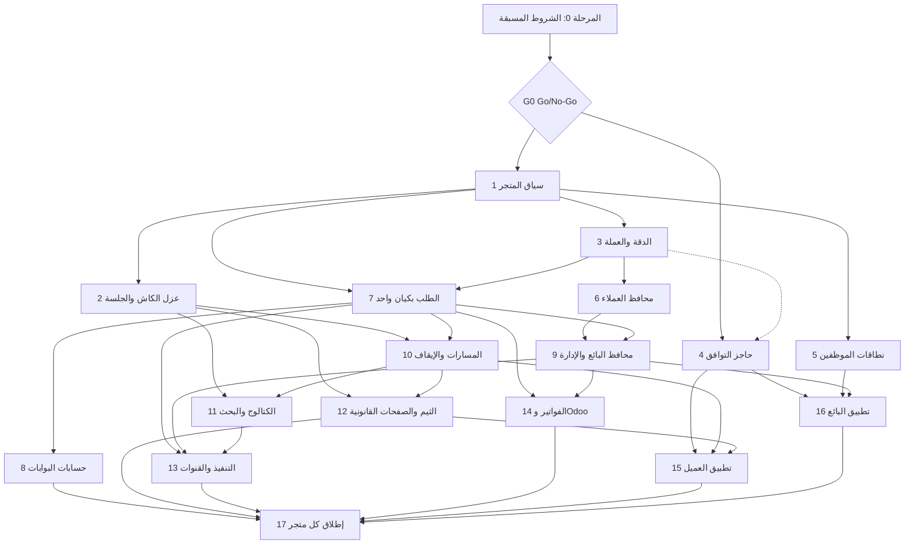

# Lavkoo GCC — Discovery-01 — التقرير 10: خارطة طريق التنفيذ بمراحل صغيرة معتمدة كلٌّ على حدة

> **المرحلة:** AUDIT (قراءة فقط) — **الجلسة:** `claude/exciting-shannon-4mh2ok` — **التاريخ:** 2026-11-12 (+03:00)
> **SHA الأساس:** `lavkoo@7f42777` · `lavkooapp@eedbbb8` · `lavkooappseller@8ea0092` · مرجع قديم `ksaapp98@79f50be`
> **يعتمد على:** [التقرير 03](./03-data-ownership-isolation-matrix.md)، [التقرير 04](./04-preserve-extend-refactor-new-matrix.md)، [التقرير 05](./05-gap-risk-register.md)، [التقرير 07](./07-migration-rollback-plan.md)، [التقرير 08](./08-web-customer-seller-impact-matrix.md)، [التقرير 09](./09-test-strategy.md)، و[E15](../evidence/E15-tests-ci-quality-gates.md) و[E21](../evidence/E21-git-lineage-legacy-prs.md) للتحقق من النسب والاختبارات
> **الحالة:** نهائي لهذه الجلسة — لا يتضمن أي تنفيذ.

> **وضع الوثيقة:** كل بند فيها **PROPOSED** للاعتماد اللاحق من المالك. لا يبدأ أي بند قبل بوابة Go/No-Go الخاصة به. لم يُنفَّذ شيء من هذه الخارطة في هذه الجلسة، ولم يُشغَّل أي اختبار أو أمر على المستودعات.

## 1. الخلاصة

- الخارطة تبدأ بـ**المرحلة 0** (شروط مسبقة بسبعة مسارات، P0-A إلى P0-G)، ثم **17 مرحلة مرقّمة** تتسلسل بالاعتماد. كل مرحلة تنتهي ببوابة Go/No-Go وتُعتمد على حدة، ولا تبدأ قبل اكتمال اعتمادياتها.
- المرحلة 0 تحجب كل شيء: المخطط الفعلي للإنتاج غير معروف ولا dump متتبَّع (R-001، [التقرير 05])، وأي commit منشور غير معروف (R-022)، وقيم العملة والإعدادات في الإنتاج غير معروفة (R-130). لا يُصمَّم أي ترحيل قبل قياسها.
- المراحل 1 إلى 3 إضافية بالكامل وتعمل خلف أعلام مطفأة: سياق المتجر والجداول المرجعية الفارغة، وعزل الكاش والجلسة، وتوحيد الدقة والعملة.
- أعلى المخاطر في المال (المحافظ والدفاتر والعملة والخانات) وفي العزل (الكتالوج ونطاقات الموظفين). لذلك تسبق المراحل المالية توصيف السلوك السعودي بالاختبارات، ويُتحقق من كل مرحلة مالية على نسخة مستعادة قبل أي تفعيل.
- النسخ المنشورة من التطبيقين لا تُكسر: كل تغيير في العقد إضافي، وكل سلوك جديد يُفعَّل بعد انتشار التطبيق الذي يحتاجه، وغياب سياق المتجر يعني السعودية.
- القرارات المحجوبة (القسم 8) يحسمها المالك قبل المراحل المرتبطة بها. أغلبها قرارات عملة وفواتير ومحافظ وحسابات بوابات.

## 2. المبادئ الحاكمة (PROPOSED)

1. **الإضافة أولاً.** لا حذف ولا إعادة تسمية ولا تضييق لنوع عمود قبل اكتمال المرحلة 17 بموافقة المالك ([التقرير 07] القسم 1، المبدأ 1).
2. **كل سلوك جديد خلف علم مطفأ.** النمط موجود في الشجرة: `lavkoo:tests/Feature/SalesChannels/EverythingStartsOffTest.php:35-47`، و`lavkoo:config/sales_channels.php:23`، و`lavkoo:config/odoo.php:28-42`، و`lavkoo:config/fulfillment.php:26-34` ([التقرير 04] القسم 3.16).
3. **السعودية بمعرّف ثابت.** غياب سياق المتجر يعني متجر السعودية المثبَّت صراحةً، لا «المتجر الافتراضي الحالي» الذي يقبل التغيير لاحقاً (GCC-19، `lavkoo:docs/gcc/DECISIONS.md:34`؛ [التقرير 08] القسم 3.2 القاعدة 1).
4. **عقود إضافية فقط.** لا يتغير معنى حقل قائم، ولا معنى رمز 401، ولا معنى `lang` الذي يُطوى فيه `sa` إلى `ar` ([التقرير 08] القسم 3.2 القواعد 2 و4).
5. **لا كتابة على الإنتاج.** الإنتاج مصدر قراءة لأغراض القياس فقط، وعلى نسخة مستعادة أولاً، وبموافقة المالك ([التقرير 07] القسم 1، المبدأ 9).
6. **فروع مستقلة لكل مسار عمل.** كل مرحلة تنتج فرعاً باسم `gcc/<workstream>` في مستودع واحد أو أكثر. لا force push ولا squash ولا rebase على `main` في `lavkoo` ([التقرير 04] القسم 3.17). الدفع إلى GitHub ليس نشراً.
7. **هوية التطبيقات مجمّدة.** لا تغيير آلي لـ applicationId أو bundle id أو مشاريع Firebase، ولا إعادة تسمية قبل قرار مكتوب ([التقرير 04] القسم 5؛ R-023 في [التقرير 05]).
8. **لا دمج تلقائياً.** كل دمج إلى `main` يحتاج بوابة المرحلة المعتمدة، ولا يُدمج فرع يحمل عمل GCC مع فرع يعدّل توقعات السعودية دون قرار.
9. **كل فرع يشغّل حزمه.** كل فرع يشغّل حزم B1 إلى B17 المعنية وبوابات G1 إلى G14 من [التقرير 09] القسم 5 بحسب ما تنص عليه مرحلته.

## 3. جدول المراحل (ملخص)

| المرحلة | الاسم | المستودع | الفرع المقترح (PROPOSED) | الاعتماديات | المعتمِد (Go/No-Go) |
|---|---|---|---|---|---|
| 0 | الشروط المسبقة P0-A إلى P0-G | `lavkoo` (اختبارات وتوثيق) وقياسات خارج المستودع | `gcc/p0-saudi-baseline`، `gcc/p0-lineage-docs` | لا شيء | المالك (G0) |
| 1 | سياق المتجر والجداول المرجعية | `lavkoo` | `gcc/core-store-context` | G0 | المالك |
| 2 | عزل الكاش والجلسة والإعدادات | `lavkoo` | `gcc/core-cache-scope` | 1 | المالك |
| 3 | الدقة والعملة والعقد الإضافي | `lavkoo` | `gcc/core-money-precision` | 1، D-05 | المالك والمسؤول المالي |
| 4 | حاجز التوافق للتطبيقات | `lavkoo` و`lavkooapp` و`lavkooappseller` | `gcc/core-contract-tests`، `gcc/mobile-customer`، `gcc/mobile-seller` | G0، P0-A، D-08 | المالك ومالك حسابات المتاجر |
| 5 | نطاقات الموظفين | `lavkoo` | `gcc/core-staff-scopes` | 1، P0-G | المالك |
| 6 | محافظ العملاء والنقاط | `lavkoo` | `gcc/core-wallet-ledger` | 1، 3، B3، D-01، D-03، D-09 | المالك والمسؤول المالي |
| 7 | الطلب بكيان واحد ولقطة الطلب | `lavkoo` | `gcc/core-checkout-entity` | 1، 3، B2، D-15 | المالك |
| 8 | حسابات البوابات لكل كيان | `lavkoo` | `gcc/core-payment-accounts` | 7، P0-G، D-10، D-17 | المالك ومسؤول التسويات |
| 9 | محافظ البائع والإدارة لكل كيان | `lavkoo` | `gcc/core-vendor-ledger-entity` | 3، 6، 7، D-13 | المالك والمسؤول المالي |
| 10 | المسارات الواعية بالمتجر والإيقاف | `lavkoo` | `gcc/web-storefront-routing` | 2، 7، B16 | المالك |
| 11 | الكتالوج والتصنيفات والقسائم والبحث | `lavkoo` | `gcc/catalog-storefront` | 2، 10، B14 | المالك |
| 12 | الثيم والصفحات القانونية والإشعارات | `lavkoo` | `gcc/theme-comms-storefront` | 2، 10، B9، B10، B17، D-12 | المالك ومستشار قانوني لكل دولة |
| 13 | حسابات التنفيذ والقنوات | `lavkoo` | `gcc/fulfillment-channel-accounts` | 7، 9، 11، P0-A، D-10، D-18، D-19 | المالك ومشغّل المزوّدين |
| 14 | الفواتير وOdoo لكل كيان | `lavkoo` | `gcc/accounting-invoice-entity` | 7، 9، D-02، D-18 | المالك والمستشار الضريبي |
| 15 | تطبيق العميل: اختيار المتجر | `lavkooapp` | `gcc/mobile-customer` | 3، 4، 10، 12، D-07، D-20، D-21، D-22 | المالك ومسؤول إصدار المتجر |
| 16 | تطبيق البائع وتعدد المتاجر | `lavkooappseller` و`lavkoo` (v3 إضافي) | `gcc/mobile-seller`، `gcc/seller-multistore` | 4، 5، 9، D-11، D-12، D-14 | المالك ومسؤول إصدار المتجر |
| 17 | إطلاق كل متجر | `lavkoo` (إعدادات الإطلاق) | `gcc/launch-<cc>` | كل ما يخص المتجر من المراحل 1 إلى 16 | المالك وحده |

## 4. المرحلة 0 — الشروط المسبقة (PROPOSED)

كل مسار من P0-A إلى P0-G مستقل ويُعتمد على حدة. لا يغيّر أي مسار منها سلوك الإنتاج. تجمعها بوابة G0 (القسم 4.8).

### 4.1 P0-A — نسب Git والـ PRs القديمة

- **الهدف:** حسم الشجرة المرجعية، وحالة PR #1 وPR #2 وPR #9 إلى PR #17 ونسبها، وتصويب ما يصف الحالة بخلاف الواقع ([التقرير 06]؛ [E21]).
- **النطاق:** تحقق للقراءة من أن commits تنفيذ PR #12 إلى PR #16 موجودة في `main` عبر PR #17، وهي `lavkoo@7efe022` و`lavkoo@32249dd` و`lavkoo@0366ba7` و`lavkoo@a907bf0` و`lavkoo@8f92f7e` و`lavkoo@cbf2cdd` (VERIFIED، [التقرير 04] القسم 3.17). ويُقابَل ذلك بنص `lavkoo:docs/gcc/DECISIONS.md:60-61` الذي يصف هذه الـPRs بالمفتوحة، وبـ`lavkoo:docs/gcc/STATUS.md:35`. ويُحدَّد commit الإنتاج عند توفره (UNKNOWN، R-022). ويُحدَّد ما يقابل تطبيق العميل في `ksaapp98` ويُنقل منه ما هو مفقود بعد الموافقة (R-086، `ksaapp98@1a34a4d`).
- **خارج النطاق:** أي دمج أو تعديل شجرة أو إعادة كتابة تاريخ. الوثيقة التاريخية لا تُعدَّل؛ تُضاف ملاحظة «الحالة بعد 2026-11-11».
- **معيار القبول:** جدول نسب موقّع يبيّن لكل merge الفرع وSHA وهل هو سلف لـ`main`، مع تصويب مكتوب لوثائق الحالة بعد الموافقة.
- **التراجع غير الهدّام:** التراجع عن ملف التوثيق فقط (revert)؛ لا أثر على الكود.
- **المعتمِد:** المالك. الوصول إلى `pharmacyksa98` شرط لإغلاق المسار، وهو UNKNOWN بسبب انعدام الوصول (missing access).

### 4.2 P0-B — خط أساس انحدار السعودية

- **الهدف:** توصيف السلوك السعودي الحالي بالاختبارات قبل أي تغيير، وفق الحزم B1 إلى B13 في [التقرير 09] القسم 2.2، مع إضافات مقترحة B14 إلى B17 لأن التقرير 09 لا يغطيها.
- **النطاق:** اختبارات توصيفية (characterization) على السلوك الحالي للحزم B2 إلى B10. وتشغيل CI كامل على HEAD المعتمد لإثبات الخضرة (B12؛ R-084؛ `lavkoo:.github/workflows/ci.yml:5-9`). وامتدادات مقترحة: B14 توصيف الكتالوج والبحث، لأن الكتالوج بلا اختبارات (`lavkoo:tests/Feature` بحسب [التقرير 09] القسم 1.3)؛ B15 توصيف تدفق Paymob بعودة المتصفح، لأنه بلا اختبارات (R-071)؛ B16 توصيف المسارات الجذرية وتحويلاتها؛ B17 توصيف الصفحات القانونية لتفعيل المحور A14 المقترح أدناه.
- **خارج النطاق:** أي تعديل لكود التطبيق. أي تعديل لتوقع سعودي موجود دون قرار مالك ([التقرير 09] القسم 2.3).
- **معيار القبول:** CI أخضر على HEAD؛ الحزم B2 إلى B10 وB14 إلى B17 مسماة مهمة CI مستقلة لا تُعدَّل توقعاتها إلا بقرار (B13)؛ لقطات golden للمبالغ والطلبات والمحافظ المرجعية السعودية مبنية على بيانات مجهولة الهوية.
- **التراجع غير الهدّام:** إلغاء فرع الاختبارات؛ لا أثر على الإنتاج.
- **المعتمِد:** المالك، ومراجع تقني للاختبارات (UNKNOWN: لم يُحدَّد الشخص).

### 4.3 P0-C — المخطط البنيوي المرجعي (B1)

- **الهدف:** إنتاج لقطة بنيوية بلا بيانات من الإنتاج تُبنى منها قاعدة الاختبار ([التقرير 07] M-01؛ R-001؛ R-121).
- **النطاق:** DDL فقط للجداول المالية والتجارية، يُخزَّن في مخزن مقيّد خارج المستودع العام. ويُطبَّق عليه كل الهجرات على MySQL 8 وMariaDB 11.4.2 (G5). وتُحسم أعداد الجداول بلا migration، إذ تقدّر E01 بـ37 و110، وتقدّر E03 بـ36 و71 (R-001).
- **خارج النطاق:** أي صف بيانات. وإدراج لقطة DDL في المستودع العام محظور بقاعدة `lavkoo:.gitignore:53` و`lavkoo:CLAUDE.md:22`.
- **معيار القبول:** اللقطة تُبنى، وكل الهجرات تُطبَّق بلا خطأ على المحركين، ويُحسم فرق الأعداد بين E01 وE03.
- **التراجع غير الهدّام:** لا يلزم؛ القراءة لا تغيّر شيئاً.
- **المعتمِد:** المالك ومشغّل الخادم، بعد قرار D-06 حول التخزين.

### 4.4 P0-D — نظافة الأسرار والمستودع العام

- **الهدف:** ألا تحتوي الملفات المتتبَّعة ولا الاختبارات ولا سجلات الإصدار على قيم سرية أو بيانات أفراد ([التقرير 09] القسم 4.2؛ R-086؛ R-107).
- **النطاق:** فحص آلي للقيم السرية في الملفات المتتبَّعة وفي سجل المستودعات الثلاثة. وتوسيع `lavkoo:scripts/ci/leak-guard.php:149-151` ليلتقط أرقام الدول الخمس الأخرى (R-107). وإن ظهرت قيمة مكشوفة يُدوِّرها المالك، ولا تُسجَّل القيمة في أي وثيقة أو سجل.
- **خارج النطاق:** تغيير مفاتيح المزوّدين أو البوابات بصورة مباشرة من هذا المسار.
- **معيار القبول:** صفر قيمة سرية في الفحص؛ وبوابة G11 تلتقط أرقام الدول الست.
- **التراجع غير الهدّام:** يقتصر التراجع على إزالة قاعدة الفحص الجديدة، ولا يعيد أي قيمة سرية إلى المستودع.
- **المعتمِد:** المالك.

### 4.5 P0-E — قياسات الإنتاج والبيئات

- **الهدف:** قياس كل القيم UNKNOWN التي يعتمد عليها التصميم ([التقرير 07] القسم 5، M-01 إلى M-16).
- **النطاق:** قياسات على نسخة مستعادة، أو قراءة من الإنتاج بموافقة المالك فقط، بلا قيم سرية ولا بيانات أفراد؛ وتُقاس الحقول الحساسة بالوجود والطول فقط. يشمل ذلك `currency_model` والعملة الافتراضية و`decimal_point_settings` و`unified_address_mode` و`app.mode` (R-130)، وحالة بوابات الدفع المضافة على الخادم (R-002)، وحالة مزوّدي التنفيذ والقنوات (M-11)، وأحجام الجداول المالية ومحركها وإصداره (M-05). وتحديد بيئة staging وبيئة إعادة الإنتاج (D-07؛ E15-F11، staging غير موجودة).
- **خارج النطاق:** أي كتابة على الإنتاج.
- **معيار القبول:** كل بند M-01 إلى M-16 مسجَّل بالقيمة أو العدد، مع تاريخ القياس وطريقته، ومحفوظ في المخزن المقيّد.
- **التراجع غير الهدّام:** لا يلزم.
- **المعتمِد:** المالك، ومسؤول مالي لقياسات الأرصدة (M-06، M-08، M-09).

### 4.6 P0-F — القرارات المحجوبة

- **الهدف:** حسم القرارات D-01 إلى D-22 في القسم 8 التي تحجب مرحلة أو أكثر.
- **النطاق:** نص قرار مكتوب لكل قرار حاجب. الأرقام المؤقتة تُثبَّت في [التقرير 11] (قيد الإعداد).
- **معيار القبول:** لكل قرار حاجب نص قرار موقّع بتاريخه.
- **التراجع غير الهدّام:** القرار قابل للتعديل بقرار لاحق، وتبقى المراحل المرتبطة مجمّدة لا منفَّذة.
- **المعتمِد:** المالك.

### 4.7 P0-G — معالجة البنود الأمنية المقيّدة

- **الهدف:** إغلاق البنود الأمنية المقيّدة قبل أي عمل على GCC-13 وGCC-14 والمسارات المرتبطة بهما ([التقرير 05] القسم 4).
- **النطاق:** تُعالج البنود في مسار مستقل ومعتمد، وتفاصيلها في الملحق المقيّد غير المنشور؛ ولا يصفها هذا التقرير. تُتتبَّع بالمعرّفات فقط ضمن 222 معرّفاً في القسم 4 من [التقرير 05]، ومنها مجموعات SEC-E04 وSEC-E05 وSEC-E14 وSEC-E10 وSEC-E11 وغيرها بحسب الجدول.
- **معيار القبول:** إغلاق البنود المعلنة بدرجة P0 في [التقرير 05] (SEC-E04-…، وSEC-E05-01 إلى SEC-E05-03، وSEC-E14-01 إلى SEC-E14-14) بتوقيع المالك، مع اختبارات منع انحدار على المسارات المعنية (G6).
- **التراجع:** لا يُتراجع عن إصلاح أمني إلا بقرار مكتوب من المالك.
- **المعتمِد:** المالك وحده، بعد مراجعة الملحق المقيّد.

### 4.8 بوابة G0 — الدخول إلى المرحلة 1

- **الشروط:** P0-A وP0-B وP0-C وP0-D وP0-E وP0-F مكتملة. وCI أخضر على HEAD (B12). وP0-G لا يُشترط قبل المرحلة 1، بل قبل المرحلة 5 والمراحل اللاحقة المرتبطة بها.
- **المعتمِد:** المالك.

## 5. المراحل 1 إلى 17 (PROPOSED)

مرجع المحاور: A1 إلى A13 من [التقرير 09] القسم 3؛ وA14 مقترح لصفحات كل متجر القانونية لأن [التقرير 09] (قسم الحدود، بند «قرارات بلا محور») ذكر غيابه؛ وG1 إلى G14 من القسم 5 في التقرير نفسه. وكل خلية «اختبارات القبول» تشير إلى المحور أو البوابة المقابلة.

### المرحلة 1 — سياق المتجر والجداول المرجعية (PROPOSED)

| البند | التفاصيل |
|---|---|
| الهدف | إدخال كائن `StoreContext` واحد يُحلّ مرة لكل طلب أو وظيفة أو أمر، وجداول مرجعية `countries` و`legal_entities` و`storefronts` تحتوي صف السعودية فقط، دون تغيير سلوكي ([التقرير 04] القسم 4، P1 وP2؛ [التقرير 03] القسم 4.2 البنود 1–3). |
| النطاق | مصادر الحل: بادئة الويب، وترويسة API اختيارية غائبها السعودية، وسياق الوظيفة. هجرات expand-only للجداول المرجعية الثلاثة. معرّف السعودية ثابت في الإعداد. ربط الحل بنقاط الدخول (`lavkoo:app/Providers/AppServiceProvider.php:196-225` وهو مكان بناء `web_config` عند الإقلاع اليوم). |
| خارج النطاق | أي تغيير في المسارات أو الاستجابات. تعبئة الأعمدة القديمة. تفعيل أي سوق غير السعودية. |
| المستودع والفرع | `lavkoo` — `gcc/core-store-context` |
| الاعتماديات | G0. مخطط بنيوي (P0-C) لاختبار الهجرة. |
| اختبارات القبول | B1 (بناء المخطط من اللقطة وتشغيل الهجرة على MySQL 8 وMariaDB 11.4.2)؛ A12 (B2 إلى B10 بلا تغيير)؛ A1 البند 8 (طلب بلا سوق صريح يُحلّ إلى السعودية) على مستوى الحل؛ اختبار ساكن يثبت أن كل نقطة دخول تستدعي الحل (على غرار A1 البند 9)؛ G4 وG5. |
| التراجع غير الهدّام | تعطيل العلم `gcc_store_context`. الجداول تبقى فارغة. الحذف لاحقاً يحتاج قرار المالك وأن تكون الجداول فارغة تماماً ([التقرير 07] القسم 4، المرحلة 1). |
| بوابة Go/No-Go | المعتمِد: المالك. المعيار: B1 وA12 أخضران على HEAD، وفرق الاستجابات السعودية صفر مقابل لقطة B7. |

### المرحلة 2 — عزل الكاش والجلسة والإعدادات بالسوق (PROPOSED)

| البند | التفاصيل |
|---|---|
| الهدف | كل مفتاح كاش وجلسة ومفتاح إعداد مخصّص يحمل بُعد السوق، وإبطال الكاش يصبح موجَّهاً بدل الإفراغ الشامل (R-025، R-083، R-082؛ [التقرير 04] القسم 3.1). |
| النطاق | باني مفاتيح مركزي يضيف السوق، والمفاتيح الحالية تبقى كما هي للسعودية. فضاء أسماء للجلسة (`lavkoo:config/session.php:143`). طبقة تخصيص للإعدادات (P3) فوق `lavkoo:app/Utils/settings.php:26-30`. استبدال مواضع الإفراغ الشامل (17 موضعاً، `lavkoo:app/Traits/CacheManagerTrait.php:153-192`، و`lavkoo:app/Services/Platform/Policy.php:119`، و`lavkoo:app/Http/Controllers/Admin/Marketplace/ExchangeRateController.php:50`) بإبطال موجَّه بعد قياس أثر كل موضع. |
| خارج النطاق | تغيير قيم الإعدادات العامة. تبديل `currency_model`. تغيير المسارات. |
| المستودع والفرع | `lavkoo` — `gcc/core-cache-scope` |
| الاعتماديات | المرحلة 1. |
| اختبارات القبول | A1 البندان 4 و5 (المفتاح نفسه في سوقين يعيد محتوى كل سوق؛ تفريغ سوق لا يفرّغ آخر). A12. اختبار بمخزن كاش حقيقي، لأن `CACHE_DRIVER=array` في `lavkoo:phpunit.xml:25-29` يخفي هذه الفئة من الأخطاء ([التقرير 09] القسم 1.4). فاحص ساكن يمنع الإفراغ الشامل خارج أوامر الصيانة (G6). |
| التراجع غير الهدّام | العلم `gcc_cache_scope` يعيد المفاتيح القديمة. الكاش لا يحمل مصدر بيانات، فالتراجع يفرّغ فقط ولا يفقد شيئاً. |
| بوابة Go/No-Go | المعتمِد: المالك. المعيار: صفر إفراغ شامل من مسارات الطلب والدفع، وA12 أخضر. |

### المرحلة 3 — الدقة والعملة والعقد الإضافي (PROPOSED)

| البند | التفاصيل |
|---|---|
| الهدف | منسِّق مبالغ واحد يأخذ العملة وعدد الخانات صراحةً (KWD وBHD وOMR بثلاث خانات)، وتوسيع دقة الأعمدة الضيقة بالتوسّع فقط، وحقلان إضافيان `currency_code` و`decimal_places` في الاستجابات المالية، دون تغيير مبالغ السعودية (R-003، R-012، R-013، R-014، R-036). |
| النطاق | دوال تقريب موحّدة بدل `round(…,2)` المتفرقة (193 موضعاً، [التقرير 05] R-036). عمود عملة وخانات للسجلات الجديدة فقط. توسيع `myfatoorah_*` في `lavkoo:app/Services/MyFatoorah/PaymentInitiationService.php:72` و`provider_fulfillments` بعد قياس أكبر القيم (M-05). حقول إضافية في `lavkoo:app/Http/Controllers/RestAPI/v1/ConfigController.php` وفي استجابات المال (كتعديل إضافي فقط، [التقرير 08] القسم 4 البند 1). |
| خارج النطاق | تحويل `float` و`double` إلى `decimal` (يحتاج قياس فروق مستقلاً، [التقرير 07] القسم 2 المرحلة 1). أي تحويل صرف آلي. تغيير صيغة العرض في التطبيقين (المرحلتان 15 و16). |
| المستودع والفرع | `lavkoo` — `gcc/core-money-precision` |
| الاعتماديات | المرحلة 1. D-05 (قاعدة التقريب وعرض السعودية بصفر خانات). D-16 (تعطيل مسارات FX التلقائي في الويب والدفع). M-03 وM-04 وM-05. |
| اختبارات القبول | A5 كاملاً: ذهاب-إياب لكل عملة (SAR/2، AED/2، QAR/2، KWD/3، BHD/3، OMR/3)، وإرسال المبالغ للبوابة بالوحدة الصغرى حسب أُسّ العملة بدل الضرب الثابت (`lavkoo:app/Http/Controllers/Payment_Methods/PaymobController.php:108`)، وصفر تحويل آلي في الكتالوج والـ checkout، وسعر سوق لا يُشتق من آخر. A13 البند 2 (الإضافة لا تكسر golden). B6 golden. G7. |
| التراجع غير الهدّام | الحقول الإضافية تبقى ولا تُحذف، والعلم يعيد السلوك القديم. توسيع الدقة لا يُعكس بالتضييق أبداً، لأن التضييق هدّام، ويُستبعد. |
| بوابة Go/No-Go | المعتمِد: المالك والمسؤول المالي (UNKNOWN: لم يُحدَّد الشخص). المعيار: قرار D-05 مكتوب، وB6 أخضر، وصفر فرق في لقطات SAR. |

### المرحلة 4 — حاجز التوافق للتطبيقات (PROPOSED)

| البند | التفاصيل |
|---|---|
| الهدف | تثبيت عقود النسخ المنشورة وفحصها آلياً قبل أي تغيير في الاستجابات أو التطبيقات. محلّلات تتسامح مع الحقول الجديدة والـ null في الحقول المالية (R-078، R-024؛ [التقرير 09] A13). |
| النطاق | `lavkoo`: لقطة سطح متتبَّعة ومقارنتها في CI بـ`api:snapshot` بعد توفر جدوله (E15 القسم 2.10؛ [التقرير 09] A13). `lavkooapp`: نقل اختبارات ksaapp98 الستة وCI بعد حسم النسب (P0-A؛ R-086). `lavkooappseller`: توليد golden مشترك من اختبارات الخلفية، والإبقاء على 14 ملف عقد الموجودة (`lavkooappseller:test`، [التقرير 09] القسم 1.5). |
| خارج النطاق | أي تغيير وظيفي. تغيير `X-App-Version` أو بوابة الإصدار (D-20). |
| المستودعات والفروع | `lavkoo` — `gcc/core-contract-tests`؛ `lavkooapp` — `gcc/mobile-customer` (حاجز اختبارات فقط)؛ `lavkooappseller` — `gcc/mobile-seller` (golden فقط). |
| الاعتماديات | G0. P0-A لنقل اختبارات ksaapp98. P0-B للحزمة B7. المرحلة 3 لحقول العملة (لاختبار التحمّل). D-08 للإصدارات المنشورة. |
| اختبارات القبول | A13 كاملاً (المطابقة البنيوية، وغياب الحقول الجديدة يبقي السعودية، وتحليل النسخ المثبتة لاستجابات الخادم الجديد). B7. B11 جزئياً (CI تطبيق العميل). G8، G9، G10. |
| التراجع غير الهدّام | حذف الفروع أو الاختبارات الجديدة لا يمس الإنتاج، لأن المرحلة لا تغيّر سلوكاً. |
| بوابة Go/No-Go | المعتمِد: المالك ومالك حسابات المتاجر (UNKNOWN: يُحسم بالوصول إلى Play Console وApp Store Connect). المعيار: golden أخضر لكل النسخ المثبتة المعروفة. |

### المرحلة 5 — نطاقات الموظفين (PROPOSED)

| البند | التفاصيل |
|---|---|
| الهدف | تطبيق GCC-14: نطاق بيانات وإجراء فوق صلاحيات الوحدات القائمة دون تغيير شكلها ([التقرير 04] القسم 3.11، P10؛ R-005، R-020، R-053). |
| النطاق | جدول `staff_scopes` مرتبط بالمتجر أو الكيان. وسيط نطاق مجاور لـ`lavkoo:app/Http/Middleware/ModulePermissionMiddleware.php:20-31`. تصفية قوائم العملاء والتصدير والمحافظ والتقارير والتدقيق بالنطاق (`lavkoo:app/Repositories/CustomerRepository.php:185-209`). ختم النطاق على `audit_logs`. وضع `shadow` أولاً يسجّل الرفض دون منعه، ثم `enforce`. |
| خارج النطاق | حذف `admin_roles.module_access` (بيانات إنتاج قائمة). تعديل أدوار البائعين. معالجة البنود الأمنية (تتبع P0-G). واجهة الموظف متعدد المتاجر (تُفتح في المرحلة 17 فقط). |
| المستودع والفرع | `lavkoo` — `gcc/core-staff-scopes` |
| الاعتماديات | المرحلة 1. P0-G إغلاق بنود الصلاحيات المعلنة بدرجة P0. P0-B للحزمة B8. |
| اختبارات القبول | A4 كاملاً: صفر مسار إداري بلا وحدة أو استثناء موثّق؛ صفر تصدير خارج النطاق؛ الحقول الحساسة مخفاة للأدوار المقيّدة؛ شكل الرفض موحّد. B8. G6. A1 البند 7 (موظف بنطاق واحد لا يرى بيانات سوق آخر). |
| التراجع غير الهدّام | العلم `gcc_staff_scope_mode` بقيم `off` و`shadow` و`enforce`. الرجوع إلى `off` لا يحذف الجدول. التراجع عن `enforce` لا يفقد بيانات. |
| بوابة Go/No-Go | المعتمِد: المالك. المعيار: مصفوفة الصلاحيات موقّعة، ووضع `shadow` بلا فروق غير مفسَّرة خلال دورة مراجعة يحددها المالك. |

### المرحلة 6 — محافظ العملاء والنقاط (PROPOSED)

| البند | التفاصيل |
|---|---|
| الهدف | كاتب موحّد للمحفظة والولاء، ورصيد لكل (عميل × كيان × عملة) في `customer_balance_accounts`، مع إبقاء `users.wallet_balance` و`users.loyalty_point` إسقاطاً لرصيد السعودية ([التقرير 07] القسم 2 المراحل 3 إلى 5؛ R-008، R-009، R-039). |
| النطاق | توصيف كل الكتّاب (أربعة للمحفظة واثنان للولاء، `lavkoo:app/Utils/CustomerManager.php:36-91`، و`lavkoo:app/Traits/CustomerTrait.php:42-92`). كاتب موحّد داخل معاملة الطلب، ومفتاح تكرار على الحركة، وقفل صف. وضع `shadow` مع مقارنة ليلية. بناء الحسابات المشتقة من الدفتر (`lavkoo:app/Utils/CustomerManager.php:74-77`). |
| خارج النطاق | حذف الأعمدة القديمة. أي حساب بين كيانين (محظور). تحويل النقاط بين الدول (GCC-15 مطفأ). معالجة سعر التحويل التاريخي (UNKNOWN، لا يحفظه الكود، [التقرير 07] M-14). |
| المستودع والفرع | `lavkoo` — `gcc/core-wallet-ledger` |
| الاعتماديات | P0-B للحزمة B3 (شرط دخول صريح، [التقرير 09] القسم 2.3). المرحلتان 1 و3. D-01 (وحدة التخزين، Q-01)، وD-03 (قواعد النقاط، Q-07)، وD-09 (الإحالة والمحفظة لكل متجر). M-06. |
| اختبارات القبول | A3 كاملاً: كل نوع حركة يحدّث الرصيد والدفتر معاً؛ مجموع الدفتر يساوي الرصيد قبل الهجرة وبعدها؛ لا رصيد سالب تحت التزامن؛ لا شحن مكرر لإشعار واحد؛ صفر حركة بين كيانين. B3. A1 البند 3. Concurrency على MySQL، ومطابقة [التقرير 07] القسم 3.1 و3.2 بصفر فرق غير مفسَّر. |
| التراجع غير الهدّام | إعادة `gcc_ledger_writer_mode` و`balance_read_source` إلى `legacy` ([التقرير 07] القسم 4). الحسابات المشتقة تُفرَّغ دون فقد لأنها مشتقة. الجزء غير القابل للعكس: حركات الظل المكتوبة تبقى وتُستبعد من المطابقة. |
| بوابة Go/No-Go | المعتمِد: المالك والمسؤول المالي. المعيار: صفر فرق غير مفسَّر على لقطة الإنتاج المستعادة (M-06)، وتوقيع المالك للفروق المفسَّرة. |

### المرحلة 7 — الطلب بكيان واحد ولقطة الطلب (PROPOSED)

| البند | التفاصيل |
|---|---|
| الهدف | الطلب = كيان واحد = عملة واحدة. رفض السلة المختلطة الكيان قبل إنشاء `payment_requests`. لقطة الكيان والعملة وعدد الخانات على الطلب الجديد فقط ([التقرير 03] القسم 4.2 البنود 7 و8؛ GCC-19؛ R-007). |
| النطاق | حارس الكيان في `lavkoo:app/Utils/OrderManager.php:887-902` ومسار الدفع (`lavkoo:app/Http/Controllers/Customer/PaymentController.php:379-383`). أعمدة لقطة nullable على `orders` و`order_details` (`lavkoo:app/Models/Order.php:75-133`). لقطة الطلب داخل `lavkoo:app/Utils/OrderManager.php:1059-1108`. مفتاح idempotency لكل محاولة دفع (P9، [التقرير 04] القسم 3.4). الإبقاء على تقسيم البائعين داخل الكيان الواحد (القرار المعتمد، `lavkoo:docs/gcc/DECISIONS.md:38`). |
| خارج النطاق | تعبئة لقطات الطلبات السعودية القديمة قبل المطابقة. تغيير `orders.id`. الفوترة (المرحلة 14). |
| المستودع والفرع | `lavkoo` — `gcc/core-checkout-entity` |
| الاعتماديات | المرحلتان 1 و3. P0-B للحزمة B2 (B2 جزئية اليوم، [التقرير 09] القسم 2.2). D-15 (ترويسة مفتاح إنشاء الطلب). M-07. |
| اختبارات القبول | A2 كاملاً: سلة بعنصر سعودي وآخر إماراتي تُرفض قبل الدفع؛ طلب متعدد البائعين القديم يبقى مقروءاً بالمبالغ والتقسيم نفسهما؛ استجابة الدفع لا تُقبل إن لم تطابق كيان الطلب؛ حارس COD لكل مجموعة (`lavkoo:tests/Feature/Fulfillment/StatusAndCheckoutGuardsTest.php:144`)؛ إنقاص المخزون مرة واحدة لكل مجموعة. B2. A12. Concurrency على خصم المخزون. G7. |
| التراجع غير الهدّام | العلم `gcc_checkout_entity_guard` يعيد السلوك القديم. الأعمدة اللقطة تبقى nullable. الجزء غير القابل للعكس: الطلبات التي حملت لقطة الكيان. |
| بوابة Go/No-Go | المعتمِد: المالك. المعيار: B2 لطلبات السعودية مطابق بنسبة 100%، وسلة مختلطة تُرفض قبل إنشاء أي `payment_request`. |

### المرحلة 8 — حسابات البوابات لكل كيان (PROPOSED)

| البند | التفاصيل |
|---|---|
| الهدف | حساب بوابة لكل كيان ومتجر، مع الإبقاء على Paymob وMyFatoorah (`lavkoo:docs/gcc/DECISIONS.md:15`)، وتثبيت الحساب على كل محاولة، وبقاء الصف الحالي حساب السعودية (R-015، R-016، R-002). |
| النطاق | جدول `payment_gateway_accounts` مرتبط بالكيان. أعمدة نسبة على `payment_requests` وجداول MyFatoorah (`lavkoo:database/migrations/2026_11_08_100001_create_myfatoorah_payment_attempts_table.php:37-65`). اختيار السرّ من حساب المحاولة لا من إعداد عام. تحويل الإعداد من صف واحد لكل `key_name` إلى حساب مرتبط بالكيان، وفق `lavkoo:app/Http/Controllers/Admin/ThirdParty/PaymentMethodController.php:181-189`. توثيق Paymob بالتوصيف (B15) قبل أي تعديل. تقييم Tabby وTamara وثيقةً فقط. |
| خارج النطاق | إضافة Tabby أو Tamara كتكامل (القدرات لكل بلد UNKNOWN، `lavkoo:docs/gcc/DECISIONS.md:15`). إشعار خادم-إلى-خادم لـPaymob، وهو قرار منفصل بعد التوصيف (R-071). تغيير عناوين العودة، وهي ثابتة ([التقرير 05] R-116). |
| المستودع والفرع | `lavkoo` — `gcc/core-payment-accounts` |
| الاعتماديات | المرحلة 7. P0-G للبنود المرتبطة بعودة البوابات والـ webhooks. P0-E لمفاتيح البيئة (M-13) وحالة Gateways على الخادم (D-17، R-002). D-10 (هوية الحساب بالكيان). |
| اختبارات القبول | A2 البندان 3 و4 (كل `payment_request` مرتبط بكيان واحد، واستجابة الدفع لا تُقبل إن لم تطابق كيان الطلب). A8 البند 3 (كل جزء يعود لمصدره) جزئياً. B15 وB-payments (MyFatoorah golden). A12. G4. اختبار webhook بتوقيع اختباري بمفتاح في الاختبار فقط ([التقرير 09] القسم 4.2). |
| التراجع غير الهدّام | الصف الحالي يبقى حساب السعودية. العلم `gcc_payment_accounts` يوقف الحساب الجديد. المحاولات المنشأة تبقى مرتبطة بحسابها. |
| بوابة Go/No-Go | المعتمِد: المالك ومسؤول التسويات (UNKNOWN). المعيار: صفر دفعة بحساب كيان مختلف عن كيان الطلب، ونجاح توصيف Paymob وMyFatoorah. |

### المرحلة 9 — محافظ البائع والإدارة لكل كيان (PROPOSED)

| البند | التفاصيل |
|---|---|
| الهدف | مفتاح الرصيد والتسوية (بائع، كيان، عملة)، ومحفظة إدارة لكل كيان، وتسوية بعملة واحدة وكيان واحد، ومصدر سحب واحد لكل كيان (R-010، R-043، R-044؛ [التقرير 07] القسم 3.4). |
| النطاق | أعمدة كيان وعملة على `admin_wallets` (`lavkoo:app/Models/AdminWallet.php:39-47`) و`seller_wallets` (`lavkoo:app/Models/SellerWallet.php:28-52`) و`vendor_ledger_entries` للقيود الجديدة فقط. لقطة افتتاحية موقّعة للعدّادات السعودية. تسوية تُحصر بعملة وكيان واحدين (`lavkoo:app/Services/Marketplace/SettlementEngine.php:102`). توجيه الطلبات الجديدة للكيانات الجديدة بعيداً عن صف `admin_id = 1` (MIG-04). |
| خارج النطاق | إعادة كتابة العدّادات التاريخية. أي تحويل بين الكيانات. حذف `withdraw_requests` القديم (يبقى مجمّداً). |
| المستودع والفرع | `lavkoo` — `gcc/core-vendor-ledger-entity` |
| الاعتماديات | المراحل 1 و3 و6 (نمط الكتابة) و7 (لقطة الكيان). D-13 (مصدر السحب). M-08 وM-09. |
| اختبارات القبول | A3 لمسار البائع والإدارة (لا حركة بين كيانين، ومطابقة العدّادات بصفر فرق غير مفسَّر). A4 البند 2 (كل مسار بائع له حارس وعزل). B5 جزئياً (الاسترداد يطابق المحفظة والمخزون والعمولة). A12. |
| التراجع غير الهدّام | العلم يعيد الصف القديم. اللقطة الافتتاحية تبقى. لا حذف. |
| بوابة Go/No-Go | المعتمِد: المالك والمسؤول المالي. المعيار: توقيع اللقطة الافتتاحية، وصفر تسوية مختلطة العملة. |

### المرحلة 10 — المسارات الواعية بالمتجر والإيقاف (PROPOSED)

| البند | التفاصيل |
|---|---|
| الهدف | مسارات `/sa …/om` مع تحويلات 301 من المسارات الجذرية، وحالة متجر مستقلة عن صيانة المنصة (active وbrowse_only وmaintenance وredirect)، واستثناءات ما بعد البيع (GCC-12؛ R-057، R-004). |
| النطاق | مجموعة مسارات بادئة `{store}` بقيمة افتراضية، والمسارات الجذرية تبقى تحويلات (`lavkoo:routes/web/routes.php:162-357` مع 3735 استدعاء `route(`، [التقرير 04] القسم 3.12). استخدام `ApplySeoRedirects` لخطة 301 (`lavkoo:app/Http/Middleware/ApplySeoRedirects.php:32-56`). حالة متجر في قاعدة البيانات، مع إبقاء `lavkoo:app/Traits/MaintenanceModeTrait.php:14` لصيانة المنصة. حجب إنشاء السلة والطلب لا القراءة، مع استثناءات للدفع والـ webhooks والطلبات السابقة والاسترجاع والدعم، ورمز خطأ آلي للحالة. |
| خارج النطاق | تغيير `api/v1` الحالية. تغيير `/go/{code}` وروابط الرجوع (تبقى دائماً). تفعيل سوق. |
| المستودع والفرع | `lavkoo` — `gcc/web-storefront-routing` |
| الاعتماديات | المرحلتان 2 و7. P0-B للحزمة B16. |
| اختبارات القبول | A11 كاملاً، البنود 1 إلى 10. A1 البند 8. اختبارات التحويل 301 لكل مسار جذري منشور، و`/go/{code}` دائماً. A12. G4. |
| التراجع غير الهدّام | تعود حالة المتجر إلى `active`. التحويلات الجذرية تبقى. هذه المرحلة أعلى خطر كسر في الويب ([التقرير 08] القسم 4 البند 9)، لذلك تُطلق في وضع مراقبة أولاً. |
| بوابة Go/No-Go | المعتمِد: المالك ومن يملك الفهرسة وSEO (UNKNOWN). المعيار: صفر مسار جذري بلا تحويل، وصفر تغيير في الاستجابات السعودية. |

### المرحلة 11 — الكتالوج والتصنيفات والقسائم والبحث (PROPOSED)

| البند | التفاصيل |
|---|---|
| الهدف | كتالوج مستقل لكل متجر، وشجرة تصنيفات مركزية مع جدول ظهور لكل متجر (GCC-08)، وقسائم بقواعد محلية (GCC-17)، وفهرس بحث مرشَّح بالمتجر قبل السقف (R-006، R-033، R-054، R-064، R-065). |
| النطاق | `storefront_id` nullable على `products` و`carts` و`coupons` و`flash_deals` و`shipping_methods` و`theme_versions` ([التقرير 03] القسم 4.2 البند 6)، مع تعبئة سعودية عبر دفعات قابلة للعكس ([التقرير 07] القسم 2 المرحلة 2). مفاتيح تفرّد مركّبة بعد فحص التكرار في الإنتاج (`lavkoo:app/Http/Requests/ProductAddRequest.php:49-52`). ترشيح `lavkoo:app/Services/Search/ProductSearchService.php:32` بالمتجر قبل السقف. جرد مسارات القراءة (85 موضعاً مباشراً و20 ملحقاً، `lavkoo:app/Models/Product.php:208-249`) قبل إدخال أي صف لغير السعودية. |
| خارج النطاق | نسخ المنتجات بين الدول (إجراء إداري لاحق بقرار منفصل). الشحن. الثيم. |
| المستودع والفرع | `lavkoo` — `gcc/catalog-storefront` |
| الاعتماديات | المراحل 1 و2 و10. P0-B للحزمة B14. M-10 (قيم `products.shop_id`). |
| اختبارات القبول | A1 البندان 1 و2 (كتالوج وأسعار ومخزون، وSKU وslug دون تصادم). A5 البند 3 (منتج بلا سعر في سوق لا يُباع فيه). اختبار بحث لكل متجر بسقف 500 بعد الترشيح. A12. G6. |
| التراجع غير الهدّام | العلم `gcc_catalog_storefront`. الأعمدة nullable. التعبئة تُعكس بالدفعات المسجَّلة. الجزء غير القابل للعكس: علامات عُدّلت يدوياً بعد التعبئة، وتُسجَّل. |
| بوابة Go/No-Go | المعتمِد: المالك. المعيار: توصيف الكتالوج السعودي مطابق للقطة B14، وصفر منتج بلا علامة متجر بعد التعبئة. |

### المرحلة 12 — الثيم والصفحات القانونية والإشعارات لكل متجر (PROPOSED)

| البند | التفاصيل |
|---|---|
| الهدف | ثيم لكل متجر من مكتبة مشتركة (GCC-07، GCC-09)، وشعار واسم لكل متجر فوق الهوية المشتركة (GCC-10)، وصفحات قانونية معتمدة لكل متجر قبل البيع (GCC-11)، وحملات مركزية تختار أسواقها (GCC-17)، وtopics ومرسلين لكل متجر (R-055، R-056، R-058، R-074، R-091، R-093). |
| النطاق | `active` لكل متجر بدل الحصرية العالمية (`lavkoo:app/Services/Theme/ThemeManager.php:83-86`). نسخ صفوف البانر مع الثيم بدل الربط المشترك (`lavkoo:app/Services/Theme/ThemeBannerLink.php:140-176`). حملات بنطاق أسواق (`lavkoo:app/Services/Commerce/CampaignResolver.php:43-47`). إصدارات `business_pages` لكل (متجر، نوع، لغة) بحالات draft وapproved وpublished (`lavkoo:database/migrations/2025_03_08_201607_create_business_pages_table.php:14-23`)، والصف الحالي يصبح إصدار السعودية المنشور ([التقرير 08] القسم 4 البند 7). topics بلاحقة السوق بجانب القديمة (`lavkoo:app/Traits/PushNotificationTrait.php:449`). عناوين مرسل لكل متجر مع طبقة override تسقط إلى العام (`lavkoo:app/Traits/EmailTemplateTrait.php:36`). بوابة جاهزية تمنع تفعيل البيع بلا صفحات معتمدة. |
| خارج النطاق | الحكم القانوني على المحتوى (خارج نطاق التدقيق). الموافقات التسويقية (D-25 المؤجَّل إلى التقرير 11). تغيير أسماء topics القائمة. |
| المستودع والفرع | `lavkoo` — `gcc/theme-comms-storefront` |
| الاعتماديات | المرحلتان 2 و10. P0-B للحزمتين B9 وB10 وB17. اعتماد قانوني لكل متجر (خارج التدقيق، UNKNOWN). D-12 (نطاق الثيم للبائع). |
| اختبارات القبول | A6 كاملاً، بما فيه مسودة سوق لا تغيّر منشور سوق آخر، ولا تحديث صف بانر مشترك عبر النسخ. A10 كاملاً. A14 (مقترح): كل متجر يملك صفحات قانونية معتمدة قبل تفعيل البيع. B9. B10. A12. |
| التراجع غير الهدّام | الحصرية العالمية تعود بعلم. الصفحات القديمة تبقى منشورة. topics الجديدة لا يشترك فيها أحد من النسخ القديمة فلا أثر لها. الجزء غير القابل للعكس: نسخ الثيم المنشورة لمتجر. |
| بوابة Go/No-Go | المعتمِد: المالك ومستشار قانوني لكل دولة (خارج التدقيق). المعيار: صفحات قانونية معتمدة لكل متجر، وB9 وB10 خضراوان. |

### المرحلة 13 — حسابات التنفيذ والقنوات (PROPOSED)

| البند | التفاصيل |
|---|---|
| الهدف | حساب تنفيذ لكل كيان أو دولة، ومصدر تنفيذ واحد لكل منتج لكل متجر دون بديل تلقائي (Approved)، وعملة الشحنة من الحساب أو الطلب، وحسابات قنوات مربوطة بالكيان والسوق، وAmazon لكل سوق (R-049، R-050، R-047، R-070، R-046). |
| النطاق | `fulfillment_accounts` مع توسيع مفاتيح `provider_*` ليتضمن الحساب ([التقرير 07] القسم 2 المرحلة 7). `ProviderConnectionManager` (`lavkoo:app/Services/Fulfillment/ProviderConnectionManager.php:71-89`) يعمل بالحساب. عملة الشحنة بدل `FULFILLMENT_CURRENCY` (`lavkoo:app/Services/Fulfillment/FulfillmentRouter.php:153`). خدمة أهلية المنتج للشحن العابر للحدود، تُستدعى من `lavkoo:app/Services/Fulfillment/OrderEligibility.php:30-57` ومن الحراسة، وتعتمد قواعد `RegulatedProductGate` بوصفها سابقة للنمط فقط (`lavkoo:app/Services/SalesChannels/Listings/RegulatedProductGate.php:26-55`). أعمدة كيان وسوق على `sales_channel_accounts` وتعديل قيده الفريد. مفتاح السوق في إدراج Amazon (`lavkoo:app/Services/SalesChannels/Amazon/AmazonConnector.php:220-235`). استبعاد الصف الحامل لـOdoo من أوامر القنوات (R-046). |
| خارج النطاق | تفعيل أي مزوّد أو قناة خليجية. حذف Delivery Syria (قرار D-19). أي تغيير في `ChannelHttp` وأسوار الإرسال. |
| المستودع والفرع | `lavkoo` — `gcc/fulfillment-channel-accounts` |
| الاعتماديات | المراحل 7 و9 و11. P0-A (حالة PR #12 إلى PR #16 الدمج). M-11. D-10 و D-18 و D-19. |
| اختبارات القبول | A7 كاملاً: الآليات الثلاث بلا بديل تلقائي، ولقطة كل سطر ثابتة بعد إعادة التعيين، وحدود الحجز. A9 كاملاً: الأهلية لكل خلية قبل إنشاء أي `payment_request`، وصفر طلب إلى شركة شحن لطلب مرفوض. A1 البندان 1 و6 (المخزون والمجمّعات والوظائف بسياق السوق). A12. الحزم الحالية لـ SalesChannels عبر G3. |
| التراجع غير الهدّام | `FULFILLMENT_INTEGRATIONS_ENABLED` و`SALES_CHANNELS_ENABLED` تبقيان مطفأتين كما في `lavkoo:config/fulfillment.php:26-34` و`lavkoo:config/sales_channels.php:23`. الحسابات الجديدة تُعطَّل. الشحنات المفتوحة تُفرَّغ أو تُفسَّر قبل أي قطع ([التقرير 07] القسم 3.5). |
| بوابة Go/No-Go | المعتمِد: المالك ومشغّل المزوّدين (UNKNOWN). المعيار: صفر حالة fallback في المصفوفة، والشحنات المفتوحة مفسَّرة، والأهلية مكتوبة لكل خلية. |

### المرحلة 14 — الفواتير وOdoo لكل كيان (PROPOSED)

| البند | التفاصيل |
|---|---|
| الهدف | فاتورة بلقطة كيان وضريبة وعملة وتسلسل لكل كيان. الفاتورة السعودية التاريخية تبقى برقم الطلب. Odoo اتصال وشركة لكل كيان، ومرجع مميِّز للقيود الجديدة فقط (R-018، R-019، R-044، R-045). |
| النطاق | لقطة فاتورة عند الإصدار بدل الإعدادات الحية (`lavkoo:resources/views/admin-views/order/invoice.blade.php:527-532`). تسلسل فواتير لكل كيان (D-02). اختبار الفاتورة المرجعية. تمرير منازل العملة في `lavkoo:app/Services/Accounting/Odoo/OdooMoney.php:33-34`. توحيد مصدر العمولة بعد اختبار رجعي سعودي (R-037). تحليل ضريبي بحسب الكيان في `lavkoo:Modules/TaxModule/app/Traits/VatTaxManagement.php:15-33`، مع الإبقاء على الإعداد الحالي للسعودية. صيغة مرجع Odoo للصفوف القائمة ثابتة (`lavkoo:app/Services/Accounting/Odoo/OdooPostingRun.php:137-142`). |
| خارج النطاق | إرسال مبيعات أو مرتجعات أو ضريبة مخرجات إلى Odoo (توسّع منفصل بقرار). نسب الضريبة (من المستشار، خارج التدقيق). إعادة ترقيم التاريخ. |
| المستودع والفرع | `lavkoo` — `gcc/accounting-invoice-entity` |
| الاعتماديات | المرحلتان 7 و9. D-02 (تسلسل الفواتير). D-18 (حالة Odoo في الإنتاج، M-12). قرار المستشار الضريبي (خارج التدقيق). |
| اختبارات القبول | [التقرير 07] القسم 3.3: الفاتورة المرجعية تطابق 100%، وصفر رقم فاتورة مكرر داخل الكيان. [التقرير 07] القسم 3.6: صفر مسودة مكررة، وصفر ملتبس عند القطع، وصفر فرق ثلاثي. A2. A12. |
| التراجع غير الهدّام | العلم يوقف الترقيم الجديد. الفواتير الصادرة لا تُلغى ولا تُعاد ترقيمها، والتصحيح بمستند تصحيح. المسوّدات المنشأة في Odoo تبقى وتُعكس بقيد عكسي وفق التصميم القائم، ومفاتيح Odoo مطفأة افتراضياً (`lavkoo:config/odoo.php:28-42`). |
| بوابة Go/No-Go | المعتمِد: المالك والمستشار الضريبي والمسؤول المالي (UNKNOWN). المعيار: اختبار الفاتورة المرجعية 100%، وD-02 مكتوب. |

### المرحلة 15 — تطبيق العميل: اختيار المتجر (PROPOSED) — مستودع `lavkooapp`

| البند | التفاصيل |
|---|---|
| الهدف | اختيار المتجر وحفظه، ومفاتيح كاش ومسح عند التبديل، ومحلّل روابط بمقطع الدولة، وعرض المبالغ من الخادم بعملة المتجر وخاناتها، وإزالة أولوية `SYP`، وتحديث بوابة الإصدار وفق القرار (R-024، R-026، R-040، R-075، R-081، R-092). |
| النطاق | النسخ الجديدة فقط. الإصدارات المنشورة تبقى على السعودية (غياب ترويسة المتجر = السعودية). ترويسة المتجر في `lavkooapp:lib/data/datasource/remote/dio/dio_client.dart:65-73`. مفاتيح تخزين الثيم بالمتجر (`lavkooapp:lib/features/dynamic_theme/domain/repositories/dynamic_theme_repository.dart:177-196`). منسِّق سعر يأخذ الرمز والكسور من الخادم بدل الضرب بسعر الصرف (`lavkooapp:lib/helper/price_converter.dart:65-78`). محلّل روابط يقرأ مقطع الدولة (`lavkooapp:lib/data/services/deep_link_resolver.dart:86-118`). إزالة أولوية `SYP` (`lavkooapp:lib/features/splash/controllers/splash_controller.dart:231-240`). شاشة الصيانة بحالات GCC-12. |
| خارج النطاق | إعادة تسمية `applicationId` أو bundle id أو Firebase (R-023، قرار مكتوب مطلوب). المدفوعات الجديدة. توحيد طلبات `_method` (R-077) قبل التحقق من وصولها. |
| المستودع والفرع | `lavkooapp` — `gcc/mobile-customer` |
| الاعتماديات | المراحل 3 و4 و10 و12. D-07 (بيئة staging غير موجودة، E15-F11). D-20 (إصدار البوابة والرابط). D-21 (المعرّفات). D-22 (أولوية SYP). |
| اختبارات القبول | A1 من جهة التطبيق (لا عرض لمخزّن متجر آخر، والكاش يحمل المتجر). A6 البند 2 (بعد تبديل المتجر لا يظهر محتوى السوق السابق حتى دون اتصال). A11 البندان 1 و6. A5 (عرض 1.250 KWD بثلاث خانات). A13 (النسخ المثبتة تحلّل الاستجابات الجديدة). B11. G9. |
| التراجع غير الهدّام | تراجع الإصدار من المتجر، وعلم يخفي منتقي المتجر. النسخ القديمة لا تتأثر. الجزء غير القابل للعكس: البيانات المحلية المحفوظة بمفتاح المتجر الجديد. |
| بوابة Go/No-Go | المعتمِد: المالك ومسؤول إصدار المتجر (UNKNOWN). المعيار: A13 أخضر، والإصدار التجريبي على جهاز سعودي يطابق لقطة B7. |

### المرحلة 16 — تطبيق البائع وتعدد المتاجر للبائع (PROPOSED) — مستودعا `lavkooappseller` و`lavkoo` (v3 إضافي)

| البند | التفاصيل |
|---|---|
| الهدف | GCC-14 من جهة البائع: حساب بائع لكل كيان مع مبدّل، أو رمز بنطاق متاجر (D-11)، ونقطة «من أنا» تعيد الصلاحيات والمتاجر، وتوحيد الطلبات multipart على `DioClient`، وقناة إشعار بمعرّف متجر، وطابور POS مربوط بالبائع والمتجر (R-062، R-080، R-094، R-076، R-117، R-111). |
| النطاق | `lavkoo`: نقاط v3 إضافية فقط (قائمة المتاجر، وإعداد المتجر بعد الدخول)، وترويسة متجر اختيارية، ونطاق الـPrincipal ([التقرير 04] القسم 3.13). `lavkooappseller`: مبدّل المتاجر، وتوحيد المواضع التسعة لـ`http.MultipartRequest` على `DioClient`، واستهلاك حقل `currency` بدل الثابت (`lavkooappseller:lib/helper/price_converter.dart:24`)، وإخفاء الواجهات خارج النطاق (`lavkoo:app/Services/Marketplace/SellerPermissionService.php:57-73`). |
| خارج النطاق | حذف عقود v3 الحالية. تغيير `seller_app_version_control` (بوابة إصدار لكل متجر قرار منفصل D-20). تعديل `Convert::usd` قبل اختبار السعودية. |
| المستودعات والفروع | `lavkooappseller` — `gcc/mobile-seller`؛ `lavkoo` — `gcc/seller-multistore` |
| الاعتماديات | المراحل 4 و5 و9. D-11 (هوية البائع)، وD-12 (نطاق الثيم للبائع)، وD-14 (مواضيع FCM للبائع `lavkoo_seller` التي لا مرسل لها). P0-G لبنود البائع المعلنة بدرجة P0. |
| اختبارات القبول | A4 البنود 2 و4 و7: كل مسار بائع له حارس وعزل، وتطابق الصلاحية بين الويب وv3، وشكل الرفض موحّد. A13 لعقد البائع (golden لـ14 ملف عقد، وتحليل الحقول الجديدة). A11 البندان 1 و2 (الطلبات السابقة ومعالجة webhooks الدفع لا تتوقف بإيقاف المتجر). B7 للبائع. A12. G8 وG10. |
| التراجع غير الهدّام | المبدّل مخفي بعلم، و v3 الإضافي يبقى. الجزء غير القابل للعكس: رموز أو مفاتيح جديدة مُصدرة بنطاق متجر. |
| بوابة Go/No-Go | المعتمِد: المالك ومسؤول إصدار المتجر (UNKNOWN). المعيار: صفر مسار بائع بلا حارس، وgolden أخضر للنسخ المثبتة. |

### المرحلة 17 — إطلاق كل متجر (PROPOSED)

| البند | التفاصيل |
|---|---|
| الهدف | تفعيل كل سوق على حدة بعد اكتمال المراحل المرتبطة به، بقرار مكتوب لكل متجر. تبقى السعودية الافتراضية حتى قرار مكتوب، ويجب أن يكون أي افتراضي جديد صالحاً وتشغيلياً (GCC-19؛ `lavkoo:docs/gcc/DECISIONS.md:34`). |
| النطاق | قائمة جاهزية لكل متجر، تتضمن: صفحات قانونية معتمدة، وحساب بوابة، وحساب تنفيذ، وعملة وخانات، وكيان مع تسلسل فواتير، ومرسلات، ومشرفون بنطاق، ومسار إيقاف، واختبار طلب تجريبي. وبروفة هجرة على نسخة مستعادة (G14)، وانحدار سعودي (A12)، وتفعيل حسب علم المتجر. |
| خارج النطاق | تغيير المتجر الافتراضي دون قرار مستقل. أي دمج أو نشر دون موافقة (قاعدة التقرير 05 الثانية). |
| المستودعات والفروع | `lavkoo` — `gcc/launch-<cc>` (إعدادات وتوثيق الإطلاق فقط). التطبيقان لا يعدّلان في هذه المرحلة. |
| الاعتماديات | كل المراحل المرتبطة بالمتجر من 1 إلى 16. P0-E لبيئة إعادة الإنتاج (D-07). G13 (الفحوص المطلوبة على GitHub) وG14. |
| اختبارات القبول | A1 إلى A13 كلها، وA14 المقترح. G13 وG14. طلب تجريبي على بيئة الدفع المتاحة لكل بوابة مفعّلة (حسب ما تسمحه البوابة). صفر تأثير على متجر آخر (A11 البند 10). |
| التراجع غير الهدّام | إيقاف المتجر بحالة browse_only أو maintenance وفق GCC-12، دون لمس الطلبات والدفع والاستردادات والـ webhooks. العلم يعود إلى الإيقاف. الطلبات المنشأة تبقى ملتزمة بعقودها ([التقرير 05] R-057 وGCC-12؛ `lavkoo:docs/gcc/DECISIONS.md:27`). |
| بوابة Go/No-Go | المعتمِد: المالك وحده، بعد عرض تقرير الجاهزية للمتجر. الشروط الدنيا: كل بند في قائمة الجاهزية مكتمل مع دليل. |

## 6. مخطط التبعيات والتسلسل (Mermaid، PROPOSED)

الخط المتقطع يعني أن حقول العقد من المرحلة 3 مطلوبة لاختبار التحمّل في المرحلة 4، وليست شرط بدء.

## 7. ما يمكن أن يسير بالتوازي عبر المستودعات الثلاثة (PROPOSED)

| الفترة | `lavkoo` (الخلفية والويب) | `lavkooapp` (العميل) | `lavkooappseller` (البائع) |
|---|---|---|---|
| خلال المرحلة 0 | P0-B وP0-C وP0-E (توصيف واختبارات وقياسات، بلا تعديل كود تطبيقي) | P0-A (نسب ksaapp98 وCI)، وP0-D | P0-D (فحص الأسرار) |
| بعد G0 | المرحلة 1، ثم فروع المراحل 2 و3 و5 متوازية، لأنها تمس ملفات مختلفة في الغالب | حاجز الاختبارات (4) بعد نسب ksaapp98 | حاجز golden (4) متوازٍ مع 2 و3 |
| بعد المرحلتين 3 و7 | المرحلتان 6 ثم 7 (تسلسل). المرحلة 8 بعد 7 | — | — |
| بعد 9 و10 و12 | المراحل 13 و14 متوازيتان بعد اعتمادياتهما | المرحلة 15 بعد 4 و10 و12 | المرحلة 16 بعد 4 و5 و9 |
| الإطلاق | المرحلة 17 | الإصدار بعد استعداد الخادم | الإصدار بعد استعداد الخادم |

قيود التنسيق بين المستودعات:

- **الترحيلات:** كل ترحيل جديد يأخذ بادئة تالية لـ`2026_11_22_100000` ([التقرير 04] القسم 3.17)، وتُنسَّق الأسماء بين الفروع المتوازية قبل الدمج لمنع التصادم.
- **الملفات المشتركة:** `lavkoo:app/Utils/currency.php` و`lavkoo:config/*` و`lavkoo:routes/*` تُعدَّل بفرع واحد في كل وقت، أو بتتابع مُعلَن.
- **ترتيب النشر:** الخادم ينشر أولاً، لأن النسخ المنشورة لا تُحدَّث قسرياً. والعلم يُفعَّل بعد أن ينتشر التطبيق الذي يحتاج الميزة، لا قبله.
- **بيئة الاختبار:** لا تُطلق أي مرحلة تطبيقية قبل وجود بيئة staging (D-07؛ E15-F11).

## 8. القرارات المحجوبة وربطها بالمراحل (PROPOSED، مؤقت حتى التقرير 11)

| الرقم | القرار المطلوب | المصدر | يحجب |
|---|---|---|---|
| D-01 | وحدة تخزين الأرصدة التاريخية، وهل تُكتب عملة الصفوف السعودية بـ SAR | [التقرير 07] Q-01 | 6، 9 |
| D-02 | صيغة تسلسل الفواتير لكل كيان، وهل يُشترط الاتصال بلا فجوات | [التقرير 07] Q-04 | 14 |
| D-03 | فروق قواعد النقاط بين القنوات، وهل تُعالج بأثر مستقبلي فقط | [التقرير 07] Q-07 | 6 |
| D-04 | نافذة المراقبة قبل إيقاف المسارات القديمة | [التقرير 07] Q-09 | الإيقاف النهائي بعد 17 |
| D-05 | قاعدة التقريب لـ KWD وBHD وOMR، وهل يُثبَّت عرض السعودية بصفر خانات كما هو | [التقرير 09] القسم 6 البندان 1 و2؛ R-012 | 3، 15 |
| D-06 | إنتاج لقطة بنيوية وتخزينها خارج المستودع العام، وصاحب هذا الأصل | [التقرير 09] القسم 6 البند 3 | P0-C |
| D-07 | بيئتا staging وإعادة الإنتاج وشروط الوصول إليهما | [التقرير 09] القسم 6 البند 4؛ E15-F11 | 15، 16، 17 |
| D-08 | الإصدارات المنشورة فعلاً في المتجرين | [التقرير 09] القسم 6 البند 5 | 4، 15، 16 |
| D-09 | مكافأة الإحالة والمحفظة لكل متجر | [التقرير 09] القسم 6 البند 6؛ R-039 | 6 |
| D-10 | هوية الكيان القانوني وحسابات البوابات والمزوّدين والقنوات | R-015، R-016، R-047 | 8، 13 |
| D-11 | هوية البائع متعدد الدول: حساب لكل كيان مع مبدّل، أو رمز بنطاق متاجر | R-062 | 16 |
| D-12 | نطاق الثيم للبائع | R-117 | 12، 16 |
| D-13 | مصدر واحد للسحب لكل كيان (المسار القديم أو الدفتر) | R-043 | 9 |
| D-14 | مواضيع FCM للبائع: إلغاء `lavkoo_seller` أو تعريف مواضيع مسماة بنطاق | [التقرير 04] القسم 3.15 | 16 |
| D-15 | ترويسة مفتاح إنشاء الطلب وسلوك 401 لحالات السياق | R-079 | 7 |
| D-16 | مسارات FX التلقائي في الويب والدفع والسحب: إبقاؤها للسعودية أو تعطيلها | R-042 | 3 |
| D-17 | حالة بوابات الدفع المضافة على الخادم (وجودها وتفعيلها) | R-002 | P0-E، 8 |
| D-18 | حالة PR #12 إلى PR #16 وOdoo وAmazon في الإنتاج | R-046، R-070، P0-A | 13، 14 |
| D-19 | مصير Delivery Syria داخل الـcheckout | [التقرير 04] القسم 3.6 | 13 |
| D-20 | رقم إصدار بوابة التحديث في تطبيق العميل ورابطه، وقيمة `seller_app_version_control` | R-024؛ [التقرير 04] القسم 3.14 | 4، 15، 16 |
| D-21 | معرّفات التطبيقات النهائية وتعارض Firebase في iOS | R-023 | 15، 16 |
| D-22 | أولوية `SYP` في اشتقاق العملة وعرض المبالغ | R-040 | 15 |

تقابل D-01 وD-02 وD-03 وD-04 الأسئلة Q-01 وQ-04 وQ-07 وQ-09 في [التقرير 07] بالترتيب، والترقيم كله مؤقت ولم يُعتمد بعد. الترقيم النهائي يُثبَّت في [التقرير 11].

## 9. قواعد عدم المساس بالإنتاج (PROPOSED، ملزمة لكل المراحل)

1. لا تكتب أي مرحلة على قاعدة الإنتاج أو على ملفات الخادم. القراءة من الإنتاج تحتاج موافقة المالك، وتجري على نسخة مستعادة أولاً.
2. لا تُحذف جداول أو أعمدة أو صفوف مالية، ولا تُعاد تسميتها، ولا تُضيَّق أنواعها قبل اكتمال المرحلة 17 بقرار المالك.
3. لا force push ولا squash ولا rebase على `main` في `lavkoo` ([التقرير 04] القسم 3.17).
4. كل تغيير سلوكي خلف علم مطفأ افتراضياً، ولا تُفعَّل قيمة علم إلا بعد اكتمال بوابة المرحلة.
5. لا تغيير على عقد منشور إلا بالإضافة. ولا تغيير على معنى `lang` أو رمز 401 ([التقرير 08] القسم 3.2).
6. لا تغيير على معرّفات الحزم ولا على مشاريع Firebase دون قرار مكتوب (R-023).
7. لا يُفعَّل علم يعتمد على إصدار تطبيق قبل انتشار ذلك الإصدار.
8. لا تُنقل أسرار أو بيانات أفراد إلى المستودع العام أو إلى الوثائق. الملاحق المقيّدة لا تُنشر، والبنود الأمنية تُذكر بالمعرّف فقط.
9. الاختبارات لا تصل إلى أي خدمة خارجية، وتُمنع الطلبات الخارجية غير المزيّفة ([التقرير 09] القسم 4.2).
10. الدفع إلى GitHub ليس نشراً، ولا يُعد أي فرع مدموجاً إلى `main` إلا بعد بوابة المرحلة.

## حدود هذا التقرير وعناصر UNKNOWN

- **المخطط الفعلي للإنتاج (UNKNOWN):** لا dump متتبَّع، وعدد الجداول بلا migration يختلف بين E01 وE03 (R-001). يحسمه P0-C.
- **Commit المنشور والهجرات المطبّقة (UNKNOWN):** R-022. يحسمه P0-A بقراءة `migrations` ومانيفست آخر نشر، بموافقة المالك.
- **المستودع القديم `pharmacyksa98` (UNKNOWN، missing access):** حالة PR #12 إلى PR #16 والـ commits اللاحقة لها غير معروفة ([التقرير 05] R-087). المرحلتان 13 و14 تعتمدان على حسمه.
- **قيم الإنتاج (UNKNOWN):** `currency_model` والعملة الافتراضية و`decimal_point_settings` و`unified_address_mode` و`app.mode` وحالة بوابات الدفع المضافة على الخادم (R-130، R-002). تحدد اختيار المرحلتين 3 و8.
- **توزيع النسخ المثبتة في المتجرين (UNKNOWN):** [التقرير 08] القسم 3.3. يحتاج Play Console وApp Store Connect.
- **حالة CI على HEAD (UNKNOWN):** R-084، وحالة الفحوص المطلوبة للدمج G13 غير معروفة (E15-F04).
- **قدرات Tabby وTamara في الدول الست (UNKNOWN):** لا كود ولا تجربة (`lavkoo:docs/gcc/DECISIONS.md:15`).
- **المحتوى القانوني والضريبي وقواعد الاستيراد والتصدير (UNKNOWN):** خارج نطاق التدقيق، وتتطلب مستشاراً لكل دولة. المراحل 12 و13 و14 تحيلها إلى بوابة المستشار.
- **المعرّفات النهائية للتطبيقات (UNKNOWN):** R-023 وR-021 في [التقرير 05].
- **قاعدة الدفع المطبقة في الإنتاج لـ Paymob (UNKNOWN):** لا اختبارات له، وتوصيفه في B15 بعد إعداد البيئة.
- **المدد الزمنية:** لم تُقدَّر مدد لأي مرحلة، لأن التدقيق الساكن لا يقيس الجهد ولا سعة الفرق.
- **الأعداد الواردة من التقارير السابقة:** تعود إلى الجداول المنشورة في [التقرير 05] و[التقرير 09] كما وردت، ولم تُعَد كلها في هذا التقرير.
- **حالة التقرير 07:** يذكر أن التقريرين 04 و05 لم يكونا متاحين وقت كتابته. هذه الخارطة اعتمدت نسختيهما المنشورتين، وتُعدّ هذه الملاحظة حالة قديمة في التقرير 07.
- **المحاور المقترحة الجديدة:** A14 (الصفحات القانونية لكل متجر) وB14 إلى B17 لا تأتي من [التقرير 09]. وهي إضافات مقترحة تحتاج اعتماد المالك.
- **القرارات المحجوبة (D-01 إلى D-22):** كلها مفتوحة. الترقيم مؤقت حتى [التقرير 11].
- **لم يُشغَّل أي اختبار أو أمر أو كود من المستودعات**، ولم يُكتب أي استعلام. كل الاستعلامات والقياسات المذكورة موصوفة بالكلمات فقط.
- **البنود الأمنية المقيّدة:** تُذكر بالمعرّفات ومجموعات الفئات فقط. تفاصيلها في الملحق المقيّد غير المنشور.

## سجل الأدلة الرئيسية

| الادعاء | الموضع | الحالة |
|---|---|---|
| لا dump للمخطط المتتبَّع، و`*.sql` متجاهَل | `lavkoo:CLAUDE.md:22`؛ `lavkoo:.gitignore:53` | VERIFIED |
| الجداول خارج الهجرات تُسرد في الكود | `lavkoo:app/Services/Fulfillment/Readiness/Compatibility/RestoreSection.php:23-30` | VERIFIED |
| الصيغ الثلاث للعمود المالي `orders.order_amount` في الاختبارات | `lavkoo:tests/Support/BuildsApiAddressSchema.php:98`؛ `lavkoo:tests/Support/BuildsFulfillmentSchema.php:169`؛ `lavkoo:tests/Support/BuildsMyFatoorahSchema.php:94` | VERIFIED |
| الاختبارات تعمل بـ SQLite و`CACHE_DRIVER=array` | `lavkoo:phpunit.xml:25-29` | VERIFIED |
| كاش بلا بُعد سوق، وإفراغ شامل من 17 موضعاً | `lavkoo:app/Traits/CacheManagerTrait.php:153-192`؛ `lavkoo:app/Services/Platform/Policy.php:119` | VERIFIED |
| المبالغ تُفسَّر بإعداد عام عند القراءة | `lavkoo:app/Utils/currency.php:50-67` | VERIFIED (الأثر INFERRED) |
| تقريب ثابت بخانتين في Paymob وMyFatoorah وOdoo | `lavkoo:app/Http/Controllers/Payment_Methods/PaymobController.php:108`؛ `lavkoo:app/Services/MyFatoorah/Money.php:43-50`؛ `lavkoo:app/Services/Accounting/Odoo/OdooMoney.php:33-34` | VERIFIED |
| سلة واحدة تُقسَّم بالبائع وتُحصَّل دفعة واحدة | `lavkoo:app/Utils/OrderManager.php:887-902`؛ `lavkoo:app/Http/Controllers/Customer/PaymentController.php:379-383` | VERIFIED |
| محفظة الإدارة ثابتة على `admin_id = 1` | `lavkoo:app/Models/AdminWallet.php:39-47`؛ `lavkoo:app/Utils/OrderManager.php:809-823` | VERIFIED |
| دفتر البائع بمفتاح (بائع، نوع البائع) فقط، وعملة التسوية عملة أول قيد | `lavkoo:app/Services/Marketplace/VendorLedger.php:74-80`؛ `lavkoo:app/Services/Marketplace/SettlementEngine.php:102` | VERIFIED |
| أربعة كتّاب للمحفظة وكاتبان للولاء | `lavkoo:app/Utils/CustomerManager.php:36-91`؛ `lavkoo:app/Traits/CustomerTrait.php:42-92` | VERIFIED |
| حساب بوابة واحد لكل نظام | `lavkoo:app/Http/Controllers/Admin/ThirdParty/PaymentMethodController.php:181-189` | VERIFIED |
| مسارات الدفع والـ webhook خارج مجموعة الصيانة | `lavkoo:routes/web/routes.php:574-612` | VERIFIED |
| الصيانة عامة وتحجب الطلبات السابقة والسلة تبقى | `lavkoo:app/Traits/MaintenanceModeTrait.php:14`؛ `lavkoo:routes/web/routes.php:162-357` | VERIFIED |
| الاختبارات الستة الغائبة موجودة في ksaapp98 | `ksaapp98@79f50be`؛ `lavkooapp@eedbbb8` ([التقرير 04] القسم 3.14؛ [E21]) | VERIFIED |
| commits تنفيذ PR #12 إلى #16 موجودة في main | `lavkoo@7efe022`؛ `lavkoo@32249dd`؛ `lavkoo@0366ba7`؛ `lavkoo@a907bf0`؛ `lavkoo@8f92f7e`؛ `lavkoo@cbf2cdd` ([التقرير 04] القسم 3.7) | VERIFIED |
| وثيقة القرارات تصف PR #12 إلى #16 بالمفتوحة | `lavkoo:docs/gcc/DECISIONS.md:60-61` | VERIFIED |
| تطبيق العميل يطوي التحويل ويقرّب بصفر خانات | `lavkooapp:lib/helper/price_converter.dart:65-78` | VERIFIED |
| تطبيق العميل يرسل ترويسات من `DioClient` | `lavkooapp:lib/data/datasource/remote/dio/dio_client.dart:65-73` | VERIFIED |
| أولوية `SYP` تُبطل اختيار المستخدم | `lavkooapp:lib/features/splash/controllers/splash_controller.dart:231-240` | VERIFIED |
| ثابت إصدار تطبيق العميل ليس إصدار البناء | `lavkooapp:lib/utill/app_constants.dart:29` | VERIFIED (الكود)، UNKNOWN (الإنتاج) |
| CI تطبيق البائع موجود، وتشغيله على GitHub UNKNOWN | `lavkooappseller:.github/workflows/ci.yml:35-42` | VERIFIED / UNKNOWN |
| تحليل التطبيق للعميل والثيم يتحمّل الحقول الإضافية | `lavkooapp:lib/features/dynamic_theme/domain/models/theme_schema.dart:494-531` | VERIFIED |
| تطبيق البائع يستهلك `active_theme` لاشتراطات الصور فقط | `lavkooappseller:lib/features/shop/screens/shop_update_screen.dart:549` | VERIFIED |
| القناة `vendor_app` غير قابلة للعرض والقائمة الثيمية فارغة | `lavkoo:app/Services/Theme/ComponentCapabilityRegistry.php:156-158` | VERIFIED |
| دعم v3 يعتمد هوية البائع من الرمز وحده، بلا وسيط متجر | `lavkoo:app/Http/Middleware/SellerApiAuthMiddleware.php:56-64`؛ `lavkoo:app/Models/Seller.php:96-99` | VERIFIED |
| تعديل مفتاح الاختبار المطفأ افتراضياً لقنوات البيع | `lavkoo:config/sales_channels.php:23`؛ `lavkoo:tests/Feature/SalesChannels/EverythingStartsOffTest.php:35-47` | VERIFIED |
| إضافة الأهلية لم تُستدعَ من مسار الطلب اليوم | `lavkoo:app/Services/SalesChannels/Listings/RegulatedProductGate.php:26-55`؛ `lavkoo:app/Services/Fulfillment/OrderEligibility.php:30-57` | VERIFIED |
| عملة الشحنة من إعداد عام | `lavkoo:app/Services/Fulfillment/FulfillmentRouter.php:153` | VERIFIED |
| اتصال مزوّد واحد لكل رمز مزوّد | `lavkoo:app/Services/Fulfillment/ProviderConnectionManager.php:71-89` | VERIFIED |
| مواضيع FCM العامة ثابتة | `lavkoo:app/Utils/settings.php:264-269` | VERIFIED |
| تحويل صفحات القانونية عالمي بلا إصدار | `lavkoo:database/migrations/2025_03_08_201607_create_business_pages_table.php:14-23` | VERIFIED |
| الحزم المرجعية B1 إلى B13 ومحاور A1 إلى A13 وبوابات G1 إلى G14 | [التقرير 09] القسم 2.2 و3 و5 | VERIFIED (من التقرير 09) |
| الإنتاج: المخطط وقيم الإعدادات | [التقرير 07] القسم 5 (M-01 إلى M-16)؛ [التقرير 05] R-130 | UNKNOWN |
| commit الإنتاج والهجرات المطبّقة | [التقرير 05] R-022 | UNKNOWN |
| تغليف المتجر الافتراضي (GCC-19) | `lavkoo:docs/gcc/DECISIONS.md:34` | VERIFIED (نص القرار) |
| GCC-12 وقائمة الإيقاف | `lavkoo:docs/gcc/DECISIONS.md:27` | VERIFIED (نص القرار) |
| الكيان الواحد للدفع ومنع الخلط | `lavkoo:docs/gcc/DECISIONS.md:38` | VERIFIED (نص القرار) |
| Paymob وMyFatoorah محفوظتان، وTabby وTamara تُفحصان | `lavkoo:docs/gcc/DECISIONS.md:15` | VERIFIED (نص القرار) |
