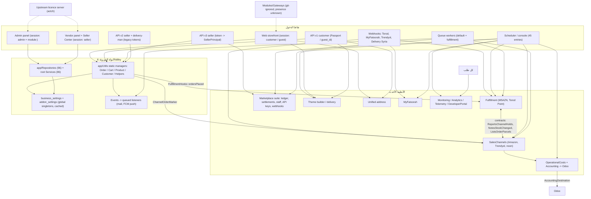

# E01 — خريطة كود ومستودع الواجهة الخلفية (Backend code and repository map)

> جلسة التدقيق: Discovery-01 — التاريخ: 2026-11-12 (+03:00) — الحالة: قراءة فقط
> المستودعات والـ SHA المدقَّقة: `lavkoo` (fullstackfull/lavkoo) عند `lavkoo@7f42777` — وهو الـ commit المدقَّق لكود التطبيق. أثناء الجلسة أضافت الجلسة القائدة commit توثيقياً واحداً فوقه (`lavkoo@046d623`، ملف واحد تحت `docs/gcc/audits/`) لا يمسّ أي كود. لم يُستخدم أي مستودع آخر في هذا الملحق.

## 1. النطاق وما تم فحصه

**التغطية:** البند A من `DISCOVERY_PROMPT_01` (خريطة الكود والمستودع) للواجهة الخلفية Laravel.

**ما قُرئ كاملاً (سطراً بسطر):** `composer.json`؛ `bootstrap/app.php` و`bootstrap/providers.php`؛ جميع ملفات `app/Providers` العشرين؛ جميع ملفات `app/Http/Middleware` التسعة والثلاثين (عدا متن `RecordAnalytics` الذي فُحص بالبحث)؛ `config/app.php`, `auth.php`, `passport.php`, `queue.php`, `cache.php`, `session.php`, `database.php`, `modules.php`, `cors.php`, `trustedproxy.php`, ورأس `deeplinks.php`؛ `app/Console/Kernel.php` و`app/Console/ScheduleDefinition.php`؛ ملفات المسارات `routes/web/routes.php`, `routes/rest_api/v1/api.php`, `v2/api.php`, `v3/seller.php`, الأربعة webhooks، `routes/seller/routes.php`, `install.php`, `update.php`, `test.php`, `shared.php`, `channels.php`, `console.php`؛ ثمانية من ملفات `app/Jobs` الاثني عشر؛ `.github/workflows/ci.yml`؛ `phpunit.xml` و`phpunit.mysql.xml`؛ `tests/TestCase.php` و`tests/CreatesApplication.php`؛ أوامر `BootstrapTestSchema`, `PrepareDatabase`, `DatabaseRefresh`, `LocalDatabaseRefresh`؛ `InstallController`, `UpdateController`, `SoftwareUpdateController`؛ الـ traits `ActivationClass`, `AddonHelper`, `MaintenanceModeTrait`؛ ملفات الجذر `index.php`, `server.php`, `.htaccess`, `.gitignore`, `.env.example` (مع حجب القيم), `README.md`, `auto_builder_sh.sh`, `models.json`, `modules_statuses.json`, `package.json`, `webpack.mix.js`.

**ما فُحص بنيوياً (قراءة الرؤوس + بحث + سكربتات قراءة فقط):** `routes/admin/routes.php` (1,941 سطراً) وباقي ملفات `routes/admin/*`؛ `routes/vendor/routes.php`؛ مسارات الـ Modules الثلاثة؛ `app/Events` (24)، `app/Listeners` (26)، `app/Observers` (10)؛ `app/Contracts` (99) و`app/Repositories` (96)؛ `app/Traits` (33)؛ `app/Utils` (24)؛ `app/Console/Commands` (79 أمراً + 6 concerns)؛ `scripts/deploy/*` و`scripts/ci/*` (الرؤوس)؛ `database/migrations` (336) وmigrations الـ Modules (14)؛ `app/Models` (235) لاستخراج أسماء الجداول؛ `composer.lock` لاستخراج الإصدارات المثبَّتة.

**أدوات القياس:** ثلاثة سكربتات Python للقراءة فقط كُتبت في مجلد scratchpad الخاص بالجلسة: (1) ماسح ثابت للمسارات يتتبّع تداخل المجموعات ويستخرج لكل مسار البادئة وسلسلة الـ middleware؛ (2) مقارن بين الجداول التي تنشئها الـ migrations والجداول التي تشير إليها الـ models؛ (3) مستخرج لأسماء الجداول المشار إليها في كود `app/` و`Modules/`. أرقام المسارات في هذا الملحق **عدّ ثابت لتعريفات `Route::…`** وليست مخرجات `route:list` (التشغيل ممنوع في هذه الجلسة)، فهي تقريبية: `Route::resource` يُعدّ تعريفاً واحداً.

**ما لم يُفحص:** متن الـ controllers والخدمات إلا بقدر ما يلزم لإثبات النمط المعماري؛ مجلد `vendor/` (غير موجود في المستودع، لذا كل ما يخص سلوك إطار Laravel نفسه موسوم `INFERRED`)؛ القوالب (1,501 ملف blade) إلا عدّاً؛ أي قيمة إنتاجية (`.env`، قاعدة البيانات، إعداد الخادم)؛ المستودع القديم `pharmacyksa98` — `UNKNOWN (missing access: pharmacyksa98)`.

**تفاصيل أمنية:** ستة عشر بنداً أمنياً حساساً حُوِّلت تفاصيلها إلى الملحق المقيّد، وتظهر هنا بمؤشرات محايدة `SEC-E01-01` … `SEC-E01-16` (القسم 6.3).

## 2. الوضع الحالي — كيف يعمل النظام فعلياً

### 2.1 الإطار والإصدارات والحزم

| العنصر | القيمة | الدليل | الحالة |
|---|---|---|---|
| PHP | `^8.2`، ومنصة composer مثبتة على 8.2.0 | `lavkoo:composer.json:11`, `lavkoo:composer.json:132-134` | VERIFIED |
| Laravel | القيد `^12.0`، المثبَّت `v12.62.0` | `lavkoo:composer.json:33`, `lavkoo:composer.lock:3449-3450` | VERIFIED |
| Passport | `^12.4` → `v12.4.3` | `lavkoo:composer.json:34`, `lavkoo:composer.lock:3671-3672` | VERIFIED |
| Sanctum | `^4.2` → `v4.3.2` (يستخدمه مسار هيكلي واحد فقط) | `lavkoo:composer.json:35`, `lavkoo:composer.lock:3806-3807`, `lavkoo:Modules/TaxModule/routes/api.php:17-19` | VERIFIED |
| nwidart/laravel-modules | `^10.0` → `10.0.6` | `lavkoo:composer.json:45`, `lavkoo:composer.lock:6424-6425` | VERIFIED |
| PHPUnit | `^11.0` | `lavkoo:composer.json:67` | VERIFIED |
| المنتج الأصلي | 6Valley، `SOFTWARE_VERSION = '16.3'`؛ اسم التطبيق الافتراضي `6vally` | `lavkoo:app/Library/Constant.php:471`, `lavkoo:config/app.php:16` | VERIFIED |
| الواجهة الأمامية للوحة | Vue 2 + Bootstrap 4 + Laravel Mix 5 | `lavkoo:package.json:19-30` | VERIFIED |

حزم بارزة: Firebase (`kreait/firebase-php`)، Excel/PDF (`maatwebsite/excel`, `mpdf`, `dompdf`)، OpenAI (`openai-php/laravel`)، AWS S3، Twilio، وحزمة تحديد الموقع من IP `devrabiul/laravel-geo-genius` (`lavkoo:composer.json:22-58`). حزم SDK لبوابات دفع غير خليجية ما زالت مطلوبة (iyzico, MercadoPago, PayPal, PhonePe, Razorpay, Stripe, Xendit: `lavkoo:composer.json:31`, `lavkoo:composer.json:42`, `lavkoo:composer.json:47-48`, `lavkoo:composer.json:51`, `lavkoo:composer.json:55`, `lavkoo:composer.json:58`)، ولا توجد حزمة composer لـ Paymob أو MyFatoorah أو Tabby أو Tamara — تكاملاتها مكتوبة داخل التطبيق. حزمة `laravel-geo-genius` مطلوبة لكن لم يُعثر على أي استخدام لها (بحث عن `geogenius|geo-genius|laravelGeoGenius|GeoLocation|geoip|ip-api|ipinfo|country_from_ip|getCountry(` في `app`, `Modules`, `config`, `resources/views`, `resources/themes`: النتيجة الوحيدة ملاحظة في لوحة المراقبة بأن لا قاعدة GeoIP مثبتة — `lavkoo:app/Services/Monitoring/Panels/LiveTrafficPanel.php:668-675`). أي أنه **لا يوجد اليوم أي استنتاج للدولة من IP**.

ستة وعشرون ملف دوال عامة تُحمَّل في كل طلب عبر `autoload.files`، منها `Helpers.php`, `OrderManager.php`, `CartManager.php`, `ProductManager.php`, `currency.php`, `settings.php` (`lavkoo:composer.json:71-98`).

### 2.2 الإقلاع والـ providers

- التطبيق مهيأ بأسلوب Laravel 11/12 عبر `Application::configure()` في `lavkoo:bootstrap/app.php:42-144`، **بلا** `withRouting()`؛ المسارات تُحمَّل بالطريقة القديمة من `RouteServiceProvider::map()` (`lavkoo:app/Providers/RouteServiceProvider.php:48-66`). لا يوجد ملف `app/Http/Kernel.php` (محتوى `app/Http`: `Controllers`, `Middleware`, `Requests`, `Resources`, `View` فقط)؛ الـ middleware معرّف كله في `lavkoo:bootstrap/app.php:44-133`. الملفان `lavkoo:app/Console/Kernel.php:25-28` و`app/Exceptions/Handler.php` موروثان وغير مستخدمين بحسب تعليقات الكود نفسه (`lavkoo:bootstrap/app.php:140-141`) — `INFERRED` من سلوك الإطار.
- الـ providers المسجَّلة: 17 من التطبيق + 3 حزم خارجية (`lavkoo:bootstrap/providers.php:3-28`). `BroadcastServiceProvider` و`EventServiceProvider` **معطّلان بالتعليق** (`lavkoo:bootstrap/providers.php:6-7`)؛ التطبيق يعتمد على الاكتشاف التلقائي للمستمعين كما يصرّح `lavkoo:app/Providers/AppServiceProvider.php:163-166`.
- `AppServiceProvider::boot()` هو مسار ساخن يُنفَّذ **قبل مطابقة المسار** في كل طلب غير console (`lavkoo:app/Providers/AppServiceProvider.php:171-326`): يمسح مجلد `Modules` لاكتشاف الـ add-ons (`lavkoo:app/Providers/AppServiceProvider.php:174-176`)، يحمّل جدول `business_settings` كاملاً من الكاش (`lavkoo:app/Providers/AppServiceProvider.php:187`)، يبني مصفوفة `web_config` واحدة (اسم الشركة، الشعار، العملات، البوابات، الفئات، البانرات…) ويشاركها مع كل القوالب (`lavkoo:app/Providers/AppServiceProvider.php:196-225`, `lavkoo:app/Providers/AppServiceProvider.php:268-302`, `lavkoo:app/Providers/AppServiceProvider.php:313`)، ويحمّل العملة الافتراضية إلى الجلسة (`lavkoo:app/Providers/AppServiceProvider.php:312`). كل الأخطاء تُبتلع في `catch (\Throwable)` واحد (`lavkoo:app/Providers/AppServiceProvider.php:316-318`). الملف يرفع أيضاً `memory_limit` إلى `-1` عند تحميله (`lavkoo:app/Providers/AppServiceProvider.php:70-72`).
- providers أخرى تقرأ إعداداً **واحداً عاماً** من قاعدة البيانات عند الإقلاع:

| Provider | ما يقرؤه (مرة واحدة لكل التطبيق) | الدليل |
|---|---|---|
| `ConfigServiceProvider` | `business_settings.timezone` → `date_default_timezone_set` | `lavkoo:app/Providers/ConfigServiceProvider.php:29-35` |
| `MailConfigServiceProvider` | `mail_config` أو `mail_config_sendgrid` → `Config::set('mail', …)` | `lavkoo:app/Providers/MailConfigServiceProvider.php:28-46` |
| `PaymentConfigProvider` | صف واحد لكل من paypal / razor_pay / paystack / flutterwave / paytm | `lavkoo:app/Providers/PaymentConfigProvider.php:30-151` |
| `FirebaseServiceProvider` | حساب خدمة Firebase واحد `push_notification_key` | `lavkoo:app/Providers/FirebaseServiceProvider.php:19-22` |
| `SocialLoginServiceProvider` | إعداد Google/Facebook واحد بعناوين callback ثابتة | `lavkoo:app/Providers/SocialLoginServiceProvider.php:29-48` |
| `ThemeServiceProvider` | مسار قوالب واحد `resources/themes/` + `theme_root_path()` التي تعيد الثابت `'default'` | `lavkoo:app/Providers/ThemeServiceProvider.php:17-23`, `lavkoo:app/Utils/theme-helpers.php:16-19` |

- providers الأنظمة الفرعية الأحدث تسجّل روابط وحدوداً فقط ولا تفعّل شيئاً بذاتها: `FulfillmentServiceProvider` (`lavkoo:app/Providers/FulfillmentServiceProvider.php:30-51`)، `SalesChannelsServiceProvider` الذي يحمّل أيضاً أربعة ملفات مسارات (`lavkoo:app/Providers/SalesChannelsServiceProvider.php:59-71`)، `MonitoringServiceProvider` (مستمعون على أحداث المجدول والطابور وعميل HTTP: `lavkoo:app/Providers/MonitoringServiceProvider.php:51-61`)، `AnalyticsServiceProvider` (`lavkoo:app/Providers/AnalyticsServiceProvider.php:28-37`)، `ObserverServiceProvider` (القسم 2.8).

### 2.3 المعمار الطبقي كما يُمارَس فعلياً

ادعاء `CLAUDE.md` هو "Controller → Service → Repository → Model مع controllers نحيفة". الممارسة الفعلية ثلاثة أنماط متعايشة:

**النمط (أ) — لوحتا الإدارة والبائع (نمط 6Valley الحديث):** الـ controller هو المنسِّق؛ يحقن واجهات المستودعات ويستدعي خدمة لتجهيز البيانات ثم المستودع للحفظ. الخدمة لا تملك المستودع. مثال: `BrandController` يحقن أربع واجهات مستودعات وخدمة (`lavkoo:app/Http/Controllers/Admin/Product/BrandController.php:27-35`)، وفي `add()` يستدعي `BrandService::getAddData()` ثم `brandRepo->add()` (`lavkoo:app/Http/Controllers/Admin/Product/BrandController.php:96-109`)؛ والخدمة مجرد تحويل بيانات (`lavkoo:app/Services/BrandService.php:12-27`). الربط بين الواجهة والمستودع آلي بمسح مجلد `app/Repositories` (`lavkoo:app/Providers/InterfaceServiceProvider.php:20-36`)؛ العقد العام في `lavkoo:app/Contracts/Repositories/RepositoryInterface.php:9-58`. توجد 97 واجهة و96 مستودعاً. خدمة واحدة فقط من 86 خدمة في جذر `app/Services` تشير إلى واجهة مستودع (بحث `App\Contracts\Repositories`).

**النمط (ب) — واجهة المتجر و REST API (النمط الأقدم):** controllers سميكة تستدعي دوالاً ساكنة في `app/Utils/*Manager` وتستعلم Eloquent مباشرة. مثال: `place_order` في API v1 يستدعي `CartManager::get_cart_group_ids` و`CartManager::product_stock_check` و`OrderManager::verifyCartListMinimumOrderAmount` ويستعلم `Cart` و`ShippingAddress` مباشرة (`lavkoo:app/Http/Controllers/RestAPI/v1/OrderController.php:171-240`). إنشاء الطلب نفسه في `OrderManager::generateOrder` (`lavkoo:app/Utils/OrderManager.php:1537`). أحجام هذه المساعدات: `OrderManager.php` 3,241 سطراً، `ProductManager.php` 2,944، `CartManager.php` 1,121، `Helpers.php` 867.

**النمط (ج) — الأنظمة الفرعية الأحدث (Fulfillment, SalesChannels, OperationalCosts, Marketplace, Theme, Address, Monitoring, MyFatoorah, Accounting):** خدمات مجالية تحت `app/Services/<Subsystem>` تتعامل مع Eloquent و`DB` مباشرة دون طبقة المستودعات (صفر ملفات تشير إلى `App\Contracts\Repositories` في هذه المجلدات التسعة، وملف واحد في مجلد عاشر هو `SellerCenter`)، وتتصل بالنواة عبر نقاط ربط صريحة، مثل استدعاء `FulfillmentHooks::ordersPlaced` من داخل `OrderManager` بعد حفظ الطلب (`lavkoo:app/Utils/OrderManager.php:1762-1764`).

قياس كمّي (عدّ ثابت؛ 430 controller):

| منطقة الـ controllers | العدد | تشير إلى RepositoryInterface | تستعلم models أساسية مباشرة | نداءات `OrderManager::` | نداءات `Helpers::` |
|---|---|---|---|---|---|
| `Admin` | 216 | 86 | 27 | 3 | 19 |
| `Vendor` | 41 | 33 | 3 | 2 | 11 |
| `Web` | 22 | 12 | 5 | 25 | 14 |
| `RestAPI` (v1/v2/v3) | 91 | 16 | 44 | 30 | 323 |
| `Customer` | 9 | 4 | 3 | 7 | 18 |
| `Seller` (Seller Center) | 15 | 0 | 1 | 0 | 0 |

الـ controllers ليست نحيفة: أكبرها `RestAPI/v3/seller/ProductController.php` (2,238 سطراً) و`Web/WebController.php` (1,666 سطراً). **الخلاصة (VERIFIED بالعدّ، INFERRED بالتعميم):** لا توجد طبقة واحدة يمرّ بها كل وصول للبيانات؛ منطق الطلب والسلة والمنتج موزّع بين دوال ساكنة عامة، ومستودعات، وخدمات مجالية، واستعلامات مباشرة داخل controllers. أي "سياق متجر" لا يمكن فرضه في نقطة واحدة من طبقة البيانات.

### 2.4 جدول نقاط الدخول (كل ملفات المسارات)

ترتيب التحميل في `lavkoo:app/Providers/RouteServiceProvider.php:48-66`: API v1 ثم v2 ثم v3 ثم Delivery Syria ثم webhooks الـ fulfillment ثم webhook MyFatoorah ثم admin ثم admin/fulfillment ثم admin/addresses ثم vendor ثم Seller Center ثم web. مسارات القنوات والتكاليف وOdoo تُحمَّل من `SalesChannelsServiceProvider`.

| الملف | المُحمِّل | بادئة URL | سلسلة الـ middleware (ثابتة) | الـ guard / المصادقة | مساحة الـ controllers | عدد التعريفات | الغرض |
|---|---|---|---|---|---|---|---|
| `routes/web/routes.php` | `lavkoo:app/Providers/RouteServiceProvider.php:215-220` | `/` (بلا بادئة) | `web` + `logUserBrowsingNavigation`؛ ثم `maintenance_mode` + `guestCheck` على 108 مسارات، و`customer` على 30 | جلسة guard `customer`؛ الضيف بـ `guest_id` في الجلسة | `Web`, `Customer`, `Payment_Methods` | 219 | واجهة المتجر، السلة، الدفع، حساب العميل، تحويلات وcallbacks بوابات الدفع، beacon التحليلات، الروابط القصيرة |
| `routes/admin/routes.php` | `lavkoo:app/Providers/RouteServiceProvider.php:187-192` | `admin/*` و`login/*` وبضعة مسارات جذرية | `web` + `admin` + `actch:admin_panel` + `module:<name>` لمعظم المسارات (764 من 810)؛ والبقية مسارات عامة للدخول والتفعيل وتبديل اللغة (7) ومسارات مصادَقة بلا `module:` (39 — التفصيل في SEC-E01-03) | جلسة guard `admin` | `Admin\*` | 810 | لوحة الإدارة كاملة |
| `routes/admin/fulfillment.php` | `lavkoo:app/Providers/RouteServiceProvider.php:194-199` | `admin/fulfillment-providers` | `web`,`admin`,`actch:admin_panel`,`module:3rd_party_setup`,`EnsureFulfillmentMigrated` (`lavkoo:routes/admin/fulfillment.php:20-24`) | `admin` | `Admin\Fulfillment` | 33 | مركز التكامل M5AZN / Torod Point |
| `routes/admin/addresses.php` | `lavkoo:app/Providers/RouteServiceProvider.php:202-207` | `admin/address-system` | …+`module:business_settings`,`EnsureAddressMigrated` (`lavkoo:routes/admin/addresses.php:22-26`) | `admin` | `Admin\Address` | 17 | نظام العناوين الموحّد |
| `routes/admin/sales-channels.php` | `lavkoo:app/Providers/SalesChannelsServiceProvider.php:66` | `admin/sales-channels` | …+`module:sales_channels`,`EnsureSalesChannelsMigrated` (`lavkoo:routes/admin/sales-channels.php:25-29`) | `admin` | `Admin\SalesChannels` | 50 | مركز قنوات البيع |
| `routes/admin/operational-costs.php` | `lavkoo:app/Providers/SalesChannelsServiceProvider.php:67` | `admin/operational-costs` | …+`module:operational_costs` (`lavkoo:routes/admin/operational-costs.php:24-28`) | `admin` | `Admin\OperationalCosts` | 41 | دفتر التكاليف التشغيلية |
| `routes/admin/odoo-accounting.php` | `lavkoo:app/Providers/SalesChannelsServiceProvider.php:70` | `admin/accounting/odoo` | …+`module:operational_costs` (`lavkoo:routes/admin/odoo-accounting.php:24-28`) | `admin` | `Admin\Accounting` | 16 | ربط Odoo |
| `routes/vendor/routes.php` | `lavkoo:app/Providers/RouteServiceProvider.php:209-214` | `vendor/*` | `web`,`maintenance_mode`,`actch:admin_panel` ثم `seller`,`seller_staff_access` على 207 (`lavkoo:routes/vendor/routes.php:45-87`)؛ 14 مسار دخول/تسجيل عامة | جلسة guard `seller` | `Vendor\*` | 221 | لوحة البائع الكلاسيكية |
| `routes/seller/routes.php` | `lavkoo:app/Providers/RouteServiceProvider.php:180-185` | `vendor/*` (أسماء `seller.`) | ما سبق + `seller_center` + `seller_can:<perm>` (`lavkoo:routes/seller/routes.php:40-48`) | جلسة `seller` + `SellerPrincipal` | `Seller\*` | 27 | Seller Center الجديد على البادئة نفسها |
| `routes/rest_api/v1/api.php` | `lavkoo:app/Providers/RouteServiceProvider.php:97-103` | `api/v1` | `api` + `api_lang` (`lavkoo:routes/rest_api/v1/api.php:54`)؛ `auth:api` على ~45، `apiGuestCheck` على ~73، والباقي (~62) عام | guard `api` (Passport) أو `guest_id` | `RestAPI\v1` | 180 | API تطبيق العميل |
| `routes/rest_api/v2/api.php` | `lavkoo:app/Providers/RouteServiceProvider.php:105-111` | `api/v2/seller` و`api/v2/delivery-man` | `api`,`api_lang`؛ مجموعة delivery-man: `delivery_man_auth`,`actch:deliveryman_app` (`lavkoo:routes/rest_api/v2/api.php:144`)؛ مجموعة seller: المصادقة داخل الـ controllers بـ token البائع | token مخصص | `RestAPI\v2` | 95 (59 seller + 36 delivery-man) | API البائع القديم + API المندوب |
| `routes/rest_api/v3/seller.php` | `lavkoo:app/Providers/RouteServiceProvider.php:113-119` | `api/v3/seller` | `api`,`api_lang` (`lavkoo:routes/rest_api/v3/seller.php:49`) + `seller_api_auth` (`lavkoo:routes/rest_api/v3/seller.php:72`) + `seller_can:<perm>` أو `seller_owner`؛ 8 مسارات دخول/تسجيل عامة | token → `SellerPrincipal` | `RestAPI\v3\seller` | 236 | API تطبيق البائع الحالي |
| `routes/rest_api/delivery_syria.php` | `lavkoo:app/Providers/RouteServiceProvider.php:127-133` | `api/delivery-syria/orders/update-status` | `api` + `deliverysyria_auth` (`lavkoo:routes/rest_api/delivery_syria.php:16-18`) | Bearer token مشترك + ترويسة منصة | `Api` | 1 | webhook ناقل سوري (موروث) |
| `routes/rest_api/fulfillment_webhooks.php` | `lavkoo:app/Providers/RouteServiceProvider.php:139-144` | `api/fulfillment-webhooks/{provider}/{secret}/{type}` | حدّ معدّل مخصص للمسار (`lavkoo:routes/rest_api/fulfillment_webhooks.php:15-18`) | التحقق داخل الـ controller، وإعداد واحد لكل مزوّد (انظر SEC-E01-10) | `Api` | 1 | webhooks Torod Point |
| `routes/rest_api/myfatoorah_webhook.php` | `lavkoo:app/Providers/RouteServiceProvider.php:150-155` | `api/myfatoorah/webhook` | حدّ معدّل مخصص للمسار (`lavkoo:routes/rest_api/myfatoorah_webhook.php:19-21`) | التحقق داخل الـ controller (انظر SEC-E01-10) | `Api` | 1 | webhook MyFatoorah V2 |
| `routes/rest_api/sales_channel_webhooks.php` | `lavkoo:app/Providers/SalesChannelsServiceProvider.php:64` | `api/sales-channel-webhooks/{account}` | حدّ معدّل مخصص للمسار (`lavkoo:routes/rest_api/sales_channel_webhooks.php:14-17`) | مفتاح لكل حساب قناة | `Api` | 1 | webhook Trendyol |
| `routes/install.php` | **غير مركّب** (`lavkoo:app/Providers/RouteServiceProvider.php:57`) | `/`, `/step1…5` | `web` لو رُكِّب | — | `InstallController` | 11 | مثبِّت 6Valley |
| `routes/update.php` | **غير مركّب** (`lavkoo:app/Providers/RouteServiceProvider.php:58`) | `/`, `update-system` | `web` لو رُكِّب | — | `UpdateController` | 3 | محدِّث 6Valley |
| `routes/test.php` | غير محمَّل (لا يوجد مُحمِّل؛ بحث `test.php` و`routes/test` في `app`,`bootstrap`,`config`,`routes`,`Modules`) | — | — | — | closures | 7 | بقايا تجارب — انظر SEC-E01-08 |
| `routes/shared.php` | غير محمَّل؛ فارغ | — | — | — | — | 0 | — |
| `routes/channels.php` | يحمّله `BroadcastServiceProvider` غير المسجَّل (`lavkoo:app/Providers/BroadcastServiceProvider.php:15-19`) | — | — | — | — | قناة واحدة | البثّ غير مفعّل |
| `routes/console.php` | فارغ | — | — | — | — | 0 | — |
| `Modules/AI/routes/*` | `lavkoo:Modules/AI/app/Providers/RouteServiceProvider.php:40-66` | `admin/*`, `vendor/*`, `customer/auction/*`, `api/v3/seller/*`, `api/v1/customer/*` | بحسب الملف: `web`+`admin`+`actch:admin_panel`؛ `web`+`seller`؛ `api`+`seller_api_auth`؛ `api`+`auth:api` | كما في النواة | `Modules\AI` | 81 (9+27+16+29) | توليد محتوى بالذكاء الاصطناعي |
| `Modules/Blog/routes/*` | `lavkoo:Modules/Blog/app/Providers/RouteServiceProvider.php:40-62` | `/blog`, `/app/blog`, `admin/blog/*` | `web` + middleware حالة المدوّنة؛ الإدارة: `web`+`admin`+`module:marketing` | `admin` للإدارة | `Modules\Blog` | 30 (6+24) | المدوّنة |
| `Modules/TaxModule/routes/*` | `lavkoo:Modules/TaxModule/app/Providers/RouteServiceProvider.php:40-72` | `admin/vat-tax/*`, `admin/report/*`, `vendor/report/*`, `api/v1/vat-tax/*`, `api/v3/seller/*` | الإدارة: `web`+`admin` (`lavkoo:Modules/TaxModule/routes/web.php:16` — انظر SEC-E01-03)؛ البائع: `web`+`seller`؛ API v1 (قائمة وحاسبة ضريبة): `api`؛ v3: `seller_api_auth` | كما في النواة | `Modules\TaxModule` | 22 (16+2+1+2+1) | إعداد VAT وتقاريره |

المجموع الثابت التقريبي: نحو 1,949 تعريف مسار مركّب في النواة و133 في الـ Modules.

ملاحظات بنيوية:
1. **لا توجد أي بادئة دولة/متجر/لغة في أي مسار.** الصفحة الرئيسية هي `/` (`lavkoo:routes/web/routes.php:165`)، والمنتج `/product/{slug}` (`lavkoo:routes/web/routes.php:228`).
2. مسارات بوابات الدفع تحت `/payment/*` (ومنها Paymob وMyFatoorah) تُسجَّل **شرطياً**: فقط إذا لم يوجد add-on `Gateways` منشور على القرص (`lavkoo:routes/web/routes.php:472-482`). المجلد `Modules/Gateways` مستثنى من git (`lavkoo:.gitignore:25`) — انظر 2.10.
3. مسارات MyFatoorah لها اسمان: `payment/myfatoorah/*` و`payment/fatoorah/*` (`lavkoo:routes/web/routes.php:599-612`).
4. 111 مساراً في ملف الويب خارج مجموعة `maintenance_mode` — عدّ ثابت؛ تشمل فئات تشغيلية حساسة (انظر SEC-E01-14).
5. حدود المعدّل: مجموعة `api` بـ `throttle:3000,1` (`lavkoo:bootstrap/app.php:85`)؛ محدِّدات مسمّاة `auth` و`global` تُقرأ من إعدادات السياسة وقت الطلب، ومحدِّدات webhooks بـ 600/دقيقة لكل IP (`lavkoo:app/Providers/RouteServiceProvider.php:233-253`, `lavkoo:app/Providers/FulfillmentServiceProvider.php:50`, `lavkoo:app/Providers/SalesChannelsServiceProvider.php:61`).

### 2.5 الـ middleware

| الطبقة | المحتوى | الدليل |
|---|---|---|
| عام (كل طلب) | `TrustProxies`, `CheckForMaintenanceMode`, `ValidatePostSize`, `TrimStrings`, `ConvertEmptyStringsToNull`, `DatabaseRefreshMiddleware`, `HandleCors`, `MonitorRequest` | `lavkoo:bootstrap/app.php:44-59` |
| مجموعة `web` | تشفير الكوكيز، الجلسة، CSRF، `Localization`, `DetectMobile`, `ApplySeoRedirects`, `NoIndexThemePreview`, `RecordHttpTelemetry`, `MonitorRequest`, `RecordAnalytics` | `lavkoo:bootstrap/app.php:60-83` |
| مجموعة `api` | `throttle:3000,1`, `SubstituteBindings`, `RecordHttpTelemetry`, `MonitorRequest`, `RecordAnalytics`, `RecordApiResponseShape` | `lavkoo:bootstrap/app.php:84-94` |
| الأسماء المستعارة | `admin`, `seller`, `seller_staff_access`, `seller_center`, `customer`, `module`, `actch`, `api_lang`, `maintenance_mode`, `delivery_man_auth`, `seller_api_auth`, `seller_can`, `seller_owner`, `deliverysyria_auth`, `guestCheck`, `apiGuestCheck`, `logUserBrowsingNavigation` … | `lavkoo:bootstrap/app.php:100-133` |

سلوكيات تمسّ GCC مباشرة:
- `api_lang`: يقرأ ترويسة `lang` ويطوي القيمتين `sa` و`us` إلى `ar` و`en` لأن إصدارات من تطبيق العميل أرسلت **رمز الدولة** في ترويسة اللغة (`lavkoo:app/Http/Middleware/APILocalizationMiddleware.php:23-29`).
- `Localization` (الويب): يقرأ مفتاح الجلسة `locale` (`lavkoo:app/Http/Middleware/Localization.php:20-22`)، بينما الكود يكتب اللغة في المفتاح `local` (`lavkoo:app/Http/Controllers/SharedController.php:32`, `lavkoo:app/Utils/Helpers.php:80`)؛ لم يُعثر على أي كتابة للمفتاح `locale` (بحث `put('locale'` في `app` و`Modules`: صفر). أي أن لغة الويب تُحسم داخل `Helpers::default_lang()` عند كل نداء لا في middleware (`lavkoo:app/Utils/Helpers.php:62-84`).
- `maintenance_mode`: علم عام واحد في مفتاح الكاش `system_maintenance_mode` مع اختيار "الأنظمة" (لوحة البائع، موقع المستخدم) عبر مطابقة أنماط المسار `vendor/*`, `admin/*`, `api/*` (`lavkoo:app/Traits/MaintenanceModeTrait.php:10-32`). واجهة API لا تُحجب بـ middleware؛ الحالة تُعاد للتطبيق ضمن `GET /api/v1/config` (`lavkoo:app/Http/Controllers/RestAPI/v1/ConfigController.php:107`). أما صيانة الإطار نفسها (`artisan down`) فتمرّ عبر middleware عام بلا أي استثناءات مسار (`lavkoo:app/Http/Middleware/CheckForMaintenanceMode.php:14-16`)، أي أنها تحجب webhooks والـ API معاً.
- `actch:<app>`: فحص ترخيص المنتج الأصلي المرتبط بالنطاق، يُخزَّن يوماً في الكاش بمفتاح يتضمن النطاق (`lavkoo:app/Traits/ActivationClass.php:22-25`, `lavkoo:app/Traits/ActivationClass.php:97-117`)، ويعيد كتابة الملف المتتبَّع `config/system-addons.php` وقت التشغيل (`lavkoo:app/Traits/ActivationClass.php:119-125`).
- `ApplySeoRedirects`: يستثني بادئات ثابتة `/api`, `/admin`, `/vendor`, `/install`, `/update`, `/payment` ويطابق `from_path` من الجذر بكاش عام (`lavkoo:app/Http/Middleware/ApplySeoRedirects.php:32`, `lavkoo:app/Http/Middleware/ApplySeoRedirects.php:75-86`).
- `MonitorRequest`: يربط كائن `RequestContext` لكل طلب في الحاوية (correlation id، المنصة من `X-Platform`، إصدار التطبيق) — وهو السابقة الوحيدة لكائن "سياق طلب" في النظام (`lavkoo:app/Http/Middleware/MonitorRequest.php:32-50`, `lavkoo:app/Http/Middleware/MonitorRequest.php:100-118`).

### 2.6 المصادقة: guards و providers و tokens

| الفاعل | الـ guard / الآلية | النموذج | حامل الهوية | فرض الصلاحية |
|---|---|---|---|---|
| مدير/موظف | `admin` (session) — `lavkoo:config/auth.php:49-52` | `App\Models\Admin` — `lavkoo:config/auth.php:88-91` | كوكي الجلسة | `AdminMiddleware` يعيد 404 لغير المسجَّل (`lavkoo:app/Http/Middleware/AdminMiddleware.php:20-28`)؛ `module:<name>` يقرأ `module_access` من دور الموظف، والدور رقم 1 مُعفى من الفحص (`lavkoo:app/Utils/Helpers.php:374-390`)؛ المدير `id == 1` له صفحة دخول مستقلة (`lavkoo:app/Http/Controllers/Admin/Auth/LoginController.php:49-60`) |
| بائع (لوحة الويب) | `seller` (session) — `lavkoo:config/auth.php:54-57` | `App\Models\Seller` | الجلسة + `seller_staff_id` للموظف | `SellerMiddleware` يشترط `status == approved` (`lavkoo:app/Http/Middleware/SellerMiddleware.php:21-26`)؛ `SellerStaffAccessMiddleware` خريطة deny-by-default مبنية على **المقطع الثاني من المسار** (`lavkoo:app/Http/Middleware/SellerStaffAccessMiddleware.php:65-135`)؛ `SellerCenterContext` يبني `SellerPrincipal` (`lavkoo:app/Http/Middleware/SellerCenterContext.php:30-52`) |
| عميل (الويب) | `customer` (session) — `lavkoo:config/auth.php:59-62` | `App\User` — `lavkoo:config/auth.php:83-86` | الجلسة؛ الضيف: `guest_id` في الجلسة (`lavkoo:app/Http/Middleware/GuestMiddleware.php:20-28`) | `CustomerMiddleware` يشترط `is_active` (`lavkoo:app/Http/Middleware/CustomerMiddleware.php:21-29`) |
| عميل (API) | `api` بسائق `passport` — `lavkoo:config/auth.php:44-47` | `App\User` | Passport personal access token باسم ثابت `LaravelAuthApp` بلا scopes (`lavkoo:app/Http/Controllers/RestAPI/v1/auth/CustomerAPIAuthController.php:101`)؛ الضيف: معامل `guest_id` | `auth:api`؛ `apiGuestCheck` (`lavkoo:app/Http/Middleware/APIGuestMiddleware.php:15-34`) |
| بائع (API v3) | middleware مخصص، لا guard | `Seller` / `SellerStaff` / مفتاح API | Bearer: `sellers.auth_token` (`lavkoo:app/Http/Controllers/RestAPI/v3/seller/auth/LoginController.php:99-100`) أو `seller_staff.auth_token` (`lavkoo:app/Http/Controllers/RestAPI/v3/seller/auth/LoginController.php:50-51`) أو مفتاح مُصدَر | `SellerApiAuthMiddleware` يحلّ الـ token إلى `SellerPrincipal` ويعيد فحص الحالة في كل طلب (`lavkoo:app/Http/Middleware/SellerApiAuthMiddleware.php:41-93`, `lavkoo:app/Services/Marketplace/SellerPermissionService.php:98-120`)؛ `seller_can` (`lavkoo:app/Http/Middleware/EnsureSellerPermission.php:26-59`)؛ `seller_owner` (`lavkoo:app/Http/Middleware/EnsureSellerIsOwner.php:24-41`) |
| بائع (API v2 القديم) | داخل كل controller | `Seller` | `sellers.auth_token` (`lavkoo:app/Http/Controllers/RestAPI/v2/seller/auth/LoginController.php:35-36`) | `Helpers::get_seller_by_token` (`lavkoo:app/Utils/Helpers.php:529-547`) — انظر SEC-E01-02 |
| مندوب توصيل (API v2) | middleware مخصص | `App\Models\DeliveryMan` | `auth_token` في جدول المندوبين (`lavkoo:app/Http/Controllers/RestAPI/v2/delivery_man/auth/LoginController.php:47-48`) | `DeliveryManAuth` (`lavkoo:app/Http/Middleware/DeliveryManAuth.php:18-32`) + `actch:deliveryman_app` |

ملاحظات: الـ guard الافتراضي `web` على provider `users` (`lavkoo:config/auth.php:16-19`) وهو ما يشير إليه إعداد Passport (`lavkoo:config/passport.php:16`). يوجد صنفان للجدول `users`: `App\User` (نموذج المصادقة) و`App\Models\User` (المستخدم في 65 ملفاً من كود الأعمال) — `lavkoo:app/User.php:16-18`, `lavkoo:app/Models/User.php:56-58`. لم يُعثر على أي ضبط لعمر الـ token (بحث `Passport::` في `app`,`Modules`,`config`,`bootstrap`: صفر) فالعمر هو افتراضي الحزمة — `INFERRED`. **لا يحمل أي token أو جلسة أي إشارة إلى متجر أو دولة أو كيان قانوني.**

### 2.7 الطوابير والـ jobs

- الاتصال الافتراضي `sync` ما لم يُضبط `QUEUE_CONNECTION` (`lavkoo:config/queue.php:16`)؛ ملف المثال يضع `database` (`lavkoo:.env.example:16`). الاتصالات المعرّفة: `sync`, `database` (جدول `jobs`، `retry_after` من `QUEUE_RETRY_AFTER` وافتراضه 90)، `beanstalkd`, `sqs`, `redis` (`lavkoo:config/queue.php:31-70`). الفاشلة إلى جدول `failed_jobs` (`lavkoo:config/queue.php:83-87`). القيمة الفعلية في الإنتاج `UNKNOWN (missing access: production .env)`.
- **طابور مسمّى واحد فقط:** `fulfillment` (واتصاله الاختياري) عبر `config('fulfillment.queue.*')` — `lavkoo:config/fulfillment.php:71-74`, `lavkoo:app/Services/Fulfillment/FulfillmentQueue.php:74-83`. لا يوجد أي `onQueue`/`onConnection` آخر في `app` أو `Modules` (بحث `onQueue(|onConnection(|allOnQueue(`). كل ما عداه يذهب إلى الطابور `default`.
- مع السائق `sync` لا تُرسل jobs الـ fulfillment أصلاً ويتولى المجدول العمل (`lavkoo:app/Services/Fulfillment/FulfillmentQueue.php:25-43`).

| Job | الطابور | tries / timeout / backoff | الحمولة | نقطة الإرسال | الدليل |
|---|---|---|---|---|---|
| `Fulfillment\DispatchProviderFulfillment` | `fulfillment` | 1 / 120s | `fulfillmentId`, `manual` | `FulfillmentQueue::dispatchFulfillment` | `lavkoo:app/Jobs/Fulfillment/DispatchProviderFulfillment.php:20-35` |
| `Fulfillment\ReconcileProviderFulfillment` | `fulfillment` | 1 / 120s | `fulfillmentId` | `FulfillmentQueue::dispatchReconcile` | `lavkoo:app/Jobs/Fulfillment/ReconcileProviderFulfillment.php:12-18` |
| `Fulfillment\CancelProviderFulfillment` | `fulfillment` | 1 / 90s | `fulfillmentId` | `FulfillmentQueue::dispatchCancel` | `lavkoo:app/Jobs/Fulfillment/CancelProviderFulfillment.php:12-18` |
| `Fulfillment\ProcessProviderEvent` | `fulfillment` | 3 / 60s / [30,120] | `eventId` | `FulfillmentQueue::dispatchEvent` | `lavkoo:app/Jobs/Fulfillment/ProcessProviderEvent.php:16-34` |
| `Fulfillment\RouteOrderFulfillment` | `fulfillment` | 2 / 60s | `orderId` | `FulfillmentQueue::dispatchRoute` | `lavkoo:app/Jobs/Fulfillment/RouteOrderFulfillment.php:13-28` |
| `SalesChannels\DrainStockEvents` | `default` | 1 / 300s، `WithoutOverlapping` | `limit` فقط (لا يسمّي صفوفاً) | `StockEventNudge` بعد الـ commit | `lavkoo:app/Jobs/SalesChannels/DrainStockEvents.php:29-50` |
| `DeliverSellerWebhook` | `default` | 1 | `deliveryId` | مرسِل webhooks البائع + أمر `seller:retry-webhooks` | `lavkoo:app/Jobs/DeliverSellerWebhook.php:23-42` |
| `RunSellerBulkJob` | `default` | 1 / 900s | `bulkJobId` | `SellerBulkJobService` | `lavkoo:app/Jobs/RunSellerBulkJob.php:25-46` |
| `RebuildProductSearchIndex` | `default` | `ShouldBeUnique` ساعة | `requestedBy` | لوحة المراقبة | `lavkoo:app/Jobs/RebuildProductSearchIndex.php:29-55` |
| `SendEmailJob` | — | — | — | لا توجد نقطة إرسال (بحث `SendEmailJob` خارج ملفه: صفر) | `lavkoo:app/Jobs/SendEmailJob.php:13-38` |
| 16 مستمعاً مصفوفاً (بريد) | `default` | 2 / 30s / 60 | الحدث مسلسلاً | `event(...)` | `lavkoo:app/Listeners/Concerns/QueuedMailDelivery.php:23-30` |

كل job يحمل **معرّفات كيانات فقط** ويعيد قراءة الحالة عند التنفيذ؛ لا يحمل لغة ولا عملة ولا متجراً. ملاحظة تشغيلية: `retry_after` (90 افتراضياً، 180 في ملف المثال: `lavkoo:.env.example:56`) أقل من مهلة `RunSellerBulkJob` (900s) و`DrainStockEvents` (300s)، بينما تعليق الإعداد نفسه يشترط أن تزيد على مهلة أطول job (`lavkoo:config/queue.php:41-42`).

### 2.8 الأحداث والمستمعون والمراقبون

- 24 حدثاً و25 مستمعاً (+ trait). خريطة `$listen` في `EventServiceProvider` (`lavkoo:app/Providers/EventServiceProvider.php:60-130`) **غير نافذة** لأن الـ provider غير مسجَّل؛ الربط بالاكتشاف التلقائي — `INFERRED` من سلوك Laravel 12 ومن تعليق `lavkoo:app/Providers/AppServiceProvider.php:163-166`. الاشتراك اليدوي الوحيد: `RecordAuthenticationEvents` (`lavkoo:app/Providers/AppServiceProvider.php:166`).
- المستمعون ناقلو إشعارات لا منطق مالي: بريد عبر `EmailTemplateTrait` وإشعارات push عبر `PushNotificationTrait` (مثال: `lavkoo:app/Listeners/OrderPlacedListener.php:35-71`, `lavkoo:app/Listeners/OrderStatusListener.php:23-34`, `lavkoo:app/Listeners/RefundListener.php:29-57`). الأحداث لا تنفّذ `ShouldBroadcast` (بحث `ShouldBroadcast` في `app`,`Modules`: صفر) وسائق البثّ الافتراضي `null` (`lavkoo:config/broadcasting.php:18`).
- المراقبون المسجَّلون فعلاً (`lavkoo:app/Providers/ObserverServiceProvider.php:50-77`) يحملون منطق أعمال:

| المراقب | النماذج | الأثر |
|---|---|---|
| `ProductSearchIndexObserver` | `Product` | تحديث فهرس البحث عند كل حفظ/حذف (`lavkoo:app/Observers/ProductSearchIndexObserver.php:26-49`) |
| `ProductPriceObserver` | `Product` | سجل تغيّر الأسعار |
| `SellerWebhookEventObserver` | `Product`, `Order`, `RefundRequest`, `VendorPayoutRequest` | إطلاق webhooks البائع الصادرة؛ حمولة `order.placed` تحمل `order_amount` بلا رمز عملة (`lavkoo:app/Observers/SellerWebhookEventObserver.php:31-42`) |
| `AutomationClaimObserver` | `Product` | تحرير "مطالبة" الأتمتة عند تعديل يدوي |
| `AuditTrailObserver` | 11 نموذجاً (الكوبونات، العروض، البانرات، طرق الدفع/السحب، الأدوار، المدراء) | سجل تدقيق |

- خمسة مراقبين موروثين (`OrderObserver`, `ProductObserver`, `BusinessSettingsObserver`, `CurrencyObserver`, `TranslationObserver`) غير مسجَّلين في أي مكان (بحث أسمائها في `app`,`Modules`,`bootstrap`,`config`: تعريف الصنف فقط).
- `AnalyticsServiceProvider` يسجّل مستمعي نماذج لأحداث التجارة حتى في console (`lavkoo:app/Providers/AnalyticsServiceProvider.php:28-37`).

### 2.9 المجدول (الجدول الكامل)

التعريف الوحيد في `App\Console\ScheduleDefinition::define` ويُربط من `lavkoo:bootstrap/app.php:138`. 45 مدخلاً فعّالاً ومدخل معلَّق واحد (`monitoring:check`: `lavkoo:app/Console/ScheduleDefinition.php:159`). يتطلب سطر cron واحداً `schedule:run` كل دقيقة (وجوده في الإنتاج `UNKNOWN`). أقفال `withoutOverlapping` تعيش في الكاش، فالسائق `array` غير صالح (`lavkoo:docs/integrations/operations.md:40`).

| # | الأمر | التواتر | شرط التسجيل | منع التداخل | السطر |
|---|---|---|---|---|---|
| 1 | `cart:remind-abandoned` | كل 30 دقيقة | — | نعم | `lavkoo:app/Console/ScheduleDefinition.php:28` |
| 2 | `marketplace:settle --release` | يومياً 02:00 | — | نعم | `lavkoo:app/Console/ScheduleDefinition.php:35` |
| 3 | `cart:remind-abandoned --stage=2` | يومياً 10:00 | — | نعم | `lavkoo:app/Console/ScheduleDefinition.php:39` |
| 4 | `marketplace:evaluate-sla` | يومياً 03:00 | — | نعم | `lavkoo:app/Console/ScheduleDefinition.php:43` |
| 5 | `seller:refresh-insights` | كل ساعة | — | نعم | `lavkoo:app/Console/ScheduleDefinition.php:48` |
| 6 | `theme:publish-due` | كل 5 دقائق | — | نعم | `lavkoo:app/Console/ScheduleDefinition.php:53` |
| 7 | `seller:escalate-issues` | كل 4 ساعات | — | نعم | `lavkoo:app/Console/ScheduleDefinition.php:58` |
| 8 | `seller:run-automation` | كل 15 دقيقة | — | نعم | `lavkoo:app/Console/ScheduleDefinition.php:64` |
| 9 | `seller:retry-webhooks` | كل 5 دقائق | — | نعم | `lavkoo:app/Console/ScheduleDefinition.php:70` |
| 10 | `seller:run-stuck-bulk-jobs` | كل دقيقة | — | نعم | `lavkoo:app/Console/ScheduleDefinition.php:76` |
| 11 | `search:reindex-products` | أسبوعياً الأحد 04:00 | — | نعم | `lavkoo:app/Console/ScheduleDefinition.php:80` |
| 12 | `fulfillment:recover` | كل دقيقة | يعمل فعلياً فقط مع مفتاح التكاملات | نعم (10 د) | `lavkoo:app/Console/ScheduleDefinition.php:92` |
| 13 | `fulfillment:poll` | كل 15 دقيقة، خلفية | كذلك | نعم (30 د) | `lavkoo:app/Console/ScheduleDefinition.php:94` |
| 14 | `fulfillment:sync --only=products,inventory --due` | كل 5 دقائق، خلفية | كذلك | نعم (60 د) | `lavkoo:app/Console/ScheduleDefinition.php:96` |
| 15 | `fulfillment:sync --only=cities` | أسبوعياً الأحد 03:30 | كذلك | نعم (60 د) | `lavkoo:app/Console/ScheduleDefinition.php:97` |
| 16 | `fulfillment:prune` | يومياً 03:50 | — | لا | `lavkoo:app/Console/ScheduleDefinition.php:98` |
| 17 | `channels:sync --due` | كل 5 دقائق، خلفية | يعمل فعلياً فقط مع مفتاح القنوات وحساب مفعّل | نعم (30 د) | `lavkoo:app/Console/ScheduleDefinition.php:109` |
| 18 | `channels:publish --only=stock,price,shipments` | كل 15 دقيقة، خلفية | كذلك + مفاتيح الكتابة | نعم (30 د) | `lavkoo:app/Console/ScheduleDefinition.php:110` |
| 19 | `channels:publish --only=allocate` | cron `2-59/5 * * * *`، خلفية | كذلك | نعم (30 د) | `lavkoo:app/Console/ScheduleDefinition.php:112` |
| 20 | `channels:stock-events` | كل دقيقة، خلفية | كذلك | نعم (10 د) | `lavkoo:app/Console/ScheduleDefinition.php:116` |
| 21 | `channels:publish --only=settle` | كل 10 دقائق | كذلك | نعم (30 د) | `lavkoo:app/Console/ScheduleDefinition.php:117` |
| 22 | `costs:refresh --days=3` | كل ساعة عند :37 | **يُسجَّل فقط** إذا `OperationalCostsSwitch::scheduled()` | نعم (60 د) | `lavkoo:app/Console/ScheduleDefinition.php:118-119` |
| 23 | `costs:accrue-storage` | يومياً 01:20 | كذلك | نعم (60 د) | `lavkoo:app/Console/ScheduleDefinition.php:120` |
| 24 | `channels:prune` | يومياً 03:55 | — | لا | `lavkoo:app/Console/ScheduleDefinition.php:122` |
| 25 | `channels:dispatch` | كل 5 دقائق، خلفية | مفتاح القنوات | نعم (30 د) | `lavkoo:app/Console/ScheduleDefinition.php:123` |
| 26 | `channels:dispatch-sync` | كل 5 دقائق | كذلك | نعم (30 د) | `lavkoo:app/Console/ScheduleDefinition.php:124` |
| 27 | `channels:purge-buyer-data` | كل ساعة عند :23 | كذلك | نعم (30 د) | `lavkoo:app/Console/ScheduleDefinition.php:125` |
| 28 | `channels:find-shipments` | كل 10 دقائق، خلفية | كذلك | نعم (30 د) | `lavkoo:app/Console/ScheduleDefinition.php:126` |
| 29 | `channels:amazon-reports --discover` | يومياً 04:40، خلفية | كذلك | نعم (60 د) | `lavkoo:app/Console/ScheduleDefinition.php:132` |
| 30 | `channels:amazon-reports` | كل 30 دقيقة، خلفية | كذلك | نعم (30 د) | `lavkoo:app/Console/ScheduleDefinition.php:133` |
| 31 | `channels:decisions` | كل 5 دقائق، خلفية | كذلك | نعم (30 د) | `lavkoo:app/Console/ScheduleDefinition.php:137` |
| 32 | closure `scheduler-heartbeat` (يكتب `business_settings.scheduler_last_run_at`) | كل 5 دقائق | — | نعم | `lavkoo:app/Console/ScheduleDefinition.php:142-147` |
| 33 | `monitoring:flush` | كل دقيقة، خلفية | — | نعم | `lavkoo:app/Console/ScheduleDefinition.php:157` |
| 34 | `monitoring:evaluate` | كل دقيقة | — | نعم | `lavkoo:app/Console/ScheduleDefinition.php:161` |
| 35 | `monitoring:rollup` | كل ساعة عند :03 | — | نعم | `lavkoo:app/Console/ScheduleDefinition.php:163` |
| 36 | `monitoring:rollup --prune` | يومياً 01:45 | — | نعم | `lavkoo:app/Console/ScheduleDefinition.php:164` |
| 37 | `analytics:rollup` | كل ساعة عند :12 | — | نعم | `lavkoo:app/Console/ScheduleDefinition.php:173` |
| 38 | `analytics:rollup --days=2 --prune` | يومياً 02:15 | — | نعم | `lavkoo:app/Console/ScheduleDefinition.php:174` |
| 39 | `commerce:metrics-refresh` | كل ساعة عند :22 | — | نعم | `lavkoo:app/Console/ScheduleDefinition.php:179` |
| 40 | `commerce:campaigns-tick` | كل 5 دقائق | — | نعم | `lavkoo:app/Console/ScheduleDefinition.php:183` |
| 41 | `telemetry:rollup` | كل ساعة عند :07 | — | نعم | `lavkoo:app/Console/ScheduleDefinition.php:187` |
| 42 | `telemetry:rollup --date=yesterday` | يومياً 00:20 | — | نعم | `lavkoo:app/Console/ScheduleDefinition.php:191` |
| 43 | `telemetry:rollup --prune` | يومياً 01:30 | — | نعم | `lavkoo:app/Console/ScheduleDefinition.php:192` |
| 44 | `myfatoorah:reconcile` | كل 10 دقائق | **يُسجَّل فقط** إذا `myfatoorah.enabled` و`myfatoorah.schedule_enabled` | نعم (30 د) | `lavkoo:app/Console/ScheduleDefinition.php:207-208` |
| 45 | `api:snapshot` | أسبوعياً الاثنين 04:10 | — | نعم | `lavkoo:app/Console/ScheduleDefinition.php:220` |

كل هذه الأوامر **مسحات عامة على كامل قاعدة البيانات**؛ خيارات التضييق الموجودة في أوامر المشروع هي `--seller` و`--account` (حساب قناة) و`--channel` فقط (مثال: `lavkoo:app/Console/Commands/RunVendorSettlements.php:25-28`)، ولا يوجد خيار متجر/دولة في أي أمر (بحث `{--(account|provider|seller|store|country|channel|market|shop)` في `app/Console/Commands`).

**المنطقة الزمنية للمجدول:** التعبيرات تُقيَّم بـ `app.timezone` وهو ثابت في الكود `Asia/Dhaka` غير مربوط بمتغير بيئة (`lavkoo:config/app.php:69`)، بينما `ConfigServiceProvider` يغيّر منطقة PHP فقط ولا يمسّ `app.timezone` (`lavkoo:app/Providers/ConfigServiceProvider.php:32-33`). كود المراقبة يوثّق أن التثبيت الحالي يعمل بـ `Asia/Dhaka` للتطبيق و`Asia/Kuwait` لعملية PHP (`lavkoo:app/Services/Monitoring/Support/Clock.php:10-14`) ولوحة المجدول تعرض `app.timezone` كمنطقة المجدول (`lavkoo:app/Services/Monitoring/Panels/SchedulerPanel.php:104-106`). أي أن "يومياً 02:00" تعني 02:00 بتوقيت دكا (UTC+6) لا بتوقيت الرياض — `INFERRED` من سلوك الإطار مع قيم `VERIFIED`.

### 2.10 الـ Modules وآلية الـ add-ons

- آلية nwidart: مجلد `Modules/`، مفعِّل ملفي يقرأ `modules_statuses.json` (`lavkoo:config/modules.php:74`, `lavkoo:config/modules.php:275-284`). الملف يعلن خمسة modules مفعّلة: `Blog`, `Gateways`, `TaxModule`, `AI`, `Auction` (`lavkoo:modules_statuses.json:2-6`).
- **الموجود فعلاً في الشجرة المتتبَّعة ثلاثة فقط:** `AI` (123 ملفاً)، `Blog` (68)، `TaxModule` (88) — `git ls-files Modules`. كل منها يسجّل provider واحداً عبر `module.json` (`lavkoo:Modules/AI/module.json:7-9`, `lavkoo:Modules/Blog/module.json:7-9`, `lavkoo:Modules/TaxModule/module.json:7-9`) وله `RouteServiceProvider` خاص.
- **`Modules/Auction` غير موجود** ولم يوجد قط في تاريخ هذا المستودع (`git log --all -- Modules/Auction Modules/Gateways`: فارغ)، مع أن 33 ملفاً في النواة والـ modules تشير إلى مساحة الأسماء `Modules\Auction` (158 موضعاً) محمية بفحص `getCheckAddonPublishedStatus('Auction')` الذي يشترط وجود `Modules/Auction/Addon/info.php` (`lavkoo:app/Utils/module-helper.php:694-712`).
- **`Modules/Gateways` مستثنى من git عمداً** (`lavkoo:.gitignore:25-26`). هو add-on بوابات الدفع والرسائل القصيرة للمنتج الأصلي. أثره لو وُجد منشوراً على الخادم: (1) مسارات الدفع في المستودع لا تُسجَّل (`lavkoo:routes/web/routes.php:472-482`)؛ (2) تُعرض كل صفوف `payment_config` النشطة عند النشر بدل المجموعة الافتراضية (`lavkoo:app/Utils/Helpers.php:833-840`)، والمجموعة الافتراضية مُعرّفة في `lavkoo:app/Utils/Helpers.php:273-277`؛ (3) إرسال OTP يتحول إلى `Modules\Gateways\Traits\SmsGateway` (`lavkoo:app/Utils/SMSModule.php:12-16`) الذي تستورده سبعة ملفات في النواة. حالة النشر تُحسب بمسح القرص في كل طلب ويب (`lavkoo:app/Traits/AddonHelper.php:64-84`, `lavkoo:app/Providers/AppServiceProvider.php:175`) — ولا تُحسب في سياق console/queue حيث تبقى القيمة فارغة. وجوده في الإنتاج `UNKNOWN (missing access: production filesystem)`.
- آلية "system add-ons" منفصلة: الملف المتتبَّع `config/system-addons.php` يحمل حالة تفعيل ترخيص ستة "تطبيقات" (`admin_panel`, `vendor_panel`, `user_app`, `vendor_app`, `deliveryman_app`, `theme_lifestyle`) إضافةً إلى `auction`، ويُستعمل في middleware `actch` (`lavkoo:app/Traits/ActivationClass.php:27-48`, `lavkoo:app/Http/Middleware/ActivationCheckMiddleware.php:22-50`). انظر SEC-E01-01.
- `Modules/Blog` و`Modules/TaxModule` و`Modules/AI` لها 14 migration خاصة تنشئ جداولها (`blogs`, `taxes`, `taxables`, `order_taxes`, `system_tax_setups`, `ai_settings` …).

### 2.11 من أين يأتي خط أساس مخطط قاعدة البيانات

1. **لا يوجد أي dump متتبَّع.** `.gitignore` يستثني `*.sql` و`/backup` (`lavkoo:.gitignore:49-53`)؛ مجلد `installation/` يحوي ملفَّي نص فقط؛ بحث `*.sql`, `*.sql.gz`, `*.sqlite` في الشجرة: لا شيء. الملف `installation/backup/database.sql` الذي يوجب `CLAUDE.md` استيراده غير موجود، وكذلك ملفا `database/migrations/addon_settings.sql` و`payment_requests.sql` اللذان يقرؤهما المثبِّت (`lavkoo:app/Http/Controllers/InstallController.php:119-126`, `lavkoo:app/Http/Controllers/InstallController.php:163-167`).
2. **الـ migrations لا تبني المخطط من الصفر.** من 350 ملف migration (336 نواة + 14 modules): 102 تنشئ جداول، 239 تعدّل فقط، 1 مختلط، 8 بلا `Schema::create/table` حرفي. تنشئ مجتمعةً 139 جدولاً. **37 جدولاً تُعدَّل ولا تُنشأ أبداً**، منها: `users`, `orders`, `order_details`, `products`, `categories`, `brands`, `sellers`, `shops`, `admins`, `coupons`, `currencies`, `shipping_addresses`, `shipping_methods`, `transactions`, `seller_wallets`, `admin_wallets`, `customer_wallets`, `customer_wallet_histories`, `withdraw_requests`, `payment_requests`, `reviews`, `flash_deals`, `banners`, `support_tickets`, `notifications`.
3. **الفجوة لا تقتصر على جداول 6Valley الأصلية.** من 234 اسم جدول تدل عليها الـ models، 117 بلا أي migration إنشاء بحسب الاستنتاج الآلي — منها سبعة على الأقل إيجابيات كاذبة مؤكدة (اختلاف صيغة الجمع مثل `delivery_men` و`error_logs`، أو أصناف ليست models) فالعدد الأقرب نحو 110، وهو تقريبي لأن اسم الجدول مستنتَج من اسم الصنف في أغلب الـ models؛ وبحث مستقل عن أسماء الجداول في كود `app/` و`Modules/` يجد نحو 120 اسماً غير منشأ بأي migration، منها عائلات ميزات خاصة بهذا المشروع: `theme_versions`/`theme_sections`/`theme_assets`/`themes`؛ `seller_staff`/`seller_roles`/`seller_api_keys`/`seller_webhooks`/`seller_bulk_jobs`/`seller_insights`/`seller_automation_rules`؛ `vendor_ledger_entries`/`vendor_settlements`/`vendor_payout_requests`؛ `warehouses`/`warehouse_stock`/`stock_movements`/`product_batches`/`purchase_orders`؛ `audit_logs`/`approval_requests`؛ `product_search_index`/`product_metrics`/`product_collections`؛ 17 جدول `monitoring_*`؛ 7 جداول `analytics_*`؛ `telemetry_*`؛ `redirects`/`seo_templates`؛ `experience_pages`؛ `business_settings`/`addon_settings`/`admin_roles`. (بحث `Schema::create(|CREATE TABLE` في `app` و`Modules` خارج مجلدات migrations: الموضعان الوحيدان هما أمر مخطط الاختبار وقراءة `SHOW CREATE TABLE`.) النماذج المعنية دخلت مع الـ commit الأول `lavkoo@34dce65`.
4. الكود نفسه يقرّ بالوضع: تعليق `BootstrapTestSchema` ("of 307 migrations, 229 are ALTER-only … `php artisan migrate` dies on the 6th migration": `lavkoo:app/Console/Commands/BootstrapTestSchema.php:14-18`)، ووثيقة التكاليف (`lavkoo:docs/sales-channels/costs.md:128`).
5. **كيف تُقلع الاختبارات و CI:** لا تُستخدم قاعدة حقيقية. كل اختبار يبني مخططاً **مستنتَجاً** يدوياً من الـ models عبر traits تحت `tests/Support` (مثال: `lavkoo:tests/Support/BuildsFulfillmentSchema.php:10-32`) ثم يشغّل migrations الميزة الحقيقية فوقه. الأمر `dev:bootstrap-test-schema` ينشئ 14 جدولاً دنيا لإقلاع محلي ويرفض العمل خارج `local/testing` (`lavkoo:app/Console/Commands/BootstrapTestSchema.php:35-41`, `lavkoo:app/Console/Commands/BootstrapTestSchema.php:64-125`)، وتعليقه يحصر صلاحيته في واجهة الإدارة والثيم والـ SEO لا في الطلب والدفع (`lavkoo:app/Console/Commands/BootstrapTestSchema.php:20-27`). أمر `prepare:database` لا علاقة له بتهيئة قاعدة اختبار رغم اسمه: يستبدل `RouteServiceProvider.php` بقالب التحديث (`lavkoo:app/Console/Commands/PrepareDatabase.php:39-46`).
6. ملاحظة موثّقة عن الخادم التجريبي داخل fixture اختبار: العملة الافتراضية صفها رقم 8 برمز `KSA` (لا `SAR`)، المتجر `single_currency`، و`decimal_point_settings = 2`، والخادم MariaDB 11.4.2 (`lavkoo:tests/Support/BuildsPilotServerSchema.php:11-22`, `lavkoo:tests/Support/BuildsPilotServerSchema.php:43-53`) — `INFERRED` بالنسبة للإنتاج (مصدرها تعليق لا قراءة مباشرة).
7. اتصال قاعدة التطبيق غير صارم (`'strict' => false`: `lavkoo:config/database.php:59`).

**النتيجة:** المخطط الحقيقي للإنتاج — بما فيه جداول الثيم والمحافظ ودفتر البائع والمخزون — موجود فقط في قاعدة الإنتاج (وربما في المستودع القديم). لا يمكن من هذا المستودع وحده إعادة بناء قاعدة مطابقة ولا التمرين على migration خليجية فوقها.

### 2.12 مسارات التثبيت والتحديث وأوامر التحزيم الموروثة

- مسارات `install.php` و`update.php` **غير مركّبة** في `RouteServiceProvider` الحالي (`lavkoo:app/Providers/RouteServiceProvider.php:57-58`)، وأثر تركيبهما مفصّل في SEC-E01-12.
- **مسار تحديث ذاتي ما زال مركّباً داخل لوحة الإدارة:** `admin/system-setup/software-update` (`lavkoo:routes/admin/routes.php:1255-1257`، خلف `module:system_settings`)؛ ينفّذ تحديثاً مع `migrate --force` (`lavkoo:app/Http/Controllers/Admin/Settings/SoftwareUpdateController.php:79-115`) بعد فحص ترخيص البائع الأصلي، وتفاصيل آليته في SEC-E01-13.
- القالب `app/Providers/RouteServiceProvider.txt` يخلو من ست خرائط مسارات مضافة في هذا المشروع (Delivery Syria، webhooks الـ fulfillment، webhook MyFatoorah، admin/fulfillment، admin/addresses، Seller Center): قارن `lavkoo:app/Providers/RouteServiceProvider.txt:47-59` مع `lavkoo:app/Providers/RouteServiceProvider.php:48-66`. أي تشغيل لمسار التحديث يُسقط هذه المسارات بصمت. والقالب يعرّف المحدِّد `global` فقط (`lavkoo:app/Providers/RouteServiceProvider.txt:144-149`) دون المحدِّدات المسمّاة `auth` و`myfatoorah-*` التي تعتمدها مسارات الدخول والدفع الحالية (ثمانية استخدامات لـ `throttle:auth`) — أثر ذلك على تلك المسارات `INFERRED`.
- ثلاثة أوامر artisan لتحزيم المنتج الأصلي **بلا أي حارس بيئة**: `prepare:installable` يحذف `storage/app/public` ومجلدات الثيمات غير `default` والـ modules `Auction`/`Gateways`، وينسخ `.env.example` فوق `.env`، ويستبدل `RouteServiceProvider.php` (`lavkoo:app/Console/Commands/InstallablePackage.php:44-78`)؛ `prepare:updatable` (`lavkoo:app/Console/Commands/UpdatePackage.php:40-66`)؛ `prepare:database` (`lavkoo:app/Console/Commands/PrepareDatabase.php:39-46`). قالبا `installation/activate_*_routes.txt` مرتبطان بتفعيل مسارات التثبيت والتحديث وتفاصيلهما في SEC-E01-12. السكربت `auto_builder_sh.sh` يسلسل هذه الأوامر (`lavkoo:auto_builder_sh.sh:1-28`). بالمقابل `database:refresh` محمي بشرط `APP_MODE=demo` (`lavkoo:app/Console/Commands/DatabaseRefresh.php:50-55`).

### 2.13 أدوات النشر و CI (وصف ثابت)

**CI** — `lavkoo:.github/workflows/ci.yml:5-9` يعمل على كل pull request وعلى push إلى `main` ويدوياً، بصلاحية قراءة فقط:

| Job | ما يفعله | الدليل |
|---|---|---|
| `lint` | `php -l` على كل ملف PHP، PHP 8.2 و8.3 | `lavkoo:.github/workflows/ci.yml:24-42` |
| `tests-sqlite` | كامل المجموعة (~4,700 اختبار بحسب التعليق) على SQLite في الذاكرة | `lavkoo:.github/workflows/ci.yml:44-80`, `lavkoo:phpunit.xml:20-31` |
| `tests-mysql` | اختبارات fulfillment/security/address على MySQL 8 وMariaDB 11.4.2 | `lavkoo:.github/workflows/ci.yml:85-148`, `lavkoo:phpunit.mysql.xml:2-9` |
| `tests-mysql-sales-channels` | القنوات (مقسّمة A-M / N-Z)، التزامن، MyFatoorah، التكاليف — على المحركين | `lavkoo:.github/workflows/ci.yml:202-310` |
| `tests-strict-mode` | تشغيل ثانٍ بوضع SQL الصارم | `lavkoo:.github/workflows/ci.yml:314-357`, `lavkoo:tests/CreatesApplication.php:21-25` |
| `leak-guard` | يرفض إضافة سرّ أو ملف بيئة أو dump أو بيانات شخصية في الأسطر المضافة | `lavkoo:.github/workflows/ci.yml:152-165` |
| `build-overlay` | يبني حزمة overlay للنشر كـ artifact (لا ينشر) من baseline افتراضي `lavkoo@698aa1e` | `lavkoo:.github/workflows/ci.yml:169-198` |

**الاختبارات:** 396 ملف PHP تحت `tests/` منها 333 ملفاً يعلن صنف اختبار في `Feature` و`Unit` (عدّ `class … extends`؛ كانت المسودة قد أوردت 318 بطريقة عدّ مختلفة)، وأغلبها للأنظمة الأحدث: SalesChannels 113+9، Address 57، Fulfillment 52+14، OperationalCosts 34+13، Accounting 10+4، Concurrency 9، MyFatoorah 5+2، Deploy 3، Security 2، DeepLink 1. **لا يوجد ملف اختبار باسم نواة السلة أو المحفظة أو الكوبونات أو الولاء أو الثيم أو API البائع:** بحث أسماء ملفات الاختبار عن `Cart|Wallet|Coupon|Loyalty|Theme|SellerApi|SellerCenter` يعيد صفراً. توجد اختبارات لصفحات الشراء وإنشاء الطلب ضمن وحدة Address (مثل `lavkoo:tests/Feature/Address/StorefrontCheckoutTest.php:1` و`lavkoo:tests/Feature/Address/ApiOrderPlacementTest.php:1`) وضمن Fulfillment وMyFatoorah، وبحث `Order` يطابق أيضاً اختبارات أوامر الشراء في OperationalCosts. اختباران أمنيان يثبّتان أن كل مسار `/admin` محمي وأن ملفات المسارات لا تنفّذ أوامر (`lavkoo:tests/Feature/Security/AdminRouteAuthenticationTest.php:23-54`, `lavkoo:tests/Feature/Security/MaintenanceRoutesTest.php:11-31`).

**النشر:** لا يوجد CD. الإجراء يدوي بحزمة overlay: `build-overlay.php` يبني من فرق بين revisionين الملفات المضافة/المعدّلة تحت `app`, `bootstrap`, `config`, `database`, `resources`, `routes` فقط ويرفض أي حذف أو تغيير في `public/`, `Modules/`, `composer.*` (`lavkoo:scripts/deploy/build-overlay.php:6-34`)؛ `deploy.php` (verify / apply / rollback) يطبّقها مع كشف الانحراف ونسخ احتياطي خارج الشجرة ودمج ملفات اللغة التي يعيد التطبيق كتابتها وقت الطلب، ولا يشغّل migrations (`lavkoo:scripts/deploy/deploy.php:6-31`)؛ `backup.sh` و`verify-backup.sh` للنسخ الاحتياطي قبل النشر (`lavkoo:scripts/deploy/backup.sh:3-13`). طوبولوجيا الإنتاج (جذر الويب، سائق الطابور، cron) تُترك للتحقق اليدوي في الوثائق (`lavkoo:docs/integrations/pilot-deployment.md:118-119`) وهي هنا `UNKNOWN`.

### 2.14 ملفات الجذر ومطابقة ادعاءات CLAUDE.md

| الملف / الادعاء | الواقع | الدليل | الحالة |
|---|---|---|---|
| `index.php` و`public/index.php` | نقطتا دخول تحددان `DOMAIN_POINTED_DIRECTORY` بـ `root` أو `public`؛ في console يُعرَّف افتراضياً `public` | `lavkoo:index.php:12`, `lavkoo:public/index.php:13`, `lavkoo:bootstrap/app.php:38-40` | VERIFIED (أيهما يخدم الإنتاج UNKNOWN — انظر SEC-E01-05) |
| `server.php` | محاكي mod_rewrite لخادم PHP المدمج | `lavkoo:server.php:10-21` | VERIFIED |
| `routes.json` و`public/routes.json` | فهرسا بحث لوحة الإدارة (58 و266 مدخلاً، كلها `admin/*`) لا علاقة لهما بالتوجيه؛ الكود يقرأ ملفاً آخر `public/json/admin/admin_formatted_routes.json` | `lavkoo:app/Packages/AdvanceSearch/AdvanceSearch.php:147` | VERIFIED |
| `models.json` | خريطة 5 أنواع بحث إلى models | `lavkoo:models.json:1-22` | VERIFIED |
| `mySpecs.html` | ملف لا يستخدمه أي كود — SEC-E01-07 | — | VERIFIED |
| `auto_builder_sh.sh` | سكربت تحزيم المنتج الأصلي (2.12) | `lavkoo:auto_builder_sh.sh:1-28` | VERIFIED |
| `README.md` | README إطار Laravel الافتراضي، لا محتوى خاص بالمشروع | `lavkoo:README.md:10-22` | VERIFIED |
| CLAUDE.md: "Modules: AI, Auction, Blog, TaxModule" | `Auction` غير موجود | 2.10 | VERIFIED — الادعاء غير دقيق |
| CLAUDE.md: "Import `installation/backup/database.sql` first" | الملف غير موجود ومستثنى من git | 2.11 | VERIFIED — غير قابل للتنفيذ من المستودع |
| CLAUDE.md: "Controller → Service → Repository → Model، controllers نحيفة" | صحيح جزئياً للوحتَي الإدارة والبائع فقط | 2.3 | VERIFIED — غير دقيق كوصف عام |
| CLAUDE.md: المسارات يحمّلها `RouteServiceProvider` | صحيح، مع أربعة ملفات يحمّلها `SalesChannelsServiceProvider` | 2.4 | VERIFIED |
| CLAUDE.md: `generate:entity`, `file:permission` | موجودان | `lavkoo:app/Console/Commands/GenerateEntity.php:11`, `lavkoo:app/Console/Commands/FilePermissionProcess.php:15` | VERIFIED |
| CLAUDE.md: `AIProviderManager` يختار المزوّد من قاعدة البيانات | صحيح | `lavkoo:Modules/AI/AIProviders/AIProviderManager.php:29-41` | VERIFIED |
| CLAUDE.md: Vue 2 + Bootstrap 4 + Mix 5 | صحيح | `lavkoo:package.json:19-30` | VERIFIED |
| ملفات config لخمس مساحات | الكود يقرأ `config('monitoring.*')` (176 موضعاً) و`analytics.*` (51) و`telemetry.*` (11) و`commerce.*` (8) و`developer_portal.*` (3) لكن لا توجد ملفات config متتبَّعة بهذه الأسماء (`git ls-files config`)؛ فيعمل الكود على القيم الافتراضية المضمّنة، ومثاله اتصال قاعدة باسم `monitoring` غير معرّف في `config/database.php` | `lavkoo:app/Providers/MonitoringServiceProvider.php:304-307`, `lavkoo:config/database.php:36-94` | VERIFIED (وجود ملفات غير متتبَّعة على الخادم UNKNOWN) |

### 2.15 مخطط الاعتماد بين الأنظمة الفرعية

أدلة الروابط: الربط بين النواة والـ fulfillment (`lavkoo:app/Utils/OrderManager.php:49-51`, `lavkoo:app/Utils/OrderManager.php:1762-1764`)؛ العقود بين Fulfillment وSalesChannels (`lavkoo:app/Providers/FulfillmentServiceProvider.php:32-37`, `lavkoo:app/Providers/SalesChannelsServiceProvider.php:38-48`)؛ وجهة المحاسبة الافتراضية فارغة (`lavkoo:app/Providers/SalesChannelsServiceProvider.php:47-48`).

## 3. افتراضات المتجر الواحد / الدولة / العملة

| # | الافتراض | الموضع | الحالة |
|---|---|---|---|
| A1 | **لا يوجد مفهوم متجر (storefront) ولا كيان قانوني ولا سياق متجر في أي طبقة دخول.** بحث عن `StoreContext`, `CurrentStore`, `storefront_id`, `market_code`, `legal_entity` في `app`,`Modules`,`config`,`routes`,`database`: صفر نتيجة فعلية. بحث عن مفاتيح جلسة تتضمن `country`/`storefront`/`market`/`store_id`: صفر. الترويسات المقروءة: `authorization`, `lang`, `x-platform`, `x-app-version`, `x-locale`, `x-ui-*`, `x-api-key` … ولا ترويسة متجر أو عملة. **توجد مع ذلك مفاهيم دولة جزئية لا تشكّل سياق متجر:** قيود دول التوصيل (`lavkoo:app/Models/DeliveryCountryCode.php:14-27`، ويستعملها `lavkoo:app/Http/Controllers/RestAPI/v1/CustomerController.php:324`)، ومعامل `country` في معاينة سعر الشحن (`lavkoo:app/Http/Controllers/Admin/Marketplace/ShippingZoneController.php:39`) ومعاينة توجيه الدفع (`lavkoo:app/Http/Controllers/Admin/Marketplace/PaymentRoutingController.php:39`)، وحقل `country_code` على البائع (`lavkoo:app/Models/Seller.php:47`). اسم `StorefrontThemeRenderer` (`lavkoo:app/Services/Theme/StorefrontThemeRenderer.php:23`) يخص معاينة الثيم فقط. | — (نتيجة بحث وقراءة) | VERIFIED (مُصحَّح) |
| A2 | إعدادات عامة مفردة تُحمَّل عند الإقلاع قبل معرفة المسار: `business_settings` كاملاً بمفتاح كاش واحد، وقيم مفردة بمفاتيح كاش تساوي اسم الإعداد (`currency_model`, `system_default_currency`, `company_name`, `decimal_point_settings`, `language` …) | `lavkoo:app/Utils/settings.php:14-33`, `lavkoo:app/Utils/settings.php:103-111`, `lavkoo:app/Traits/CacheManagerTrait.php:33-38` | VERIFIED |
| A3 | كل مفاتيح الكاش ثوابت عامة بلا بُعد متجر | `lavkoo:app/Library/Constant.php:1136-1198` | VERIFIED |
| A4 | عملة واحدة افتراضية تُنسخ إلى الجلسة (`currency_code`, `currency_symbol`, `currency_exchange_rate`) من `system_default_currency`؛ تبديل العملة عبر `POST /currency` | `lavkoo:app/Utils/Helpers.php:322-344`, `lavkoo:routes/web/routes.php:263-265` | VERIFIED |
| A5 | عملة على مستوى البيئة: `FULFILLMENT_CURRENCY` (افتراضي `SAR`)، `OPERATIONAL_COSTS_BASE_CURRENCY`، `MYFATOORAH_CURRENCY` (افتراضي `SAR`) وخادم MyFatoorah الافتراضي السعودي | `lavkoo:config/fulfillment.php:59`, `lavkoo:config/operational_costs.php:28`, `lavkoo:config/myfatoorah.php:60-62`, `lavkoo:config/myfatoorah.php:106` | VERIFIED |
| A6 | منطقة زمنية واحدة: `app.timezone` ثابت `Asia/Dhaka`، وإعداد تاجر واحد `timezone`، وساعة مراقبة UTC | `lavkoo:config/app.php:69`, `lavkoo:app/Providers/ConfigServiceProvider.php:29-35`, `lavkoo:app/Services/Monitoring/Support/Clock.php:22-30` | VERIFIED |
| A7 | إعداد دولة عام واحد `country_code` يُعاد في `GET /api/v1/config` مع عملة افتراضية واحدة وموقع افتراضي واحد وخانات عشرية واحدة؛ والنقطة لا تأخذ أي معامل متجر | `lavkoo:app/Http/Controllers/RestAPI/v1/ConfigController.php:158`, `lavkoo:app/Http/Controllers/RestAPI/v1/ConfigController.php:212-219`, `lavkoo:app/Http/Controllers/RestAPI/v1/ConfigController.php:256` | VERIFIED |
| A8 | مسار ثيم واحد ثابت `default`، وأمر نشر ثيم عام | `lavkoo:app/Utils/theme-helpers.php:16-19`, `lavkoo:app/Console/ScheduleDefinition.php:53` | VERIFIED |
| A9 | حساب واحد لكل تكامل: حساب خدمة Firebase واحد، إعداد بريد واحد، إعداد MyFatoorah واحد يوقَّع عليه الـ webhook، إعداد واحد لكل `ProviderCode` في الـ fulfillment | `lavkoo:app/Providers/FirebaseServiceProvider.php:19-22`, `lavkoo:app/Providers/MailConfigServiceProvider.php:28-46`, `lavkoo:app/Http/Controllers/Api/MyFatoorahWebhookController.php:91-98`, `lavkoo:app/Http/Controllers/Api/FulfillmentWebhookController.php:66-72` | VERIFIED |
| A10 | **اقتران المنطق بشكل الـ URL:** accessors في `Product`/`Brand`/`Category` تقرأ `request()->segment(1)` لتقرير إعادة الترجمة أو الاسم الخام؛ ودوال اللغة تميّز API عن الويب بـ `strpos(url()->current(), '/api')`؛ ومفتاح كاش العلامات يتضمن المقطع الأول من المسار | `lavkoo:app/Models/Product.php:417-439`, `lavkoo:app/Models/Brand.php:78-88`, `lavkoo:app/Models/Category.php:102-112`, `lavkoo:app/Utils/Helpers.php:62-65`, `lavkoo:app/Utils/language.php:104-107`, `lavkoo:app/Utils/BrandManager.php:14-17` | VERIFIED (9 مواضع فُتحت من 43 استخداماً لـ `url()->current()` و27 فحص مسار في 11 ملفاً) |
| A11 | قوائم بادئات مسار ثابتة تفترض أن المقطع الأول هو `admin`/`vendor`/`api`: إعداد `web_config`، كشف الجوال، الصيانة، صلاحيات موظفي البائع (المقطع الثاني والثالث)، إعادة التوجيه | `lavkoo:app/Providers/AppServiceProvider.php:227`, `lavkoo:app/Http/Middleware/DetectMobile.php:17`, `lavkoo:app/Traits/MaintenanceModeTrait.php:18-26`, `lavkoo:app/Http/Middleware/SellerStaffAccessMiddleware.php:76`, `lavkoo:app/Http/Middleware/ApplySeoRedirects.php:32` | VERIFIED |
| A12 | رموز لغة على هيئة رموز دول: مجلدات اللغة `ae bd en es in ks sa`، وطيّ `sa`→`ar` في ترويسة `lang` | `lavkoo:app/Http/Middleware/APILocalizationMiddleware.php:23-29` + محتوى `resources/lang` | VERIFIED |
| A13 | قائمة مسارات الروابط العميقة منشورة من الجذر (`/`, `/product/*`, `/brand/*`, `/products`, `/go/*`) ومطابقة لما يقرؤه تطبيق العميل وملفات الربط | `lavkoo:config/deeplinks.php:39-45`, `lavkoo:config/deeplinks.php:60-72` | VERIFIED |
| A14 | كوكي جلسة واحد على المسار `/` لكل النطاق، واسمه وبادئة الكاش مشتقان من `APP_NAME` | `lavkoo:config/session.php:127-130`, `lavkoo:config/session.php:143`, `lavkoo:config/cache.php:101` | VERIFIED |
| A15 | المدير الأعلى معرّف بالرقم: `admins.id == 1` و`admin_role_id == 1` | `lavkoo:app/Http/Middleware/AdminMiddleware.php:21`, `lavkoo:app/Utils/Helpers.php:386-388` | VERIFIED |
| A16 | بقايا سوق أصلي آخر في النواة: تكامل ناقل Delivery Syria وبوابة MTN Cash، وأمر محلي يضبط `country_code = BD` | `lavkoo:routes/rest_api/delivery_syria.php:16-18`, `lavkoo:routes/web/routes.php:617-644`, `lavkoo:app/Console/Commands/LocalDatabaseRefresh.php:30-31` | VERIFIED |
| A17 | ترخيص المنتج الأصلي مربوط بنطاق واحد (مفتاح الكاش يتضمن النطاق) | `lavkoo:app/Traits/ActivationClass.php:17-25` | VERIFIED |

## 4. الأثر على قرارات GCC المعتمدة

### 4.1 جدول القرارات

| القرار / الأساس | ما يدعمه اليوم في هذا المجال | ما يتعارض أو ينقص | الدليل |
|---|---|---|---|
| Foundation: one domain with `/sa /ae /kw /qa /bh /om` paths | الترخيص مربوط بالنطاق لا بالمسار، فنطاق واحد بمسارات لا يصطدم به (A17). 694 نداء `route()` في قوالب الثيم مقابل 51 `url()` يسهّل إدخال بادئة عبر مولّد الروابط | كل المسارات مثبتة من الجذر بلا معامل بادئة؛ منطق يعتمد على موضع المقطع الأول وعلى وجود `/api` في العنوان (A10, A11)؛ قائمة الروابط العميقة من الجذر (A13)؛ الرمزان `sa` و`ae` مستعملان كرمزَي لغة (A12) | `lavkoo:routes/web/routes.php:165`, `lavkoo:app/Models/Product.php:417-427`, `lavkoo:config/deeplinks.php:39-45` |
| Foundation: manual country choice beats IP | لا يوجد أي استنتاج دولة من IP اليوم، فلا سلوك قائم يجب مراعاته | لا يوجد اختيار دولة أصلاً ولا مكان لتخزينه (A1) | 2.1 |
| Foundation: distinct concepts (Country / Storefront / Legal Entity / Seller / Warehouse / Fulfillment Account / Sales Channel Account / Customer) | `SellerPrincipal` يفصل "المتجر-البائع" عن "الشخص الفاعل"؛ webhook Trendyol معنون بحساب القناة؛ `--account` في أوامر القنوات | webhook الـ fulfillment معنون برمز المزوّد لا بحساب؛ إعداد MyFatoorah مفرد؛ لا كيان "متجر دولة" ولا "كيان قانوني" في أي نقطة دخول | `lavkoo:app/Http/Middleware/SellerApiAuthMiddleware.php:56-64`, `lavkoo:routes/rest_api/sales_channel_webhooks.php:14-17`, `lavkoo:routes/rest_api/fulfillment_webhooks.php:15-18` |
| Foundation: separate legal selling company per country (gateways, tax, bank) | — | providers تحمّل إعداد بوابة/بريد/Firebase واحداً عند الإقلاع قبل مطابقة المسار (2.2)؛ عملة وخادم MyFatoorah على مستوى البيئة (A5)؛ مسارات الضريبة بلا نطاق | `lavkoo:app/Providers/PaymentConfigProvider.php:30-151`, `lavkoo:config/myfatoorah.php:60-62` |
| Foundation: keep Torod/M5AZN/pools/outbox/adapters | الأنظمة معزولة خلف مفاتيح رئيسية وعقود، ولها طابورها ومسحاتها واختباراتها على محركين | المسحات عامة وطابور واحد؛ إعداد واحد لكل مزوّد | `lavkoo:app/Services/Fulfillment/FulfillmentQueue.php:25-43`, `lavkoo:config/fulfillment.php:26-34` |
| Foundation: keep Paymob and MyFatoorah; accounts bound to legal entity | مسارات Paymob وMyFatoorah موجودة في المستودع | تسجيلها مشروط بغياب add-on `Gateways` غير المتتبَّع — أي كود يخدم الدفع في الإنتاج `UNKNOWN` | `lavkoo:routes/web/routes.php:472-482`, `lavkoo:.gitignore:25` |
| GCC-07 theme per country | — | مسار قوالب واحد ثابت، ومسح نشر عام؛ جداول الثيم بلا migrations (2.11) | `lavkoo:app/Utils/theme-helpers.php:16-19` |
| GCC-12 per-store pause | وضع صيانة قائم يختار "الأنظمة" ولا يحجب webhooks (المسارات خارج `maintenance_mode`)؛ API يتلقى الحالة عبر config | العلم واحد عام؛ يطبَّق على 108 من 219 مسار ويب فقط؛ لا أنماط browse-only / redirect | `lavkoo:app/Traits/MaintenanceModeTrait.php:10-32`, `lavkoo:app/Http/Middleware/MaintenanceModeMiddleware.php:22-31` |
| GCC-13 one customer identity, separate carts/orders/wallets per storefront | هوية عميل واحدة مشتركة بين الويب والتطبيق (جدول `users`، guard `customer` و`api`) | لا يحمل الـ token أو الجلسة متجراً؛ هوية الضيف معرّف عام بلا متجر (وانظر SEC-E01-06)؛ صنفان لجدول `users` | `lavkoo:config/auth.php:44-62`, `lavkoo:app/Http/Middleware/GuestMiddleware.php:20-28` |
| GCC-14 one staff login with data/action scopes | تفويض قائم بالأدوار و`module:` على نحو 94% من مسارات الإدارة، واختبار يثبّت حماية `/admin` | لا نطاق بيانات إطلاقاً؛ المدير رقم 1 مُعفى من فحص `module_access`؛ مسارات بلا `module:` (SEC-E01-03) | `lavkoo:app/Utils/Helpers.php:374-390`, `lavkoo:app/Http/Middleware/ModulePermissionMiddleware.php:20-31` |
| GCC-09 / seller app (audit API v3) | v3 منظّم: 228 مساراً مصادقاً كلها تصرّح بصلاحية `seller_can` أو `seller_owner` عدا 5 مسارات هوية | واجهة v2 القديمة ما زالت مركّبة (SEC-E01-02)؛ لا بُعد متجر في `SellerPrincipal` | `lavkoo:routes/rest_api/v3/seller.php:72-125`, `lavkoo:routes/rest_api/v2/api.php:26-27` |
| GCC-19 Saudi Arabia default storefront | النظام الحالي كله هو "المتجر الافتراضي" الضمني | لا كيان متجر يُشار إليه كافتراضي؛ بيانات السعودية التاريخية بلا أي عمود متجر (نطاق ملاحق أخرى) | A1 |
| Provisional: market-scoped caches / queues / routes / notifications | — | مفاتيح كاش عامة (A2, A3)؛ طابور مسمّى واحد؛ 45 مسحة عامة بمنطقة زمنية واحدة؛ مستمعو الإشعارات بلا لغة/عملة في سياق الطابور | `lavkoo:app/Library/Constant.php:1136-1198`, `lavkoo:app/Console/ScheduleDefinition.php:24-28` |
| Guardrail 6: audit first, with rollback | CI واسع وأدوات overlay مع rollback | المخطط غير قابل لإعادة البناء من المستودع (2.11)؛ لا اختبارات لنواة التجارة؛ مسارات تحديث موروثة تكتب فوق الكود (2.12) | `lavkoo:app/Console/Commands/BootstrapTestSchema.php:14-27` |

### 4.2 عدسة GCC — سياق المتجر المتاح اليوم عند كل نقطة دخول

| نقطة الدخول | أين يجب أن يُحسم/يُحمل سياق المتجر | السياق المتاح اليوم | الدليل |
|---|---|---|---|
| Web storefront | بادئة المسار ثم middleware قبل `AppServiceProvider`-المعتمِد على الإعدادات (أو تحويل ذلك التحميل إلى كسول) | **الجلسة فقط:** guard `customer`، `guest_id`، اللغة `local`، العملة `currency_code`، مفاتيح الكوبون والعنوان. لا متجر | `lavkoo:app/Http/Middleware/GuestMiddleware.php:20-28`, `lavkoo:app/Utils/Helpers.php:322-344` |
| Admin panel | نطاق على المستخدم/الدور + مبدّل متجر في الجلسة | **الجلسة:** guard `admin` ودور `module_access`. لا نطاق بيانات | `lavkoo:app/Utils/Helpers.php:374-390` |
| Vendor panel / Seller Center | `SellerPrincipal` | **الجلسة:** `seller` + `seller_staff_id`؛ الكائن `SellerPrincipal` (بائع، موظف، صلاحيات) بلا متجر | `lavkoo:app/Http/Middleware/SellerCenterContext.php:61-73` |
| API v1 (تطبيق العميل) | ترويسة/معامل متجر + نقطة `config` | **الـ token** (هوية فقط) أو `guest_id`؛ ترويسة `lang`؛ `X-Platform`/`X-App-Version` للمراقبة. لا متجر ولا عملة | `lavkoo:app/Http/Middleware/APILocalizationMiddleware.php:23-29`, `lavkoo:app/Http/Middleware/APIGuestMiddleware.php:21-28` |
| API v3 (تطبيق البائع) | `SellerPrincipal` المحلول من الـ token | **الـ token** → بائع/موظف/مفتاح + صلاحيات؛ `lang` | `lavkoo:app/Http/Middleware/SellerApiAuthMiddleware.php:56-64` |
| API v2 delivery-man | صف المندوب | **الـ token** → صف `DeliveryMan` | `lavkoo:app/Http/Middleware/DeliveryManAuth.php:20-26` |
| Webhook الـ fulfillment | حساب المزوّد (غير موجود) → الشحنة → الطلب | **المسار:** رمز المزوّد؛ **الحمولة:** مرجع الشحنة. إعداد واحد لكل مزوّد (انظر SEC-E01-10) | `lavkoo:app/Http/Controllers/Api/FulfillmentWebhookController.php:37-57` |
| Webhook MyFatoorah | حساب البوابة/الكيان القانوني → محاولة الدفع | **الحمولة:** مرجع الفاتورة؛ التحقق مقابل الإعداد المفرد (انظر SEC-E01-10) | `lavkoo:app/Http/Controllers/Api/MyFatoorahWebhookController.php:39-62` |
| Webhook Trendyol | حساب القناة | **المسار:** معرّف `sales_channel_accounts` — النقطة الوحيدة المعنونة بحساب | `lavkoo:app/Http/Controllers/Api/TrendyolWebhookController.php:29-34` |
| Callbacks بوابات الدفع `/payment/*` | صف `payment_requests` | مرجع الدفع في الاستعلام؛ التحقق من النتيجة خارج نطاق هذه الخريطة (ملحق المدفوعات، انظر SEC-E01-15) | `lavkoo:routes/web/routes.php:574-612` |
| Queue jobs | يُشتق من الكيان عند التنفيذ | **الحمولة:** معرّف كيان واحد فقط؛ لا شيء غيره | 2.7 |
| Queued listeners (بريد / push) | الطلب/العميل داخل الحدث | **الحدث المسلسل**؛ لا جلسة، و`web_config` لا يُبنى في console | `lavkoo:app/Providers/AppServiceProvider.php:171-172`, `lavkoo:app/Listeners/OrderPlacedListener.php:57-62` |
| Scheduler / console | حلقة على المتاجر أو خيار `--store` | **لا شيء.** مسحات عامة؛ خيارات `--seller` / `--account` / `--channel` فقط؛ منطقة زمنية واحدة | 2.9 |
| Broadcasts | — | غير مفعّل | `lavkoo:bootstrap/providers.php:6`, `lavkoo:config/broadcasting.php:18` |
| Webhooks البائع الصادرة | تضمين المتجر/العملة في الحمولة | الحمولة: معرّف الطلب والمبلغ بلا عملة | `lavkoo:app/Observers/SellerWebhookEventObserver.php:33-39` |
| روابط قصيرة / beacon / deep links | صف الحملة / كوكي الزائر | بلا متجر | `lavkoo:routes/web/routes.php:119-139` |

**ملاحظة معمارية حاكمة:** الـ providers تُقلع قبل مطابقة المسار، و`AppServiceProvider::boot` يبني اليوم كل إعدادات الواجهة فيها. سياق متجر مأخوذ من بادئة المسار لن يكون معروفاً عند تلك اللحظة؛ فأي تصميم خليجي يحتاج إما حسم السياق من `Request::path()` داخل provider مبكر جداً، أو نقل تحميل الإعدادات إلى middleware/حلّ كسول. هذا قرار تصميم يُتخذ قبل أي تنفيذ.

## 5. مصفوفة Preserve / Extend / Refactor / New

| المكوّن | التصنيف | السبب | أقل إضافة مقترحة |
|---|---|---|---|
| أسماء ومسارات API (`api/v1`, `api/v3/seller`) وأسماء مسارات الويب | Preserve | عقد مع تطبيقَي Flutter ومع 694 نداء `route()` | إضافة سياق المتجر كترويسة/معامل اختياري مع افتراض السعودية عند الغياب |
| `SellerPrincipal` + `seller_api_auth` + `seller_can` + `seller_owner` | Preserve + Extend | أنظف حامل هوية/صلاحية في النظام، مشترك بين التطبيق واللوحة | حقل نطاق (متاجر/كيانات مسموحة) داخل الـ principal لاحقاً |
| تفويض الإدارة `admin` + `module:` + `AdminRole.module_access` | Preserve + Extend | مطلوب صراحةً في GCC-14 | طبقة نطاق بيانات مستقلة بجانبه؛ سدّ SEC-E01-03 أولاً |
| اختبارا أمن المسارات و`leak-guard` وبقية CI | Preserve | يثبّتان إصلاحات سابقة | اختبار مماثل يثبّت أن كل مسار جديد يعلن نطاق متجره |
| Fulfillment / SalesChannels / OperationalCosts / MyFatoorah (providers، طابور، مسحات، عقود) | Preserve | غير قابلة لإعادة الكتابة بحسب guardrail 1 | بُعد "حساب/متجر" يُضاف في حدودها فقط بعد تصميم معتمد |
| نمط "الشحن خامداً": مفاتيح بيئة رئيسية + middleware `Ensure*Migrated` + أوامر تتخطى قبل الـ migration | Preserve + Extend | النمط الأنسب لإدخال GCC دون مساس بالسعودية | مفتاح رئيسي `off/soft/strict` لسياق المتجر على غرار `unified_address_mode` |
| `ScheduleDefinition` كقائمة واحدة مراقَبة | Preserve + Extend | مصدر واحد للمجدول ومراقبته | ضبط `app.timezone`/منطقة المجدول صراحةً؛ حلقة متاجر داخل الأوامر التي تحتاجها |
| `RequestContext` (Monitoring) | Extend | سابقة قائمة لكائن سياق طلب في الحاوية | كائن `StoreContext` شقيق يُحلّ مرة واحدة لكل طلب |
| أدوات overlay (`build-overlay.php`, `deploy.php`, backup) | Preserve + Extend | إجراء النشر المعتمد مع rollback | دعم معلَن لتغييرات `Modules/` و`public/` وcomposer التي يرفضها اليوم |
| `AppServiceProvider::boot` وتحميل الإعدادات العامة عند الإقلاع | Refactor | يبني إعدادات مفردة قبل معرفة المسار (4.2) | حلّ كسول/‏middleware للإعدادات التابعة للمتجر مع بقاء السلوك الحالي كافتراضي |
| المنطق المقترن بشكل الـ URL (`segment(1)`, `strpos('/api')`, قوائم البادئات) | Refactor | ينكسر أو يتغير معناه مع بادئة الدولة | دالة واحدة "قناة الطلب" (web/api/admin/vendor) تُشتق من المسار المطابَق لا من النص |
| مسار `software-update` الإداري، أوامر `prepare:*`، قوالب `RouteServiceProvider.txt` و`installation/*.txt` | Refactor (تعطيل/حراسة) | تكتب فوق الكود المخصَّص وتُسقط مسارات | حارس بيئة يرفض التنفيذ، أو إزالة بعد موافقة المالك |
| API v2 للبائع | Refactor (إيقاف بعد التحقق) | سطح قديم خارج نموذج `SellerPrincipal` في v3 (SEC-E01-02) | تأكيد عدم استخدامه من تطبيق البائع ثم إيقافه |
| الكود الميت: خمسة observers، `EventServiceProvider`، `App\Console\Kernel`، `SendEmailJob`، `routes/test.php`، `routes/shared.php`، Delivery Syria، MTN Cash | Refactor (تنظيف لاحق) | ضجيج يضلّل التحليل | خارج نطاق GCC؛ يُوثَّق فقط |
| خط أساس المخطط (schema baseline) | New | لا يوجد (2.11) | لقطة بنية فقط (بلا بيانات) من الإنتاج تحت سيطرة المالك + اختبار مطابقة |
| كيان وحلّ سياق المتجر (Country / Storefront / Legal Entity) عند كل نقطة دخول في 4.2 | New | غير موجود (A1) | يُصمَّم بعد اكتمال Discovery |
| اختبارات انحدار لنواة التجارة السعودية | New | لا يوجد أي اختبار (2.13) | مجموعة characterization فوق لقطة المخطط قبل أي تغيير |
| ملفات config للمراقبة/التحليلات | New (توثيق) | الكود يعمل على افتراضات مضمّنة | ملفات config متتبَّعة تطابق ما على الخادم |

## 6. الفجوات والمخاطر

### 6.1 السجل

| ID | الوصف | الدرجة | الحالة | الدليل | الأثر | المعالجة المقترحة |
|---|---|---|---|---|---|---|
| E01-F01 | مخطط قاعدة البيانات غير قابل لإعادة البناء من المستودع: 37 جدولاً أساسياً تُعدَّل ولا تُنشأ، ونحو 110 جداول models (منها الثيم، دفتر البائع والتسويات، المخزون، audit، monitoring) بلا أي migration إنشاء؛ لا dump متتبَّع | P0 | VERIFIED | `lavkoo:app/Console/Commands/BootstrapTestSchema.php:14-27`, `lavkoo:docs/sales-channels/costs.md:128`, `lavkoo:.gitignore:53` + نتائج السكربت في 2.11 | لا يمكن التمرين على migrations خليجية ولا على مطابقة أرصدة السعودية التاريخية ولا على rollback فوق مخطط مطابق؛ الاختبارات الحالية تثبت المنطق على مخططات مستنتَجة فقط | قبل أي تصميم schema: لقطة بنية فقط من الإنتاج يأخذها المالك، تُحفظ كمرجع (خاص أو متتبَّع بعد مراجعة)، مع اختبار يقارن الـ models بها |
| E01-F02 | لا يوجد سياق متجر/دولة/كيان قانوني في أي نقطة دخول (16 فئة في 4.2) | P1 | VERIFIED | القسم 3 (A1) و4.2 | كل قرار GCC يعتمد على سياق غير موجود؛ إدخاله يمسّ كل الطبقات | تصميم `StoreContext` واحد يُحلّ مرة لكل طلب/‏job/أمر، بافتراض السعودية عند الغياب، يُشحن خامداً |
| E01-F03 | الإعدادات العامة (business_settings، العملة، البريد، البوابات، Firebase، الثيم، المنطقة الزمنية) تُحمَّل كمفردات عند إقلاع الـ providers قبل مطابقة المسار وبمفاتيح كاش عامة | P1 | VERIFIED | `lavkoo:app/Providers/AppServiceProvider.php:171-318`, `lavkoo:app/Utils/settings.php:14-33`, `lavkoo:app/Providers/PaymentConfigProvider.php:30-151` | تسرّب إعدادات متجر إلى آخر عبر الكاش أو عبر `Config::set` العام؛ استحالة إعداد كيان قانوني لكل دولة دون إعادة هيكلة التحميل | حلّ كسول مرتبط بالسياق + مفاتيح كاش ببُعد المتجر؛ يُصمَّم مع ملحق ملكية البيانات |
| E01-F04 | منطق مقترن بشكل الـ URL: `segment(1)` في accessors الـ models، `strpos(url()->current(), '/api')`، قوائم بادئات ثابتة، صلاحيات موظفي البائع بموضع المقطع، قائمة deep links من الجذر | P1 | VERIFIED | `lavkoo:app/Models/Product.php:417-439`, `lavkoo:app/Utils/Helpers.php:62-65`, `lavkoo:app/Http/Middleware/SellerStaffAccessMiddleware.php:76`, `lavkoo:config/deeplinks.php:39-45` | بادئة `/sa` تغيّر المقطع الأول فتتبدل نتائج الترجمة ومفاتيح الكاش وفلاتر الصلاحيات بصمت؛ روابط التطبيق العميقة تتوقف عن المطابقة | جرد كامل للـ 43 + 27 موضعاً واستبدالها بدالة قناة واحدة قبل إدخال أي بادئة؛ تنسيق قائمة deep links مع التطبيقين |
| E01-F05 | تصادم رموز: `sa`/`ae` مستخدمان كمجلدَي لغة وكقيمة في ترويسة `lang` (تُطوى `sa`→`ar`) وهما نفسهما رمزا مسارَي السعودية والإمارات | P1 | VERIFIED | `lavkoo:app/Http/Middleware/APILocalizationMiddleware.php:23-29` | التباس بين "لغة" و"دولة" في التطبيق والويب والترجمة؛ خطر تفسير بادئة الدولة كلغة أو العكس | فصل صريح بين locale وcountry في العقد قبل التنفيذ؛ يتحقق ملحق التوطين من رموز اللغات الفعلية |
| E01-F06 | سياق الطابور والمجدول: jobs تحمل معرّفات فقط، طابور مسمّى واحد، 45 مسحة عامة، منطقة المجدول ثابتة `Asia/Dhaka`، ثلاث ساعات مختلفة في التثبيت الحالي | P1 | VERIFIED (القيم) / INFERRED (أثر المنطقة) | `lavkoo:app/Console/ScheduleDefinition.php:24-221`, `lavkoo:config/app.php:69`, `lavkoo:app/Services/Monitoring/Support/Clock.php:10-14`, `lavkoo:app/Services/Fulfillment/FulfillmentQueue.php:74-83` | تسويات وتذكيرات ونشر ثيم مجدولة تعمل لكل المتاجر معاً وبتوقيت لا يطابق أي دولة خليجية؛ لا عزل لأعطال متجر عن آخر | حسم منطقة المجدول صراحةً؛ اشتقاق السياق من الكيان داخل كل job؛ قرار لاحق حول طوابير لكل متجر |
| E01-F07 | آليات التحديث/التحزيم الموروثة قادرة على الكتابة فوق الكود المخصَّص: مسار `software-update` مركّب في الإدارة (انظر SEC-E01-13)، وأوامر `prepare:*` بلا حارس، وقالب `RouteServiceProvider.txt` ينقصه ست خرائط مسارات | P1 | VERIFIED | `lavkoo:routes/admin/routes.php:1255-1257`, `lavkoo:app/Http/Controllers/Admin/Settings/SoftwareUpdateController.php:79-115`, `lavkoo:app/Console/Commands/InstallablePackage.php:44-78`, `lavkoo:app/Providers/RouteServiceProvider.txt:47-59` | تشغيل واحد يُسقط مسارات webhooks الدفع والـ fulfillment من قالب الموجّهات، أو يستبدل `.env` بملف المثال ويحذف `storage/app/public`؛ الخطر يكبر مع ست دول على نسخة واحدة | حارس يرفض التنفيذ في الإنتاج أو إزالة بعد موافقة المالك؛ تحديث القالب أو حذفه |
| E01-F08 | add-on `Modules/Gateways` خارج git: إن كان منشوراً على الخادم فإن مسارات الدفع المتتبَّعة (Paymob وMyFatoorah وPaytabs) لا تُسجَّل، فتصبح الواجهة التي تخدم الدفع على الخادم غير مرئية من المستودع. الـ controllers موجودة في المستودع (`lavkoo:app/Http/Controllers/Payment_Methods/`) لكنها تُسجَّل شرطياً فقط | P0 (إلى أن يُحسم؛ يهبط إلى INFO إن ثبت غيابه) | VERIFIED (الآلية) / UNKNOWN (الإنتاج) | `lavkoo:routes/web/routes.php:472-482`, `lavkoo:routes/web/routes.php:18-27`, `lavkoo:.gitignore:25-26`, `lavkoo:app/Traits/AddonHelper.php:64-84` | قرارات ربط حسابات Paymob/MyFatoorah بالكيان القانوني قد تُبنى على افتراض أن المسارات المتتبَّعة هي التي تخدم الدفع، بينما الخادم قد يخدم مساراً غير مدقَّق؛ عندها قد يذهب تحصيل دولة إلى حساب كيان آخر | فحص واحد على الخادم (وجود المجلد وقيمة `is_published` في `Addon/info.php`) قبل أي تدقيق أو تصميم للمدفوعات |
| E01-F09 | لا ملفات اختبار باسم نواة السلة والمحفظة والكوبونات والولاء والثيم وAPI البائع؛ اختبارات الشراء وإنشاء الطلب موجودة ضمن وحدات Address وFulfillment وMyFatoorah فقط (2.13)، وعدد أصناف الاختبار المعلنة نحو 333 | P1 | VERIFIED (مُصحَّح) | 2.13 | لا شبكة أمان لانحدار سلوك السعودية عند إدخال سياق المتجر | اختبارات characterization فوق لقطة المخطط (E01-F01) قبل أي تغيير |
| E01-F10 | إجراء النشر overlay يرفض تغييرات `Modules/` و`public/` وcomposer والحذف؛ لا CD؛ طوبولوجيا الإنتاج غير معروفة | P1 | VERIFIED (الأداة) / UNKNOWN (الإنتاج) | `lavkoo:scripts/deploy/build-overlay.php:13-16`, `lavkoo:docs/integrations/pilot-deployment.md:118-119` | عمل GCC الذي يمسّ الـ modules أو الأصول أو التبعيات يحتاج إجراء نشر غير موجود | توثيق إجراء موسّع ضمن خارطة الطريق؛ تسجيل قيم الإنتاج (سائق الطابور/الكاش، cron، جذر الويب) |
| E01-F11 | ملفات config لخمس مساحات (`monitoring`, `analytics`, `telemetry`, `commerce`, `developer_portal`) غير موجودة في المستودع؛ اتصال `monitoring` غير معرّف | P2 | VERIFIED (المستودع) / UNKNOWN (الخادم) | `lavkoo:app/Providers/MonitoringServiceProvider.php:304-307`, `lavkoo:config/database.php:36-94` | المستودع لا يطابق بالضرورة ما يعمل على الخادم؛ سلوك المراقبة على الافتراضات المضمّنة | مقارنة مجلد `config` على الخادم بالمستودع |
| E01-F12 | `retry_after` للطابور (90 افتراضياً / 180 في المثال) أقل من مهلة `RunSellerBulkJob` (900s) و`DrainStockEvents` (300s) | P2 | VERIFIED (القيم) / INFERRED (الأثر) | `lavkoo:config/queue.php:41-42`, `lavkoo:app/Jobs/RunSellerBulkJob.php:29-31`, `lavkoo:app/Jobs/SalesChannels/DrainStockEvents.php:33-35` | job طويل قد يُسلَّم لعامل ثانٍ ويُعلَّم فاشلاً وهو يعمل | مراجعة القيمتين مع مالك التشغيل |
| E01-F13 | كود موروث/ميت يضلّل: `EventServiceProvider` غير مسجَّل، 5 observers غير مسجَّلة، `App\Console\Kernel`، `SendEmailJob`، `routes/shared.php`، `routes/test.php`، controller مكرّر لـ Delivery Syria، `newcontroller.php` | P2 | VERIFIED | `lavkoo:bootstrap/providers.php:6-7`, `lavkoo:app/Observers/OrderObserver.php:8-17`, `lavkoo:app/Http/Controllers/RestAPI/v3/newcontroller.php:7-10` | يرفع كلفة التحليل وخطر تعديل ملف لا أثر له | توثيق فقط الآن؛ تنظيف بموافقة لاحقة |
| E01-F14 | وثيقة `CLAUDE.md` غير دقيقة في ثلاثة ادعاءات (وجود `Modules/Auction`، ملف `database.sql`، المعمار الطبقي) | P2 | VERIFIED | 2.14 | جلسات Claude اللاحقة قد تبني على افتراضات خاطئة | تصحيح توثيقي تقترحه الجلسة القائدة على المالك |
| E01-F15 | صنفان لجدول `users` (`App\User` للمصادقة و`App\Models\User` للأعمال) وصنف `Customer` ثالث | P2 | VERIFIED | `lavkoo:app/User.php:16-18`, `lavkoo:app/Models/User.php:56-58`, `lavkoo:app/Models/Customer.php:9-12` | علاقات/نطاقات تُضاف لصنف دون الآخر | يراعيه ملحق العميل عند تصميم GCC-13 |
| E01-F16 | نمط الشحن الخامد (مفاتيح رئيسية + `Ensure*Migrated`) قائم ومجرَّب في أربعة أنظمة | INFO | VERIFIED | `lavkoo:config/fulfillment.php:26-34`, `lavkoo:config/sales_channels.php:23-25`, `lavkoo:config/operational_costs.php:22-24`, `lavkoo:config/myfatoorah.php:33`, `lavkoo:app/Http/Middleware/EnsureSalesChannelsMigrated.php:42-51` | أساس جاهز لإدخال GCC دون تغيير سلوك السعودية | اعتماده كنمط إلزامي لمراحل GCC |
| E01-F17 | ترخيص المنتج الأصلي مربوط بالنطاق ويُفحص يومياً من خادم خارجي؛ ملف حالته يُعاد كتابته وقت التشغيل | INFO | VERIFIED | `lavkoo:app/Traits/ActivationClass.php:17-25`, `lavkoo:app/Traits/ActivationClass.php:97-125` | قرار "نطاق واحد بمسارات" متوافق معه؛ نطاقات فرعية لكل دولة كانت ستتطلب ترخيصاً لكل نطاق | يُؤخذ كقيد عند أي نقاش لاحق حول النطاقات |
| E01-F18 | ملاحظة عن الخادم التجريبي داخل fixture: رمز العملة الافتراضية `KSA` لا `SAR`، خانتان عشريتان، متجر `single_currency` | INFO | INFERRED (للإنتاج) | `lavkoo:tests/Support/BuildsPilotServerSchema.php:11-22`, `lavkoo:tests/Support/BuildsPilotServerSchema.php:43-53` | رموز العملات في البيانات قد لا تكون ISO؛ افتراض الخانتين يمسّ KWD/BHD/OMR | يتحقق منه ملحقا المال والبيانات من قاعدة الإنتاج |
| E01-F19 | لا استنتاج دولة من IP اليوم مع وجود حزمة لذلك غير مستعملة | INFO | VERIFIED | `lavkoo:composer.json:25`, `lavkoo:app/Services/Monitoring/Panels/LiveTrafficPanel.php:668-675` | لا سلوك قائم يتعارض مع "الاختيار اليدوي يسبق IP" | — |
| E01-F20 | لا توجد طبقة وصول بيانات واحدة: ثلاثة أنماط متعايشة (controller + service + repository في اللوحتين؛ دوال ساكنة `app/Utils/*Manager` واستعلامات مباشرة في الويب و API؛ خدمات مجالية بلا مستودعات في الأنظمة الأحدث) | INFO | VERIFIED (بالعدّ) | `lavkoo:app/Http/Controllers/Admin/Product/BrandController.php:96-109`, `lavkoo:app/Http/Controllers/RestAPI/v1/OrderController.php:171-240`, `lavkoo:app/Utils/OrderManager.php:1537`, `lavkoo:app/Providers/InterfaceServiceProvider.php:20-36` | لا يمكن فرض نطاق المتجر في نقطة واحدة (global scope أو مستودع)؛ أي عزل يجب أن يُتحقق منه في كل نمط على حدة | يعتمد تصميم العزل على مصفوفة ملكية البيانات لكل جدول لا على طبقة واحدة؛ اختبارات عزل لكل نقطة دخول |

### 6.2 ترتيب الأولوية المقترح قبل أي تنفيذ

1. البندان من الدرجة P0: E01-F01 (لقطة المخطط) و E01-F08 (حالة `Gateways`)، ومعهما قيم الإنتاج في E01-F10 — كلها تحتاج وصولاً يملكه المالك فقط، وE01-F08 يُحسم بفحص واحد.
2. إغلاق البنود المقيّدة SEC-E01-02 و SEC-E01-03 قبل بناء نطاقات GCC-14 فوق التفويض الحالي.
3. تعطيل/حراسة E01-F07.
4. جرد E01-F04 و E01-F05 كمدخل لتصميم التوجيه.

### 6.3 مؤشرات البنود الأمنية المقيّدة

- SEC-E01-01: مسألة أمنية مقيّدة — التفاصيل في الملحق المقيّد غير المنشور. (P1)
- SEC-E01-02: مسألة أمنية مقيّدة — التفاصيل في الملحق المقيّد غير المنشور. (P1 — تمسّ GCC-09 و GCC-14)
- SEC-E01-03: مسألة أمنية مقيّدة — التفاصيل في الملحق المقيّد غير المنشور. (P1 — تمسّ GCC-14)
- SEC-E01-04: مسألة أمنية مقيّدة — التفاصيل في الملحق المقيّد غير المنشور. (P1 — تمسّ عزل الإشعارات)
- SEC-E01-05: مسألة أمنية مقيّدة — التفاصيل في الملحق المقيّد غير المنشور. (P1 — حالة الإنتاج UNKNOWN)
- SEC-E01-06: مسألة أمنية مقيّدة — التفاصيل في الملحق المقيّد غير المنشور. (P1 — تمسّ GCC-13)
- SEC-E01-07: مسألة أمنية مقيّدة — التفاصيل في الملحق المقيّد غير المنشور. (P2)
- SEC-E01-08: مسألة أمنية مقيّدة — التفاصيل في الملحق المقيّد غير المنشور. (P2)
- SEC-E01-09: مسألة أمنية مقيّدة — التفاصيل في الملحق المقيّد غير المنشور. (P2)
- SEC-E01-10: مسألة أمنية مقيّدة — التفاصيل في الملحق المقيّد غير المنشور. (P2)
- SEC-E01-11: مسألة أمنية مقيّدة — التفاصيل في الملحق المقيّد غير المنشور. (P2)
- SEC-E01-12: مسألة أمنية مقيّدة — التفاصيل في الملحق المقيّد غير المنشور. (P1 — مسارات غير مركّبة؛ تُرفع إن رُكّبت)
- SEC-E01-13: مسألة أمنية مقيّدة — التفاصيل في الملحق المقيّد غير المنشور. (P1 — تمسّ GCC-14 وإجراء النشر)
- SEC-E01-14: مسألة أمنية مقيّدة — التفاصيل في الملحق المقيّد غير المنشور. (P2 — تمسّ GCC-12)
- SEC-E01-15: مسألة أمنية مقيّدة — التفاصيل في الملحق المقيّد غير المنشور. (P1 — تمسّ ملحق المدفوعات)
- SEC-E01-16: مسألة أمنية مقيّدة — التفاصيل في الملحق المقيّد غير المنشور. (P2 — تمسّ GCC-09 وGCC-13)

## 7. أسئلة مفتوحة وعناصر UNKNOWN

| # | السؤال | ما يحسمه |
|---|---|---|
| U1 | ما المخطط الفعلي لقاعدة الإنتاج (كل الجداول والأعمدة والفهارس)، وهل جداول الثيم/دفتر البائع/المخزون موجودة فيه كما تفترض الـ models؟ | لقطة بنية فقط من قاعدة الإنتاج (`UNKNOWN: production DB`) |
| U2 | هل migrations إنشاء تلك الجداول موجودة في المستودع القديم؟ | `UNKNOWN (missing access: pharmacyksa98)` |
| U3 | هل `Modules/Gateways` (وربما `Modules/Auction`) موجود على الخادم، وما قيمة `is_published`؟ | قراءة نظام ملفات الخادم |
| U4 | قيم الإنتاج: `QUEUE_CONNECTION`, `CACHE_DRIVER`, `SESSION_DRIVER`, `SESSION_DOMAIN`, مفاتيح الأنظمة الرئيسية، `APP_MODE` | `.env` الإنتاج (أسماء وقيم غير سرّية فقط) |
| U5 | هل النطاق موجَّه إلى جذر المشروع أم إلى `public/`؟ وهل سطر cron لـ `schedule:run` وعامل الطابور قائمان؟ | إعداد خادم الويب و crontab |
| U6 | هل توجد على الخادم ملفات config غير متتبَّعة (`monitoring.php`, `analytics.php` …) أو `version.json`؟ | مقارنة مجلد الخادم بالمستودع |
| U7 | هل ما زال تطبيق البائع أو أي عميل آخر يستدعي `api/v2/seller/*`؟ وهل تطبيق المندوب (`api/v2/delivery-man`) مستخدم؟ | ملحق تطبيق البائع + سجلات الوصول |
| U8 | هل جدولا `failed_jobs` و`job_batches` موجودان؟ (لا migration لهما في المستودع؛ الموجود `jobs` فقط) | قاعدة الإنتاج |
| U9 | عمر Passport tokens الفعلي وحالة مفاتيح OAuth | إعداد الخادم/قاعدة الإنتاج |
| U10 | هل الاكتشاف التلقائي للمستمعين يعمل في الإنتاج كما يُفترض (كاش أحداث قديم قد يغيّره)؟ | تشغيل `event:list` على الخادم بإذن |
| U11 | أسماء ورموز اللغات المفعّلة فعلياً في `business_settings.language` وعلاقتها بمجلدات `resources/lang` | قاعدة الإنتاج + ملحق التوطين |
| U12 | هل `app.timezone = Asia/Dhaka` مقصود، وبأي ساعة تعمل التسويات اليومية فعلياً؟ | سجل `monitoring_scheduled_runs` أو المالك |

## 8. سجل الأدلة

| الادعاء | الموضع | الحالة |
|---|---|---|
| Laravel 12.62.0 / PHP ^8.2 | `lavkoo:composer.lock:3449-3450`, `lavkoo:composer.json:11` | VERIFIED |
| التطبيق مهيأ عبر `Application::configure` بلا `withRouting` | `lavkoo:bootstrap/app.php:42-144` | VERIFIED |
| `EventServiceProvider` و`BroadcastServiceProvider` غير مسجَّلين | `lavkoo:bootstrap/providers.php:6-7` | VERIFIED |
| المسارات تُحمَّل من `RouteServiceProvider::map` بترتيب محدد | `lavkoo:app/Providers/RouteServiceProvider.php:48-66` | VERIFIED |
| مسارات install/update غير مركّبة | `lavkoo:app/Providers/RouteServiceProvider.php:57-58` | VERIFIED |
| أربعة ملفات مسارات يحمّلها `SalesChannelsServiceProvider` | `lavkoo:app/Providers/SalesChannelsServiceProvider.php:64-70` | VERIFIED |
| webhooks خارج مجموعة `api` وبحدّ معدّل فقط | `lavkoo:routes/rest_api/fulfillment_webhooks.php:15-18`, `lavkoo:routes/rest_api/myfatoorah_webhook.php:19-21`, `lavkoo:routes/rest_api/sales_channel_webhooks.php:14-17` | VERIFIED |
| مسارات الدفع مشروطة بغياب add-on `Gateways` | `lavkoo:routes/web/routes.php:472-482` | VERIFIED |
| `Modules/Gateways` مستثنى من git | `lavkoo:.gitignore:25-26` | VERIFIED |
| `modules_statuses.json` يعلن `Gateways` و`Auction` غير الموجودين | `lavkoo:modules_statuses.json:2-6` | VERIFIED |
| guards: `web`, `api` (passport), `admin`, `seller`, `customer` | `lavkoo:config/auth.php:38-63` | VERIFIED |
| provider المستخدمين `App\User` | `lavkoo:config/auth.php:83-86` | VERIFIED |
| تفويض الإدارة بـ `module_access` ودور رقم 1 | `lavkoo:app/Utils/Helpers.php:374-390` | VERIFIED |
| `SellerPrincipal` يُحلّ من الـ token في كل طلب | `lavkoo:app/Http/Middleware/SellerApiAuthMiddleware.php:41-93` | VERIFIED |
| ترويسة `lang` تطوي `sa`→`ar` | `lavkoo:app/Http/Middleware/APILocalizationMiddleware.php:23-29` | VERIFIED |
| الطابور الافتراضي `sync`؛ طابور مسمّى وحيد `fulfillment` | `lavkoo:config/queue.php:16`, `lavkoo:app/Services/Fulfillment/FulfillmentQueue.php:74-83` | VERIFIED |
| 45 مدخلاً مجدولاً في تعريف واحد | `lavkoo:app/Console/ScheduleDefinition.php:24-221` | VERIFIED |
| `app.timezone` ثابت `Asia/Dhaka` | `lavkoo:config/app.php:69` | VERIFIED |
| اختلاف منطقة التطبيق عن منطقة PHP في التثبيت الحالي | `lavkoo:app/Services/Monitoring/Support/Clock.php:10-14` | INFERRED (تعليق كود) |
| observers المسجَّلة فعلاً | `lavkoo:app/Providers/ObserverServiceProvider.php:50-77` | VERIFIED |
| الجداول الأساسية بلا migration إنشاء؛ الاختبارات على مخطط مستنتَج | `lavkoo:app/Console/Commands/BootstrapTestSchema.php:14-27`, `lavkoo:tests/Support/BuildsFulfillmentSchema.php:10-20` | VERIFIED |
| جداول المخزون/المشتريات بلا migration بحسب وثائق المشروع | `lavkoo:docs/sales-channels/costs.md:128` | VERIFIED |
| `prepare:installable` ينسخ `.env.example` فوق `.env` ويستبدل `RouteServiceProvider` | `lavkoo:app/Console/Commands/InstallablePackage.php:71-77` | VERIFIED |
| `software-update` الإداري ينفّذ تحديثاً مع مهاجرات قاعدة البيانات (انظر SEC-E01-13) | `lavkoo:app/Http/Controllers/Admin/Settings/SoftwareUpdateController.php:95-115` | VERIFIED |
| قالب `RouteServiceProvider.txt` ينقصه خرائط المسارات المخصَّصة | `lavkoo:app/Providers/RouteServiceProvider.txt:47-59` | VERIFIED |
| accessors الـ models تعتمد `request()->segment(1)` | `lavkoo:app/Models/Product.php:417-427`, `lavkoo:app/Models/Brand.php:78-88`, `lavkoo:app/Models/Category.php:102-112` | VERIFIED |
| `getWebConfig` يخزّن الإعدادات بمفاتيح كاش عامة | `lavkoo:app/Utils/settings.php:14-33` | VERIFIED |
| وضع الصيانة علم عام واحد بمطابقة أنماط مسار | `lavkoo:app/Traits/MaintenanceModeTrait.php:10-32` | VERIFIED |
| `GET /api/v1/config` يعيد دولة وعملة وخانات عشرية مفردة | `lavkoo:app/Http/Controllers/RestAPI/v1/ConfigController.php:158`, `lavkoo:app/Http/Controllers/RestAPI/v1/ConfigController.php:212-219` | VERIFIED |
| CI: سبع وظائف، بلا نشر | `lavkoo:.github/workflows/ci.yml:23-357` | VERIFIED |
| overlay يقتصر على ستة مجلدات عليا | `lavkoo:scripts/deploy/build-overlay.php:29-30`, `lavkoo:scripts/deploy/deploy.php:30` | VERIFIED |
| ربط النواة بالـ fulfillment بعد حفظ الطلب | `lavkoo:app/Utils/OrderManager.php:1762-1764` | VERIFIED |
| ملاحظة الخادم التجريبي: عملة `KSA`، خانتان | `lavkoo:tests/Support/BuildsPilotServerSchema.php:11-22` | INFERRED (للإنتاج) |

## 9. سجل التحقق المستقل

> تحقق مستقل أُجري على هذا الملف بعد إعداده. اقتصر على القراءة: لم يُنفَّذ أي كود من المستودعات، ولم يُجرَ أي اتصال شبكي، ولم يُعدَّل أي مستودع. أُجري التحقق على شجرة `lavkoo` عند HEAD المذكور في البند 9.8.

### 9.1 الأعداد

| البند | العدد |
|---|---|
| ادعاءات مفحوصة (مجموعات ادعاءات، لا أسطر) | 175 |
| مؤكَّدة | 162 |
| مصحَّحة (نص أو استشهاد) | 4 |
| مُفنَّدة كلياً أو جزئياً | 3 |
| غير قابلة للتحقق في هذه الجلسة | 6 |

### 9.2 التصحيحات

1. **القسم 2.10 (استشهاد `payment_gateways()`):** صُحّح النطاق إلى `lavkoo:app/Utils/Helpers.php:833-840`، والمجموعة الافتراضية تُقرأ من `lavkoo:app/Utils/Helpers.php:273-277`.
2. **القسم 2.13 والبند E01-F09:** عبارة "كلها للأنظمة الأحدث" صُحّحت إلى "أغلبها"، لأن اختبارات الأمن والروابط العميقة ليست من الأنظمة الأحدث. وعدد أصناف الاختبار صُحّح إلى 333 بطريقة عدّ معلنة بدل 318.
3. **البند E01-F07:** وصف أثر أوامر التحزيم صُحّح. الأمر ينسخ `.env.example` فوق `.env` ويحذف `storage/app/public` (`lavkoo:app/Console/Commands/InstallablePackage.php:44-78`)، ولم يكن الوصف السابق دقيقاً.
4. **البند E01-F08:** أُضيف استشهاد استيراد الـ controllers (`lavkoo:routes/web/routes.php:18-27`)، وأُعيدت صياغة الأثر. التفصيل في البند 9.3.

### 9.3 الادعاءات المُفنَّدة

1. **البند E01-F08:** ادعاء أن الكود الذي يحصّل الأموال غير موجود في المستودع مُفنَّد جزئياً. الـ controllers الخاصة بـ Paymob وMyFatoorah وPaytabs موجودة في `lavkoo:app/Http/Controllers/Payment_Methods/`، والفجوة الحقيقية شرطية بنشر add-on `Gateways` على الخادم. بقيت الدرجة P0 لأن حالة الخادم `UNKNOWN`.
2. **القسم 3 (A1):** ادعاء "صفر" لكل مفهوم دولة مُفنَّد جزئياً. لا يوجد سياق متجر أو كيان قانوني أو `storefront_id`، لكن توجد مفاهيم دولة جزئية: قيود دول التوصيل، ومعاملات `country` في معاينة الشحن وتوجيه الدفع في وحدة Marketplace، وحقل `country_code` على البائع. صُحّح نص الصف.
3. **القسم 2.13:** ادعاء أن بحث أسماء الاختبارات يعيد 8 ملفات مُفنَّد. البحث يعيد ملفات اختبار للشراء وإنشاء الطلب ضمن Address وFulfillment وMyFatoorah. النتيجة الصحيحة أن أسماء Cart وWallet وCoupon وLoyalty وTheme وSellerApi وSellerCenter غير موجودة.

### 9.4 التحقق الآلي

- `check_citations.py` على الملف: 0 عيوب (505 استشهاداً ملفياً و4 استشهادات commit).
- `scan_sensitive.py` على الملف: 0 نتائج.
- فحص الصياغة المحظورة للتحقق المستقل: أُزيلت كل العبارات المحظورة من النص كله، وأُعيدت صياغة ما يصف مسارات بعينها بلغة محايدة.

### 9.5 البنود المنقولة إلى الملحق المقيّد

- عدد البنود المنقولة: 5، وهي `SEC-E01-12` و`SEC-E01-13` و`SEC-E01-14` و`SEC-E01-15` و`SEC-E01-16`. أُلحقت بنصها الأصلي تحت عناوين الملحق نفسها، وأُضيفت مؤشراتها المحايدة إلى القسم 6.3.
- أُعيدت صياغة صفوف محددة في الجداول 2.4 و4.1 و4.2 لتزول منها تفاصيل المسار والتحقق، وبقيت الحقائق المعمارية (أسماء الملفات، أعداد المسارات، اعتماد التحقق على الـ controller) مع مراجع إلى الملحق.
- لم يُنقل أي قيمة سرّية أو بيانات شخصية. مسح `scan_sensitive.py` نظيف.

### 9.6 ملاحظات متبقية

- **القسم 2.4 (أعداد تعريفات المسارات):** تختلف أعداد تعريفات مسارات الإدارة بين 808 و814 حسب طريقة العدّ (`Route::prefix` وview وredirect)، والعدد 810 داخل هذا النطاق. أعداد الويب والـ API والبائع متطابقة مع العدّ المعلن أو قريبة منه.
- **القسم 2.5:** فرع `api/*` في `MaintenanceModeTrait` يُستعمل عبر `GET /api/v1/config` فقط، ولا يُنفَّذ عبر middleware لأن مجموعة `api` لا تحمله. هذا تصميم قائم، وليس خللاً في التحقق.
- **القسم 2.11:** أعداد جداول الـ models بلا migration (نحو 110 ونحو 120) لم تُعَد حسابها.
- **القسم 2.10:** عدّ استخدامات `Modules\Auction` (158 موضعاً في 33 ملفاً) لم يُعَد.
- **القسم 2.11 (تعليق `BootstrapTestSchema`):** التعليق يذكر 307 migrations، والعدد الحالي 350 (336 نواة و14 في الـ Modules). التعليق متأخر عن الواقع.
- **القسم 2.13:** الرقم "نحو 4,700 اختبار" مصدره تعليق في `ci.yml` ولم يُتحقق منه بالتشغيل.
- **البند E01-F08 والقسم 7 (U3):** الدرجة P0 مشروطة بحالة `Modules/Gateways` على الخادم، وهي `UNKNOWN`.
- **القسم 2.6 (عدّ `seller_can` و`seller_owner`):** الرقم 228 مساراً مصادقاً لم يُعَد بالمجموعات. العدّ السطري يجد 56 سطراً يصرّح بالصلاحية صراحةً، والباقي يُغطّى بمجموعات من الملف نفسه.

### 9.7 فجوات التغطية

- لم تُنفَّذ `route:list` ولا أي أمر artisan (ممنوع في هذه الجلسة)، لذا أرقام المسارات عدّ ثابت.
- لم تُفحص أجسام controllers بوابات الدفع، وهي من نطاق مدقّق المدفوعات.
- لم يُفحص `vendor/` (غير موجود في المستودع)، ولا قيم الإنتاج، ولا إعداد خادم الويب، ولا محتوى `mySpecs.html` (لم يُعَد سوى عدد حقول الجرد للتحقق).
- المستودع القديم `pharmacyksa98` غير متاح: `UNKNOWN (missing access: pharmacyksa98)`.
- في القسم 2.3 جرى فحص ارتباط المستودعات بالواجهات في 7 من 9 مجلدات خدمات فرعية، ولم يُشِر أي منها إلى واجهات المستودعات.

### 9.8 حالة المستودع عند التحقق

- HEAD لمستودع `lavkoo` عند التحقق هو `381db71f`، وتشمل الـ commits بعد المدقَّق `7f42777` ملفات توثيقية فقط.
- لا توجد فروقات في `app/` و`routes/` و`config/` و`Modules/` و`database/` و`bootstrap/` و`composer.json` بين `7f42777` وHEAD، لذا تبقى استشهادات الكود صحيحة عند HEAD. شجرة العمل نظيفة.
- الـ commit `046d623` موجود وهو سلف لـ HEAD، والاستشهادات بالـ SHA تجتاز الفاحص.
